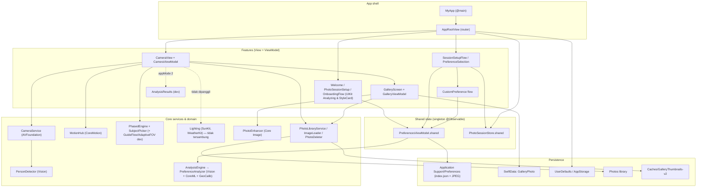
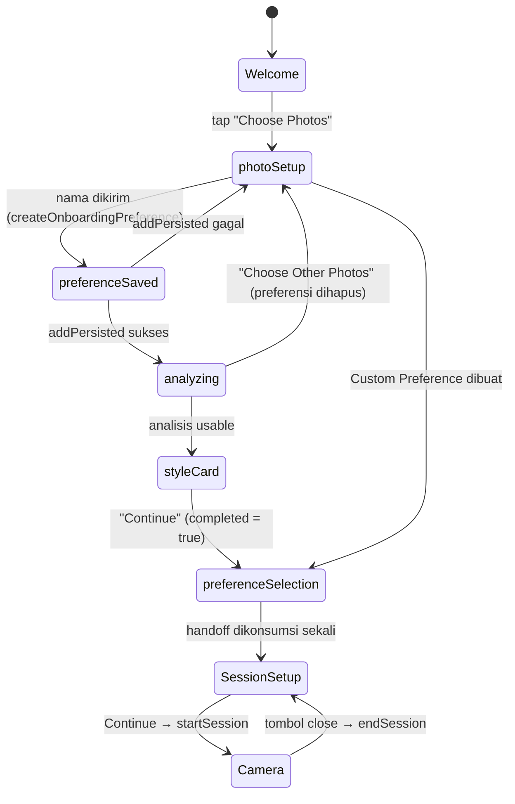
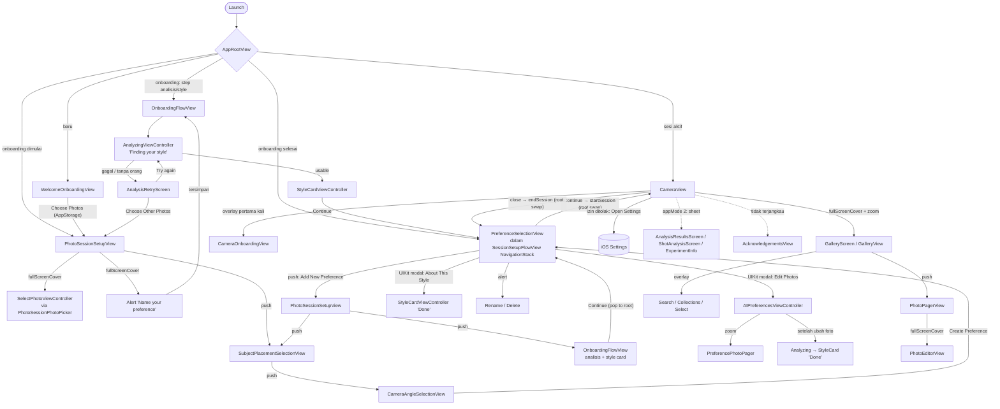
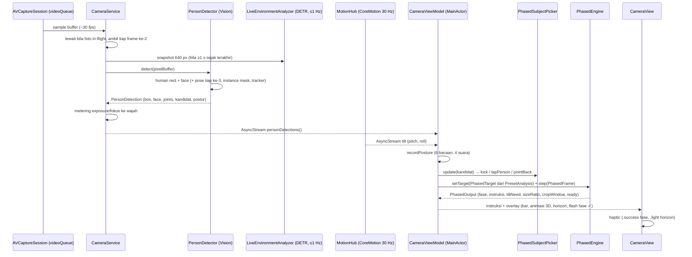
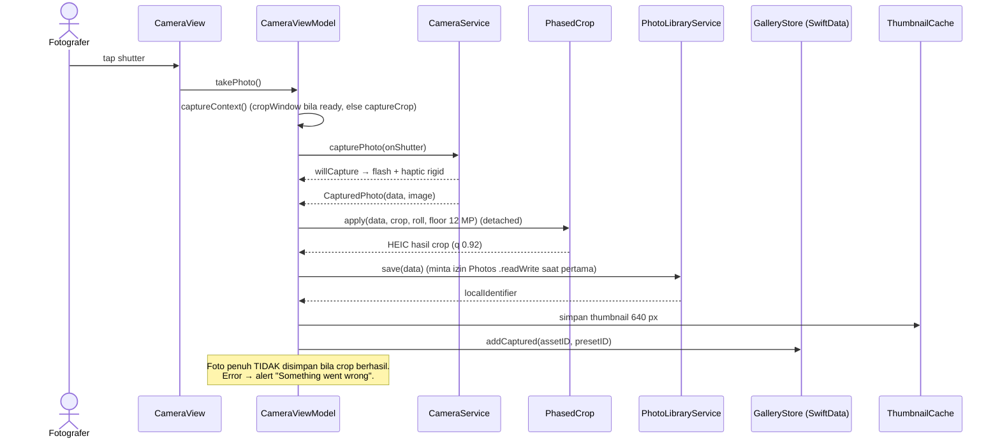
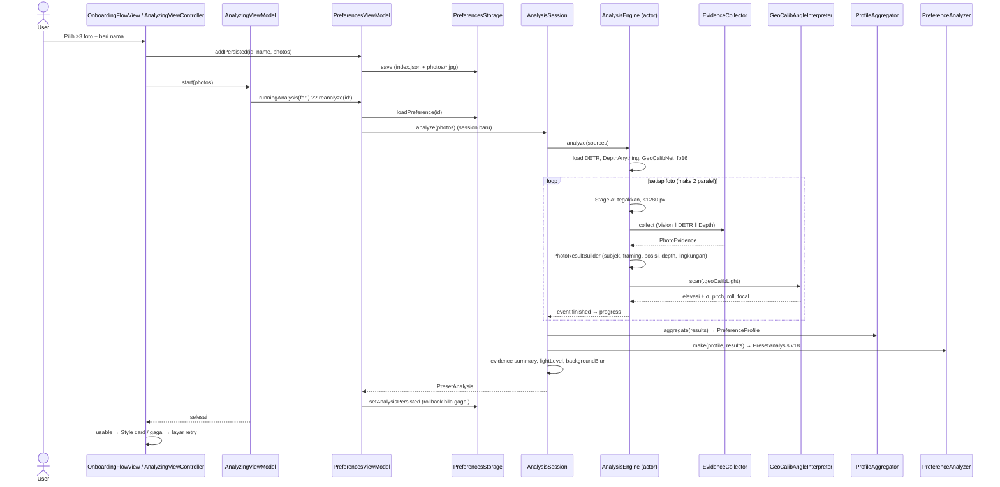
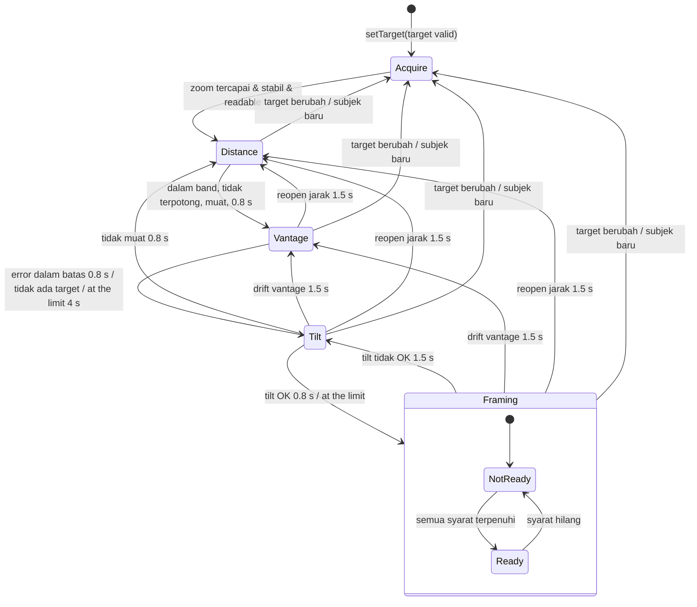
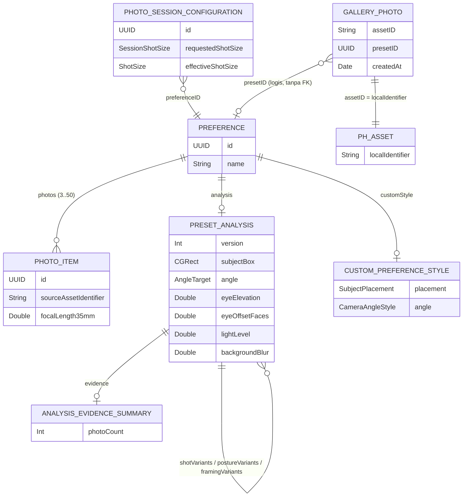

# Dokumentasi Lengkap Aplikasi Vacato (codebase: GoPhoto)

> Dokumen ini disusun dengan membaca seluruh source code repository (reverse-engineering), bukan dari asumsi.
> Setiap klaim merujuk ke file di `gophoto/…`. Hal yang tidak bisa dipastikan dari kode ditandai **[PERLU KONFIRMASI]**.
>
> - **Snapshot kode:** branch `main`, commit `63a19cd` ("camera permissions updated"), 237 commit sejak 2026-10-10.
> - **Pembaruan 13 Nov 2026 (branch `Adjust-Live-Guidance`, setelah merge `main`):** perubahan guide Phased, analisis preset, dan fitur developer 12–13 Nov dimasukkan ke §6.4, §6.6, §6.7, §6.12, §6.15, §7.4.2, §14, §16. Ringkasannya di [§17 Changelog](#17-changelog-1213-nov-2026).
> - **Pembersihan 13 Nov 2026 (kode developer keluar dari repo ini):** saklar `appMode` dihapus. GoPhoto sekarang hanya berisi **Phased · Auto crop**. Semua alat developer (ExperimentBar, GuideDebugPanel, Replay, Guide log, Record GT, guide Main/Legacy, Analysis Results, Shot Analysis) pindah ke repo **debugphoto** (§6.12). Bagian lain yang masih menyebut "appMode 2" atau "dev-only" menggambarkan keadaan sebelum pembersihan; baris terkait di §13 dan §15 sudah diberi tanda **dipindah ke debugphoto**. Sumber angka: `Core/Guide/Phased/PhasedParameters.swift` dan `Docs/Experiments/PhaseGuide/Parameters.md`.
> - **Cakupan:** 255 file Swift (sekitar 41.900 baris), 3 model CoreML, `project.pbxproj`, `Info.plist`, entitlements, `Package.resolved`, dan semua dokumen `.md`/gambar spesifikasi di repo.
> - **Legenda status:**
>   - ✅ Selesai
>   - 🟡 Sebagian / WIP / hanya mode developer
>   - ⛔ Belum diimplementasi (stub/TODO/UI kosong, atau ada di spesifikasi tetapi tidak ada di kode)
>   - 🗑️ Dead code (tidak dipakai di mana pun)
> - **Catatan penamaan:**
>   - Nama tampilan app adalah **"Vacato"** (`INFOPLIST_KEY_CFBundleDisplayName`).
>   - Nama project/target/folder adalah **gophoto/GoPhoto**.
>   - Bundle id yang sebenarnya **`co.mango.gophoto`** (bukan `com.…`).
>   - Beberapa teks UI dan pesan error masih menyebut "GoPhoto".

## Daftar Isi
1. [Ringkasan Eksekutif](#1-ringkasan-eksekutif)
2. [Identitas Teknis](#2-identitas-teknis)
3. [Arsitektur & Struktur Project](#3-arsitektur--struktur-project)
4. [Flow Aplikasi](#4-flow-aplikasi)
5. [Inventaris Layar](#5-inventaris-layar-screen-inventory)
6. [Fitur Lengkap](#6-fitur-lengkap)
7. [Kamera & Computer Vision Pipeline](#7-kamera--computer-vision-pipeline)
8. [Data Model & Persistence](#8-data-model--persistence)
9. [Networking & Layanan Eksternal](#9-networking--integrasi-backendlayanan-eksternal)
10. [Permission, Privasi & Konfigurasi](#10-permission-privasi--konfigurasi)
11. [Design System & UI](#11-design-system--ui)
12. [Testing](#12-testing)
13. [Status Project & Technical Debt](#13-status-project--technical-debt)
14. [Glosarium](#14-glosarium)
15. [Lampiran: Indeks File](#15-lampiran-indeks-file)
16. [Lampiran: Daftar [PERLU KONFIRMASI]](#16-lampiran-daftar-perlu-konfirmasi)
17. [Changelog 12–13 Nov 2026](#17-changelog-1213-nov-2026)

## 1. Ringkasan Eksekutif

**Vacato** adalah aplikasi kamera iOS untuk **wisatawan / orang yang ingin difoto** ("vacationist", sesuai user story di `Docs/UserFlowMangga.jpg`). Masalah yang diselesaikan: saat liburan, kita sering meminta orang lain (teman atau orang asing) memotret kita, tetapi hasilnya jarang sesuai selera. Bisa terlalu jauh, sudut kamera salah, kepala terpotong, atau HP terlalu tinggi/rendah.

Cara Vacato menyelesaikannya:
1. Pemilik HP memilih **3–50 foto dirinya yang ia sukai**.
2. App **menganalisis foto-foto itu sepenuhnya di perangkat** (Vision + CoreML: DETR segmentation, Depth Anything V2, GeoCalib). Yang dipelajari: ukuran shot favorit, posisi subjek di frame, tinggi dan kemiringan kamera relatif mata, postur, kecerahan, dan blur background. Hasilnya sebuah **"preference"** dengan persona gaya (mis. "The Explorer").
3. Saat sesi foto, HP diserahkan ke fotografer. Kamera memberi **panduan langkah demi langkah satu instruksi per waktu**: jarak ("Move closer/back") → tinggi HP ("Raise/Lower the phone") → kemiringan ("Tilt up/down") → "Take the photo now". Panduan ini dibantu animasi HP 3D, bar, haptic, dan auto-crop, supaya hasilnya meniru gaya foto referensi.

Value proposition utamanya adalah **"orang lain bisa memotret kita persis sesuai selera kita, tanpa perlu paham fotografi, dan tanpa foto keluar dari HP."**

**Fitur utama:**
- Onboarding: Welcome → pilih foto referensi → analisis AI on-device → kartu "YOUR STYLE" (§6.1, §6.22).
- Manajemen preferensi: buat dari foto, Custom Preference tanpa foto (penempatan + sudut), rename, edit foto, hapus (§6.2, §6.3, §6.21).
- Analisis preferensi on-device: shot size, postur, sudut/tinggi kamera via GeoCalib, posisi subjek, blur background, lingkungan (§6.15, §6.16).
- Kamera berpanduan "Phased":
  - deteksi orang + tap untuk memilih subjek;
  - panduan jarak, tinggi, dan tilt;
  - level horizon;
  - animasi 3D RealityKit;
  - auto-crop sesuai framing referensi;
  - picker shot size dan deteksi duduk/berdiri (§6.4–§6.13, §7).
- Onboarding kamera (coach mark 6 langkah) (§6.11).
- Galeri hasil jepretan: filter per preferensi, collections, search, share, hapus (ikut dari Photos iPhone) (§6.19).
- Editor foto: 5 look "AI Enhanced" + 12 slider manual, disimpan sebagai foto baru (§6.20).
- Tips cahaya (backlight, arah matahari via SunKit, cuaca via WeatherKit): **sudah dikodekan tetapi tidak tersambung** (§6.14).
- Alat developer (debug panel, eksperimen guide, replay video, guide log, layar Analysis Results): **sejak 13 Nov ada di repo debugphoto**, bukan di app ini (§6.12, §6.16, §6.17).

**Yang tidak ada:**
- login/akun;
- backend/server;
- subscription;
- panduan suara;
- lokalisasi (UI hanya bahasa Inggris).

## 2. Identitas Teknis

| Item | Nilai | Sumber |
|---|---|---|
| Display name | **Vacato** | `gophoto.xcodeproj/project.pbxproj → INFOPLIST_KEY_CFBundleDisplayName` |
| Nama project / target / produk | `gophoto` (product `gophoto.app`, `productName = MyApp`) | `project.pbxproj` |
| Bundle identifier | `co.mango.gophoto` | `PRODUCT_BUNDLE_IDENTIFIER` |
| Versi | Marketing 1.3, build 5 | `MARKETING_VERSION`, `CURRENT_PROJECT_VERSION` |
| Kategori | `public.app-category.photography` | `INFOPLIST_KEY_LSApplicationCategoryType` |
| Target | 1 target aplikasi (`gophoto`). **Tidak ada** target test, extension, atau widget | `project.pbxproj` |
| Deployment target | **iOS 26.0** (setting target); setting level project 27.0 **[PERLU KONFIRMASI]** mana yang berlaku saat rilis (yang berlaku untuk target adalah 26.0) | `IPHONEOS_DEPLOYMENT_TARGET` |
| Device | iPhone + iPad (`TARGETED_DEVICE_FAMILY = 1,2`); iPhone hanya portrait; iPad semua orientasi + `UIRequiresFullScreen` | `project.pbxproj` |
| Bahasa / mode Swift | Swift language mode **5.0**; `SWIFT_DEFAULT_ACTOR_ISOLATION = MainActor`; `SWIFT_APPROACHABLE_CONCURRENCY = YES`; `SWIFT_UPCOMING_FEATURE_MEMBER_IMPORT_VISIBILITY = YES`; ada pemakaian `@concurrent` (Swift 6.2) | `project.pbxproj`, `Core/PhotoLibrary/ImageLoader.swift` |
| UI framework | **SwiftUI** (utama) + **UIKit** (alur pilih foto, analisis, style card, editor preferensi, zoom view) | `Features/**` |
| Arsitektur | MVVM berbasis fitur (Features = View/ViewModel/Components, Core = domain & service) | §3 |
| Info.plist | Di-generate (`GENERATE_INFOPLIST_FILE = YES`); file `gophoto/Info.plist` kosong (`<dict/>`). Tidak ada URL scheme, background mode, maupun `UIFileSharingEnabled` | `gophoto/Info.plist` |
| Xcode project format | `objectVersion = 90`, file-system-synchronized group | `project.pbxproj` |
| Ikon app | `gophoto/favicon.icon` (Icon Composer) | — |

**Dependency (Swift Package Manager)** — `project.xcworkspace/xcshareddata/swiftpm/Package.resolved`:

| Nama | Versi | Lisensi | Kegunaan |
|---|---|---|---|
| [SunKit](https://github.com/Sunlitt/SunKit) | **2.8.1** (exact) | Apache-2.0 | Posisi matahari (azimuth, altitude, golden hour) secara offline. Hanya dipakai `Core/Lighting/SunService.swift` (fitur yang belum tersambung) |

Tidak ada CocoaPods/Carthage/`.xcconfig`/README.

**Model ML yang dibundel** (`gophoto/Resource/MLModels/`):

| Model | Input → Output | Dipakai di | Lisensi / catatan |
|---|---|---|---|
| `DETRResnet50SemanticSegmentationF16P8.mlpackage` | RGB 448×448 → class map Int32 448×448 (201 label COCO-panoptic) | Analisis preferensi (lingkungan, mask orang, horizon) + kamera live (sekitar 1×/s) | Model Apple/HF (lisensi tidak dicantumkan di repo **[PERLU KONFIRMASI]**) |
| `DepthAnythingV2SmallF16P6.mlpackage` | RGB 518×392 → depth 518×392 (Float16) | Analisis preferensi (struktur kedalaman) | **[PERLU KONFIRMASI]** lisensi |
| `GeoCalibNet_fp16.mlpackage` | Multi-function `h{H}_w{W}` → `up_field`, `up_confidence`, `latitude_field`, `latitude_confidence` | Analisis preferensi (pitch/roll/focal → sudut & tinggi kamera) | Bobot CC BY 4.0 (ETH Zurich), kode Apache-2.0 (`ThirdPartyNotices/GeoCalib/`) |

**Framework Apple yang dipakai** (jumlah file yang meng-import di dalam kurung):

| Framework | Kegunaan |
|---|---|
| SwiftUI (87) | Hampir semua layar |
| UIKit (51) | Layar pilih foto/analisis/style card/editor preferensi, `UIImage`, haptic UIKit, zoom `UIScrollView` |
| AVFoundation (5) | `AVCaptureSession`, foto, video frame, depth (dev), replay video (`AVAssetReader`) |
| Vision (12) | Deteksi orang/wajah/pose 2D & 3D, horizon, segmentasi orang, instance mask, tracking, landmark wajah (editor) |
| CoreML (6) | DETR, Depth Anything, GeoCalib |
| CoreImage (19) | Downscale frame, luminance, enhance/look, crop & rotasi foto, bokeh (dev) |
| Photos / PhotosUI (9 / 2) | Membaca foto referensi, menyimpan & menghapus hasil, galeri, picker akses terbatas, picker video (dev) |
| SwiftData (8) | Indeks galeri `GalleryPhoto` |
| CoreMotion (3) | Pitch/roll HP (tilt & horizon), heading true-north (lighting) |
| CoreLocation (5) | Lokasi untuk matahari/cuaca (belum tersambung); status izin di `MotionHub` |
| WeatherKit (1) | Kondisi cuaca saat ini (belum tersambung) + atribusi |
| RealityKit (11) | Animasi 3D HP pada panduan |
| ImageIO, UniformTypeIdentifiers, CoreTransferable | Metadata EXIF/HEIC, ekspor, ShareLink |
| CryptoKit (1) | SHA-256 video replay (dev) |
| Observation, Combine | `@Observable`, `ObservableObject` (`AnalysisSession`) |
| os | `Logger` (`co.mango.gophoto`) |
| CoreVideo, CoreMedia, simd, CoreGraphics | Pixel buffer, waktu, matematika 3D, geometri |

## 3. Arsitektur & Struktur Project

### 3.1 Pola arsitektur

Aplikasi memakai **MVVM berbasis fitur**, tanpa framework arsitektur pihak ketiga (bukan TCA, bukan Clean Architecture formal).

- **`Features/<Fitur>/`** = lapisan presentasi: `Views/` (layar), `Components/` (sub-view), `ViewModels/`. Pengecualian: `ChoosePhotos/VIews/` (typo) berisi campuran view SwiftUI dan **UIViewController UIKit**.
- **`Core/<Domain>/`** = lapisan domain/service: kamera, deteksi, guide engine, analisis preferensi, lighting, galeri, photo library, sesi, design system, database.
- **Algoritma** ditulis sebagai `enum` namespace dengan fungsi statis murni (mis. `PhasedMeasure`, `PreferenceAnalyzer`, `ProfileAggregator`, `BacklightController`) atau struct state-machine (`PhasedEngine`, `GuideFlow`, `PhasedSubjectPicker`). Gaya ini membuatnya "pure / unit-testable", walaupun test-nya tidak ada.
- **Pekerjaan ML berat** dijalankan di `actor` (`AnalysisEngine`, `DETRSegmenter`, `LiveEnvironmentAnalyzer`, `DepthEvidenceModel`).
- **Lapisan hardware** (`CameraService`, `MotionHub`) adalah class `@unchecked Sendable` dengan `DispatchQueue` sendiri. Data dialirkan ke ViewModel lewat **`AsyncStream`** (`bufferingNewest(1)`).

### 3.2 State management & dependency injection

| Mekanisme | Contoh |
|---|---|
| `@Observable` (Observation) | `CameraViewModel`, `PreferencesViewModel`, `PhotoSessionStore`, `GalleryViewModel`, `PreferenceSelectionViewModel`, `CustomPreferenceFlowModel`, `LightingCoordinator`, `PhotoSessionSetupSelection`, `ShotSizeSelectionViewModel` |
| `ObservableObject` | `AnalysisSession` (`@MainActor`) |
| Singleton | `PreferencesViewModel.shared`, `PhotoSessionStore.shared`, `MotionHub.shared`, `ThumbnailCache.shared`, `ImageLoader` (shared), `AppDatabase.container` |
| `@State` / `@AppStorage` | ViewModel kamera dimiliki `@State` di `CameraView`; flag onboarding & preferensi UI di `@AppStorage` |
| SwiftData | `.modelContainer(AppDatabase.container)` di `MyApp`; `@Query` di galeri |
| DI | Lewat **init dengan default argument** berbasis protokol: `CameraServiceProtocol`, `MotionServiceProtocol`, `PhotoLibraryServiceProtocol`, `GalleryStoreProtocol`, `ImageLoaderProtocol`, `PhotoDeleterProtocol`, `PhotoAuthorizationProtocol`, `LocationServiceProtocol`, `WeatherServiceProtocol`, `HeadingServiceProtocol`. Komentar menyebutnya "like swiftshop's repositories". Mock (`MockGalleryStore`, `MockPhotoDeleter`, `MockPhotoAuthorization`, `MockImageLoader`) ada tetapi hanya dipakai di Preview |
| Callback closure | Navigasi onboarding/session setup memakai closure (`onContinue`, `onFinish`, `onCreated`), bukan router global |

Karena `SWIFT_DEFAULT_ACTOR_ISOLATION = MainActor`, semua tipe tanpa `nonisolated` implisit berjalan di main actor.

### 3.3 Struktur folder

```
GoPhoto/                              (root repo)
├── Docs/
│   ├── SunKit-Spike.md               spike SunKit/heading/kompas (tiket S1)
│   └── UserFlowMangga.jpg            board user story + wireframe (10 story)
├── ThirdPartyNotices/                lisensi SunKit (Apache-2.0) & GeoCalib (Apache-2.0 + CC BY 4.0)
├── Zoom, lensa & cahaya.md           tiket tambahan Z1, Z2, X1, S1
├── gophoto.entitlements              WeatherKit
├── gophoto.xcodeproj/                project + Package.resolved
└── gophoto/                          (255 file .swift)
    ├── MyApp.swift, AppRootView.swift, ContentView.swift   entry point & router root (3)
    ├── Info.plist (kosong), Assets.xcassets, favicon.icon, Resource/ (MLModels, SunKitLicense.txt)
    ├── Debug/                         DebugFixtures, khusus DEBUG (1)
    ├── Core/
    │   ├── Camera/                    AVFoundation service, auto-crop, bokeh (3)
    │   ├── Detection/                 PersonDetector (Vision live), postur, DETR live (3)
    │   ├── Motion/                    CoreMotion hub & tilt (2)
    │   ├── Guide/                     guide engine (8) + Phased/ (6, termasuk FramingPolicy)
    │   ├── Lighting/                  backlight, matahari, heading, lokasi, cuaca (11)
    │   ├── Enhance/                   enhance foto / look (5)
    │   ├── Gallery/                   SwiftData GalleryPhoto, store, sync (3)
    │   ├── PhotoLibrary/              PhotoKit: simpan, hapus, ekspor, thumbnail (8)
    │   ├── ChoosePhotos/              model Preference + storage file + PhotoKit picker service (2 + Models 4)
    │   ├── CustomPreference/          opsi & sintesis custom preference (3)
    │   ├── PreferenceAnalysis/        analisis AI: Pipeline (8), Models (4), Input (4), Inference (5),
    │   │                              Interpretation (7), Aggregation (1), CameraAngle (9 + GeoCalib 4),
    │   │                              Environment (12), SceneModels (11)
    │   ├── Session/                   konfigurasi & store sesi foto (2)
    │   ├── DesignSystem/              token & button style (2)
    │   └── Database/                  ModelContainer (1)
    └── Features/
        ├── Camera/                    Views (2), ViewModels (2), Components (9) + Guidance3D (20), Onboarding (5)
        ├── ChoosePhotos/              onboarding, picker, analisis, style card, editor (UIKit+SwiftUI) (20)
        ├── PhotoSessionSetup/         layar "Photo Session Setup" (2)
        ├── SessionSetup/              Preference Selection (+ Shot Size yang dead) (10)
        ├── CustomPreference/          flow custom preference (5)
        ├── Gallery/                   galeri, pager, editor (12)
        └── About/                     Acknowledgements (1)
```

Jumlah file Swift per folder level atas: `Core` 133, `Features` 118, root 3, `Debug` 1 (total **255**).

### 3.4 Lapisan

| Lapisan | Isi |
|---|---|
| View | SwiftUI `View` + `UIViewController` |
| ViewModel | `@Observable` class / state |
| Service / Manager | `CameraService`, `PersonDetector`, `MotionHub`, `PhotoLibraryService`, `ChoosePhotosService`, `LocationService`, `WeatherKitService`, `SunService`, `AnalysisEngine`, `PhotoEnhancer` |
| Domain / logic murni | `PhasedEngine`, `PreferenceAnalyzer`, `ProfileAggregator`, `GeoCalibOptimizer`, `BacklightController`, … |
| Model / Repository | `Preference` + `PreferencesStorage` (file JSON), `GalleryPhoto` + `GalleryStore` (SwiftData), `PresetAnalysis` |
| Persistence | Application Support (JSON + JPEG), SwiftData store, UserDefaults/AppStorage, Photos library, Caches (thumbnail) |
| Networking | **Tidak ada**, kecuali WeatherKit lewat SDK Apple (belum tersambung) |



## 4. Flow Aplikasi

### 4.1 App launch flow

1. **`MyApp.init()`** (`gophoto/MyApp.swift`): di build DEBUG saja, `DebugFixtures` (§6.24) menyiapkan state launch-argument, seed fixture, diagnosis Vision, dan jadwal penghapusan.
2. **`WindowGroup { AppRootView() }.modelContainer(AppDatabase.container)`**: container SwiftData dibuat. Bila gagal, `fatalError`.
3. Saat body `AppRootView` pertama kali mengakses **`PreferencesViewModel.shared`**:
   - `PreferencesStorage()` membuat folder `Application Support/Preferences/photos/`;
   - `load()` berjalan **sinkron di main thread**: decode `index.json` dan semua JPEG referensi;
   - `selectedID` basi dibuang, key lama `presetShotSize` dihapus;
   - `reanalyze` dijalankan untuk setiap preferensi yang analisisnya tidak current (kecuali preferensi onboarding yang pending).
4. **`AppRootView`** memilih root (urutan prioritas):

| # | Kondisi | Layar |
|---|---|---|
| 1 | `PhotoSessionStore.shared.current != nil` | `CameraView(sessionConfiguration:onClose:)` `.id(session.id)` |
| 2 | `welcomeOnboardingCompleted` | `SessionSetupFlowView` (Preference Selection) + handoff preferensi onboarding |
| 3 | onboarding dimulai & step ∈ {preferenceSaved, analyzing, analysisComplete, styleCard} & preferensinya ada | `OnboardingFlowView` (analisis → style card) |
| 4 | onboarding dimulai | `NavigationStack { PhotoSessionSetupView }` |
| 5 | belum mulai tetapi sudah punya preferensi (pengguna rilis lama) | `SessionSetupFlowView` + set completed |
| 6 | selain itu | `WelcomeOnboardingView` |

Catatan:
- **Tidak ada splash custom** (hanya launch screen hasil generate), **tidak ada login/akun**, dan **tidak ada paywall/subscription**.
- Izin **tidak** diminta saat launch. Izin diminta saat dibutuhkan: Photos saat memilih foto atau pertama kali menyimpan; kamera saat `CameraView` mulai.
- Sesi kamera hanya in-memory, jadi app **tidak pernah** dibuka langsung ke kamera setelah relaunch.



### 4.2 User journey end-to-end (tujuan utama: difoto orang lain sesuai selera)

1. **Buka app pertama kali:** Welcome, lalu tap "Choose Photos".
2. **Photo Session Setup:** tap "Add Your Photos".
   - Izin Photos diminta (`.readWrite`). Bila ditolak, muncul alert "Photo Access Needed" + Open Settings.
   - Di picker custom, pilih ≥3 foto diri sendiri lalu "Done".
   - "Continue" memunculkan alert "Name your preference". Isi nama lalu "Continue".
3. **Simpan:** preferensi ditulis ke `Application Support/Preferences` lalu diverifikasi.
4. **Analisis "Finding your style":** foto dianalisis satu per satu (maks 2 paralel) dengan progres "Reading photo X of Y".
5. **Hasil:**
   - Usable → kartu **YOUR STYLE** (mis. "The Main Character" + trait), lalu "Continue".
   - Tidak ada orang → "Try again" / "Choose Other Photos".
   - Gagal → "Try again".
6. **Preference Selection:** preferensi baru terpilih otomatis. Tap **Continue** untuk memulai sesi dengan shot awal **3/4 body**.
7. **Kamera terbuka** (izin kamera diminta di sini). Saat pertama kali, onboarding kamera 6 langkah tampil lalu "Finish".
8. **Serahkan HP ke fotografer.** Fotografer:
   - bila ada beberapa orang: **tap orang yang akan difoto**;
   - **mengatur jarak** sesuai bar jarak ("Move closer/back") sampai muncul "Distance ✓";
   - **mengatur tinggi HP** dengan animasi 3D naik/turun ("Raise/Lower the phone") sampai "Phone height ✓";
   - **mengatur tilt** dengan bar tilt + animasi ("Tilt up/down") sampai "Tilt ✓";
   - menahan HP ("Hold it there") sampai muncul **"Take the photo now"** (pill hijau);
   - opsional: menggeser picker shot size (Full body / 3/4 / Half). Bila subjek duduk, picker berganti otomatis ke full body.
9. **Tekan shutter:** flash hitam + haptic.
   - Foto di-crop sesuai framing referensi (lantai 12 MP) lalu disimpan ke **Photos iPhone** + indeks galeri.
   - Izin Photos diminta pada simpan pertama.
   - Fotografer tetap di viewfinder untuk jepretan berikutnya.
10. **Lihat hasil:** thumbnail di kiri shutter membuka **Galeri** (filter per preferensi). Di sana bisa membuka foto, **Edit** (look/slider, disimpan sebagai foto baru), **Share**, atau **Delete** (ikut terhapus dari Photos).
11. **Tutup kamera** (✕) untuk mengakhiri sesi dan kembali ke Preference Selection. Dari sini user bisa membuat preferensi lain ("Add New Preference" / Custom), mengedit foto preferensi (lalu analisis ulang), rename, atau menghapus.

### 4.3 Navigation map



Tidak ada `TabView` tingkat app dan tidak ada deep link/URL scheme. Navigasi dilakukan lewat penggantian root di `AppRootView`, `NavigationStack` (session setup, galeri), `fullScreenCover`, `sheet`, dan presentasi modal UIKit (`PresentationAnchor`).

### 4.4 Sequence diagram flow kompleks

**(a) Pipeline kamera: frame → analisis → feedback ke fotografer**



**(b) Capture → simpan → galeri**



**(c) Upload foto referensi → personalisasi → hasil.** Lihat diagram di §6.15 (sequence analisis preferensi), yang disalin di bawah ini.



### 4.5 Penanganan kondisi khusus

| Kondisi | Perilaku | Referensi |
|---|---|---|
| Izin kamera ditolak | Layar "Camera Access Needed" + tombol "Open Settings". Dicek ulang saat app kembali aktif. Tombol close tetap ada | `CameraView.swift`, `CameraService.requestPermission` |
| Kamera dibatasi (Screen Time) | "Camera Not Available" tanpa aksi | idem |
| Kamera tidak ada (Simulator) | `CameraError.cameraUnavailable` → "Camera Unavailable" ("No camera found. (The Simulator has no camera — run on a real iPhone.)") | `CameraService.swift` |
| Izin Photos ditolak saat memilih foto | Alert "Photo Access Needed" / "Allow photo access in Settings to choose photos." + Open Settings | `PhotoPreferencePickerFlow.swift` |
| Akses Photos terbatas (limited) | Banner "You've limited access…" + "Add more" (`presentLimitedLibraryPicker`) | `SelectPhotoViewController.swift` |
| Izin Photos ditolak saat menyimpan hasil | Alert "Something went wrong" dengan pesan "GoPhoto can't save to Photos. Allow it in Settings → GoPhoto → Photos." Foto **hilang** (tidak disimpan di tempat lain) | `PhotoLibraryService.swift` |
| Izin Photos ditolak di galeri | "No Access to Photos" + Open Settings | `GalleryView.swift` |
| Lokasi | Tidak pernah diminta di build saat ini (lighting tidak tersambung) | §6.14 |
| Offline | Seluruh fungsi inti berjalan offline: analisis & guide on-device; SunKit offline. Butuh jaringan hanya untuk mengunduh foto iCloud (`isNetworkAccessAllowed = true`) dan WeatherKit (tidak aktif) | §9 |
| Tidak ada orang di foto referensi | `.noUsableFraming` → "We couldn't find a person in these photos." | §6.15 |
| Analisis gagal / dibatalkan | `.requiredAnalysisFailed` → "We couldn't finish your photo analysis." + "Try again" | §6.15 |
| Model ML gagal dimuat | Sumber opsional ditandai failed; analisis tetap usable. GeoCalib gagal → target jatuh ke aturan framing | §6.15 |
| Banyak orang di kamera | Phased: orang yang paling dekat ke tengah frame dikunci otomatis setelah stabil 0.6 s (sejak 11 Nov, tanpa prompt tap). Tap tetap bisa dipakai untuk memilih orang lain | §7.4 |
| Subjek hilang | Setelah 1.2 s: "Point back at the person". Tracker menjaga box ≤60 frame | §7.4 |
| Preset tanpa subject box / eye offset | Fase distance/vantage dilewati, tetapi **tidak pernah** "Take the photo now" | §13 |
| Preferensi dihapus saat sesi | `PhotoSessionStore.status = .invalidated(.preferenceDeleted)`; root tetap menampilkan kamera **[PERLU KONFIRMASI]** reaksi kamera | `PhotoSessionStore.swift` |
| Penyimpanan penuh | "Couldn't save the preference and its photos. Check available storage and try again." | `PreferencesViewModel.swift` |
| `index.json` korup | Dibaca sebagai daftar kosong; penyimpanan berikutnya menghapus foto (**risiko**) | §13 |
| Database SwiftData gagal dibuat | `fatalError` → app crash saat launch | `AppDatabase.swift:20` |
| App ke background saat kamera | `scenePhase` non-active → replay dijeda (dev); izin dicek ulang saat aktif. Animasi 3D berhenti | `CameraView.swift` |

## 5. Inventaris Layar (Screen Inventory)

| Nama | File | Tujuan | Komponen UI utama | Aksi user | Navigasi ke | ViewModel / State | Status |
|---|---|---|---|---|---|---|---|
| Welcome | `Features/ChoosePhotos/VIews/WelcomeOnboardingView.swift` (+ `WelcomeGalleryView.swift`) | Intro pertama kali | Dinding foto diagonal 3 track (`OnboardingPhoto01…30`), judul, tombol "Choose Photos" | Tap "Choose Photos" | Photo Session Setup (root swap via AppStorage) | `@AppStorage` di `AppRootView` | ✅ |
| Photo Session Setup | `Features/PhotoSessionSetup/Views/PhotoSessionSetupView.swift` | Memilih ≥3 foto & membuat preferensi | Teks privasi "Your photos stay on this iPhone…", grid 3 kolom + tile "+", "Add Your Photos", "Continue", "Create a Custom Preference" | Tambah/hapus foto, Continue (nama), custom, back (alert "Leave without saving?") | Picker (`fullScreenCover`), prompt nama (`fullScreenCover`), Custom flow (push), analisis | `PhotoSessionSetupSelection` (@Observable) | ✅ (cabang saved-preference 🟡) |
| Photo picker bridge | `Features/PhotoSessionSetup/Views/PhotoSessionPhotoPicker.swift` | Jembatan SwiftUI → UIKit picker / prompt nama | VC transparan | — | `SelectPhotoViewController`, `UIAlertController` | `ChoosePhotosViewModel` | ✅ |
| Select Photo | `Features/ChoosePhotos/VIews/SelectPhotoViewController.swift` | Picker foto custom PhotoKit | Tombol tutup, judul "Select Photo", "Done", grid 4 kolom, banner akses terbatas | Tap/swipe pilih, Done, "Add more" | Kembali ke flow (alert minimum/nama) | `SelectPhotoViewModel` | ✅ |
| Name prompt | `Features/ChoosePhotos/Components/PhotoPreferencePickerFlow.swift → PreferenceNamePrompt` | Memberi nama preferensi | `UIAlertController` "Name your preference" + TextField | Continue / Cancel | Simpan → analisis | `ChoosePhotosViewModel` | ✅ |
| Analyzing ("Finding your style") | `Features/ChoosePhotos/VIews/AnalyzingViewController.swift` (via `OnboardingFlowView.AnalyzingScreen`) | Progres analisis | Carousel 3 foto, oval berdenyut, "Reading photo X of Y", progress bar bersegmen, teks bergilir ("Checking your angles"…), estimasi waktu, Cancel | Cancel | Style card / layar retry | `AnalyzingViewModel` | ✅ (Cancel berisiko, §13) |
| Analysis retry | `Features/ChoosePhotos/VIews/OnboardingFlowView.swift → AnalysisRetryScreen` | Analisis gagal / tanpa orang | Ikon, judul, teks, "Try again", "Choose Other Photos" | Retry / pilih foto lain | Analyzing / Photo Session Setup | `OnboardingFlowView` | ✅ |
| Style Card ("YOUR STYLE") | `Features/ChoosePhotos/VIews/StyleCardViewController.swift` | Menampilkan persona gaya | Kicker, persona, tagline, "Based on N photos", ≤3 trait, tombol | Continue / Done | Preference Selection / tutup | `StyleSummary` | ✅ |
| Preference Selection | `Features/SessionSetup/Views/PreferenceSelectionView.swift` (+ `SessionSetupFlowView.swift`) | Memilih preferensi untuk sesi | Header, "Your Preferences" + "N Saved Profiles", kartu, "Add New Preference", Continue | Pilih, menu (About/Rename/Edit Photos/Delete), Continue | Kamera (root swap), Photo Session Setup (push), Editor (UIKit modal), Style card (modal) | `PreferenceSelectionViewModel`, `PreferencesViewModel`, `PhotoSessionStore` | ✅ |
| Edit Photos (AI Preferences) | `Features/ChoosePhotos/VIews/AIPreferencesViewController.swift` (via `PreferenceEditorPresenter`) | Mengelola foto preferensi | Judul yang bisa diedit, "N/50", grid per shot size, Select/Cancel, "+", trash | Rename, pilih & hapus, tambah, tap foto, back | `PreferencePhotoPager` (zoom), picker, Analyzing → Style card | `ChoosePhotosViewModel` | ✅ |
| Preference Photo Pager | `Features/ChoosePhotos/VIews/PreferencePhotoPager.swift` | Lihat foto referensi | TabView paged + `ZoomableImageView`, tutup | Swipe, zoom, tutup | — | — | ✅ |
| Custom: Subject Placement | `Features/CustomPreference/Views/SubjectPlacementSelectionView.swift` | Langkah 1/2 | 7 kartu opsi + ilustrasi | Pilih, Continue | Camera Angle (push) | `CustomPreferenceFlowModel` | ✅ |
| Custom: Camera Angle | `Features/CustomPreference/Views/CameraAngleSelectionView.swift` | Langkah 2/2 | 3 kartu opsi, catatan "Saved to your preferences as “…”" | Pilih, "Create Preference" | Preference Selection | `CustomPreferenceFlowModel` | ✅ |
| Shot Size Selection | `Features/SessionSetup/Views/ShotSizeSelectionView.swift` | "Choose Your Shot Size" | Kartu Half/3-4/Full | Start Shooting | — | `ShotSizeSelectionViewModel` | 🗑️ Dead (tidak terhubung) |
| ContentView | `gophoto/ContentView.swift` | `CameraView()` tanpa sesi | — | — | — | — | 🗑️ Dead |
| Camera | `Features/Camera/Views/CameraView.swift` | Layar memotret dengan guide | Top bar (close, label zoom), preview 3:4 + overlay guide, shot size picker, shutter, tombol galeri | Tap shutter, geser shot size, tap orang, buka galeri, close | Galeri (`fullScreenCover`, zoom transition), kembali ke Preference Selection (`onClose`), alert error, Settings (bila izin ditolak); dev: debug panel, sheet analisis, replay | `CameraViewModel` (@Observable, @State) | ✅ |
| Camera permission states | `CameraView.swift` (state `.permissionDenied/.restricted/.failed`) | Info bila kamera tidak bisa dipakai | `ContentUnavailableView` "Camera Access Needed" / "Camera Not Available" / "Camera Unavailable" | "Open Settings" | Settings app | `CameraViewModel.state` | ✅ |
| Camera Onboarding | `Features/Camera/Onboarding/Cameraonboardingview.swift` | Coach mark 6 langkah, sekali | Dim overlay, demo picker/animasi 3D, kartu + page dots | Continue / Finish | Kembali ke kamera | `@AppStorage("cameraOnboardingCompleted")` | ✅ |
| Captured Photo review | `Features/Camera/Views/CapturedPhotoView.swift` | Review dan enhance foto setelah capture | Sweep reveal, hold to compare, Retake/Save | — | — | `CaptureReview` | 🗑️ Dead (tidak dipresentasikan) |
| Shot Analysis (dev) | `Features/Camera/Components/ShotAnalysisScreen.swift` | Nilai analisis per shot size | List, segmented picker | Done | — | `PresetAnalysis` | 🟡 dev-only (appMode 2) |
| Experiment Info (dev) | `Features/Camera/Components/ExperimentBar.swift → ExperimentInfoSheet` | Penjelasan guide/framing | Teks | — | — | `ExperimentSelection` | 🟡 dev-only |
| Guide Debug Panel (dev) | `Features/Camera/Components/GuideDebugPanel.swift` | Overlay debug | Baris status, Share log | Buka analisis | `AnalysisResultsScreen`, `ShotAnalysisScreen` (sheet) | `CameraViewModel` | 🟡 dev-only |
| Pose Guide Panel (dev) | `Features/Camera/Components/PoseGuidePanel.swift` | Diagram tinggi/tilt | Canvas | — | — | `PoseGuideState` | 🟡 dev-only |
| Replay controls (dev) | `Features/Camera/Components/ReplayControls.swift` | Uji guide pada video | Kontrol play, run all, export | Pilih video (Files/Photos) | `fileImporter`, `photosPicker`, ShareLink | `CameraViewModel` (Replay ext.) | 🟡 dev-only |
| Gallery shortcut | `Features/Gallery/Components/GalleryButton.swift` | Tombol galeri di layar kamera | Thumbnail terbaru 52×52 | Tap | Galeri (`fullScreenCover`) | `@Query GalleryPhoto` | ✅ |
| Gallery (Library) | `Features/Gallery/Views/GalleryScreen.swift`, `GalleryView.swift` | Melihat foto hasil app | Header melayang, grid 5 kolom, menu filter/sort, tab Library/Collections, tombol search, Select | Filter, sort, select, tap foto, kembali | Push `PhotoPagerView`; overlay Search; tab Collections | `GalleryViewModel` (@Observable), `@Query` | 🟡 |
| Collections | `GalleryView.swift:932-1059` | Album per preferensi | Kartu "All Photos" + kartu per preferensi; layout cards/compact/large | Tap album → filter | Kembali ke tab Library | idem | 🟡 (Reorder no-op) |
| Search overlay | `GalleryView.swift:352-663` | Cari foto | TextField "Search your library...", Recents, hasil | Ketik, tap chip | Hasil grid | `searchText`, UserDefaults | 🟡 |
| Selection & delete dialog | `GalleryView.swift:879-928, 1143-1226` | Hapus banyak foto | Bar Share/Favorite/Delete, overlay konfirmasi custom | Delete | Alert sistem iOS | `selectedIDs` | 🟡 (Share/Favorite no-op) |
| Gallery no access | `GalleryView.swift` | Izin Photos ditolak | `ContentUnavailableView` "No Access to Photos" | "Open Settings" | Settings | `PhotoAccess` | ✅ |
| Photo Pager | `Features/Gallery/Views/PhotoPagerView.swift` (+ `FullPhotoView.swift`, `PhotoStripView.swift`) | Foto layar penuh | Paging, zoom 1–4×, ShareLink, Edit, Delete, strip | Swipe, zoom, share, edit, delete | `PhotoEditorView` (fullScreenCover) | `GalleryViewModel` | ✅ |
| Photo Editor | `Features/Gallery/Views/PhotoEditorView.swift` | Edit look / adjust | Segmented Filter/Adjust, `LookPickerView`, `AdjustPanelView` | Pilih look, geser slider, Save, Cancel | Kembali ke pager + alert hasil | state lokal + `GalleryViewModel.saveEdited` | ✅ (ada bug Save) |
| Acknowledgements | `Features/About/Views/AcknowledgementsView.swift` | Atribusi SunKit & Apple Weather | List, link, lisensi | Done, link | Sub-halaman lisensi | `WeatherKitService` | 🗑️ tidak terjangkau |
| Analysis Results (dev) | `Features/AnalysisResults/Views/AnalysisResultsScreen.swift` | Detail analisis preferensi | NavigationStack, `AnalysisProgressPanel` atau `ResultsOverviewView` | Done, "Analyze again" | `PhotoResultDetailView`, `ProfileDetailView` (push) | `AnalysisSession` (in-memory) | 🟡 dev-only (tidak terjangkau di appMode 1) |
| Results Overview (dev) | `Features/AnalysisResults/Views/ResultsOverviewView.swift` | Ringkasan profil, blur, peringatan, daftar foto | Filter segmented (All/Full/3/4/Half/1/4/Sitting), kartu | Filter, tap foto/profil, "Open Camera Guidance" | Detail foto / profil; tutup sheet | `AnalysisSession`, `ProfileAggregator` | 🟡 dev-only |
| Photo Result Detail (dev) | `Features/AnalysisResults/Views/PhotoResultDetailView.swift` | Evidence per foto | `EvidenceImageView` + layer picker, kartu karakteristik, `EnvironmentSection`, `ModelOutputSection` | Toggle overlay, expand disclosure | — | `AnalysisSession`, `AnalysisArtifactStore` | 🟡 dev-only |
| Preference Profile (dev) | `Features/AnalysisResults/Views/ProfileDetailView.swift` (+ `EnvironmentProfileSection.swift`) | Profil gabungan | `FindingSection`, `PositionMap`, kartu depth/lingkungan, limitations | Scroll | — | `PreferenceProfile` | 🟡 dev-only |
| Analysis Flow | `Features/AnalysisResults/Views/AnalysisFlowView.swift` | Progres → hasil | `AnalysisProgressPanel` | Cancel | — | `AnalysisSession` | 🗑️ Dead |

## 6. Fitur Lengkap

### 6.1 Onboarding pertama kali (Welcome → Photo Session Setup → Analisis → Style card)

- **Deskripsi:** User baru melalui tahap berikut:
  1. Halaman **Welcome**: dinding foto beranimasi berisi 30 foto contoh, judul **"Start with your best photos"**, teks "Add your favorite self-portraits as references for your AI guide.", tombol **"Choose Photos"**.
  2. **Photo Session Setup**: memilih ≥3 foto lalu memberi nama, **atau** membuat Custom Preference.
  3. Layar analisis **"Finding your style"**.
  4. Kartu **"YOUR STYLE"** lalu tombol "Continue".
  5. Masuk **Preference Selection** dengan preferensi baru sudah terpilih.
- **Cara kerja:** `AppRootView` mengatur routing dengan 5 key `@AppStorage`/UserDefaults:

  | Key | Tipe | Arti |
  |---|---|---|
  | `welcomeOnboardingCompleted` | Bool | Onboarding selesai → root = session setup |
  | `welcomeOnboardingStarted` | Bool | User sudah tap "Choose Photos" |
  | `firstTimeOnboardingStep` | String (`FirstTimeOnboardingStep`), default `photoSetup` | State machine onboarding |
  | `firstTimeOnboardingPreferenceID` | String UUID | Preferensi yang dibuat saat onboarding / handoff |
  | `pendingOnboardingAnalysisPreferenceID` | String UUID | Mencegah auto-reanalisis saat startup untuk preferensi onboarding |

  Selain itu key lama `presetShotSize` dihapus oleh `PreferencesViewModel.init`.
- **Resume setelah app di-kill:**
  - Langkah tersimpan, jadi app melanjutkan ke layar yang sesuai (analisis diulang dari awal bila belum selesai, style card bila analisis sudah usable).
  - Foto yang dipilih tetapi belum dinamai **hilang**.
  - Sesi kamera tidak pernah dipulihkan.
- **Edge cases:**
  - Analisis tanpa orang → "We couldn't find a person in these photos." dengan tombol "Try again" / "Choose Other Photos". "Choose Other Photos" menghapus preferensi lalu kembali ke picker.
  - Analisis gagal → "We couldn't finish your photo analysis." dengan tombol "Try again".
  - Pengguna rilis lama yang sudah punya preferensi tanpa flag onboarding otomatis dianggap selesai.
- **File:** `AppRootView.swift`, `Features/ChoosePhotos/VIews/WelcomeOnboardingView.swift`, `WelcomeGalleryView.swift`, `OnboardingFlowView.swift`, `AnalyzingViewController.swift`, `StyleCardViewController.swift`, `Features/PhotoSessionSetup/Views/*`.
- **Status:** ✅ Selesai.
  - Enum case `analysisComplete` tidak pernah ditulis 🗑️.
  - Cabang "saved preference / Start Analyzing" di Photo Session Setup kemungkinan tidak terjangkau **[PERLU KONFIRMASI]**.

### 6.2 Preference Selection & memulai sesi foto

- **Deskripsi:** Layar utama setelah onboarding:
  - judul **"What would you like to shoot today?"**;
  - daftar kartu preferensi (thumbnail, nama, tag "Last Used", ringkasan, chip seperti "Lighting: Bright", "Angle: Low", "Framing: Full Body", "Placement: Center");
  - kartu **"Add New Preference"**;
  - tombol **"Continue"** untuk membuka kamera.

  Menu "…" per kartu berisi **About This Style** (style card), **Rename**, **Edit Photos** (khusus preferensi foto), dan **Delete**.
- **Cara kerja:**
  - Pilihan draft diatur `PreferenceSelectionViewModel` + `PreferenceDraftRules` (pure). Pilihan awal = preferensi terakhir dipakai (`resolvedLastSelectedID`), atau yang pertama tersedia.
  - Ketersediaan kartu berasal dari `PhotoSessionStore.sessionAvailability`. Contoh alasan tidak tersedia: "No reference photos. Edit to add some." / "Not analyzed yet. Edit photos to try again." / "Analysis failed. Edit photos to try again." / "Couldn't read the framing in these photos.". Saat dianalisis ulang tampil "Updating analysis…".
  - "Continue" memanggil `PhotoSessionStore.shared.startSession(preferenceID:, shotSize: .initialSelection)`, yaitu **3/4 body**. `PhotoSessionConfiguration.resolve` memakai varian yang diminta, jatuh ke `defaultShot`, lalu ke varian duduk, lalu error.
  - Bila berhasil: `current` di-set, `recordLastSelected` disimpan, lalu `AppRootView` mengganti root ke `CameraView`.
  - Bila gagal: alert "Something went wrong" dengan pesan `PhotoSessionError`.
- **Batasan:**
  - Layar pemilihan shot size (`ShotSizeSelectionView`) 🗑️ tidak terhubung; shot size dipilih di dalam kamera.
  - Tidak ada batas jumlah preferensi.
  - Preferensi terakhir bisa dihapus (`allowingLast: true`).
- **Status:** ✅ Selesai.

### 6.3 Membuat & mengedit preferensi dari foto referensi

- **Deskripsi:**
  - User memilih 3–50 foto lewat **picker custom** (`SelectPhotoViewController`, grid 4 kolom PhotoKit, bukan PHPicker). Picker mendukung swipe untuk multi-select dan banner akses terbatas "You've limited access to selected items. Settings" + "Add more".
  - Setelah itu muncul alert **"Name your preference"**.
  - Preferensi bisa diedit lewat **Edit Photos** (`AIPreferencesViewController`): grid per shot size (Full body / Three-quarter / Half body / One-quarter / Other), rename, pilih & hapus, tambah foto, dan viewer layar penuh (`PreferencePhotoPager`). Perubahan foto memicu analisis ulang, lalu style card dengan tombol "Done".
- **Cara kerja:**
  - `ChoosePhotosService` meminta izin `PHPhotoLibrary` `.readWrite`, memuat gambar ≤1024×1024, dan membaca focal EXIF.
  - `PhotoPreferencePickerFlow` (koordinator UIKit) mengalirkan izin → picker → cek minimum → nama → simpan.
  - `PreferencesViewModel.addPersisted`: validasi, dedupe foto, minimal 3 foto valid. Data disimpan ke disk, dibaca ulang untuk verifikasi, baru kemudian dimasukkan ke memori.
- **Validasi & pesan:**
  - Nama kosong → "Enter a name.".
  - Nama duplikat → "That preference already exist." (typo; versi rename: "…exists.").
  - Minimum foto → "Each preference needs at least 3 photos. Add N more.".
  - Maksimum → "You can add up to 50 photos." / "A preference can have up to 50 photos.".
  - Izin ditolak → "Photo Access Needed" + "Open Settings".
  - Gagal simpan → "Couldn't save the preference and its photos. Check available storage and try again.".
- **Status:** ✅ Selesai (dengan beberapa risiko, lihat §13).

### 6.4 Kamera live, deteksi orang & penguncian subjek

- **Deskripsi:** Layar kamera utama tempat fotografer (teman/orang asing) memotret user. Guide selalu mengikuti **satu** orang: yang terbesar, atau (di mode Phased) orang yang di-tap.
- **Cara kerja teknis:** `CameraService` (AVFoundation) mengirim frame ke `PersonDetector` (Vision). Subjek dikunci dengan IoU terhadap box sebelumnya dan dengan tracker `VNTrackObjectRequest` (level `.fast`).
- **Konstanta penting** (`Core/Detection/PersonDetector.swift → PersonDetector`):

  | Konstanta | Nilai | Arti |
  |---|---|---|
  | `poseInterval` | 3 | Body pose dihitung setiap deteksi ke-3 |
  | `maxMissedFrames` | 15 | |
  | `minOverlap` | 0.15 | IoU minimum untuk dianggap orang yang sama |
  | `maxTrackedOnlyFrames` | 60 | |
  | `minTrackConfidence` | 0.3 | |
  | `reseedOverlap` | 0.6 | |
  | `frameEdge` | 0.01 | Joint yang berjarak <1% dari tepi dianggap terpotong |

  Instance mask harus overlap box >0.2, dan instance yang menutupi >0.98×0.98 frame ditolak. Dim mask memakai alpha 140/255 (≈55%).
- **Alur data:**
  1. Pixel buffer masuk (≈30 fps). Setiap frame ke-2 dianalisis.
  2. Vision menjalankan human rectangles, face, dan pose. Instance mask hanya dijalankan saat penguncian ketat (strict lock).
  3. Hasilnya `PersonDetection` (box, face, joints, `visibleJoints`, posture, kandidat, zoom, FOV, MP), di-yield lewat `AsyncStream` (`bufferingNewest(1)`) ke `CameraViewModel`.
- **Edge cases:**
  - Error Vision diam-diam menghasilkan `nil`, sehingga dianggap "tidak ada orang" (`PersonDetector.swift:186-190`).
  - Orang yang terkunci boleh hilang ≤15 deteksi. Tracker bisa membawa box sampai ≤60 frame.
  - Mode non-strict jatuh ke orang terbesar. Mode strict (Phased), sejak 11 Nov: orang yang **paling dekat ke tengah frame** dikunci otomatis setelah stabil 0.6 s (`PhasedSubjectPicker.centred`, `autoLockDwell`), juga saat ada banyak orang. Prompt "Tap the person to photograph" + dim mask hanya muncul di state `choosing` (pilih manual). Setelah subjek hilang lama (`lossGrace` + `chooseAfterLoss`) dan ada orang lain, picker kembali mengunci orang di tengah.
- **File:** `Core/Camera/CameraService.swift`, `Core/Detection/PersonDetector.swift`, `Features/Camera/ViewModels/CameraViewModel.swift`.
- **Status:** ✅ Selesai.

### 6.5 Deteksi postur (duduk/berdiri) & pemilih shot size

- **Deskripsi:** Di atas tombol shutter ada picker horizontal bergaya "TikTok" berisi shot size yang tersedia di preferensi: Full body / 3/4 / Half / 1/4. Picker hanya memakai shot size yang ditemukan di foto referensi.
  - Saat subjek duduk, picker berganti ke "Sitting · full body only".
  - Di Phased, opsi 1/4 disembunyikan dan muncul catatan "1/4 isn't available in Phased yet".
- **Cara kerja:** `Core/Detection/PostureClassifier.swift → PostureClassifier.posture(of:)` membandingkan panjang paha dengan torso dari pose 2D.

  | Konstanta | Nilai | Arti |
  |---|---|---|
  | `sittingThighRatio` | 0.45 | Di bawahnya = duduk |
  | `standingThighRatio` | 0.65 | ≥ ini = berdiri; nilai di antaranya = ambigu |
  | `sittingThighToShin` | 0.5 | Bila ada ankle: shin >0.4 dan thigh/shin <0.5 = duduk |
  | `minTorso` | 0.03 | |

  Classifier yang sama dipakai juga oleh analisis preferensi.
- **Smoothing** (`CameraViewModel.recordPosture`):
  - jendela 6 bacaan (`postureWindow`);
  - pergantian postur butuh 4 suara (`postureSwitchVotes`), bacaan pertama butuh 3 (`postureFirstVotes`);
  - postur dilupakan setelah orang hilang ≥2.5 s (`GuideFlow.lostReset`).
- **Pemilihan shot aktif:**
  - `shotOptions = presetAnalysis.shotOptions(for: posture)`.
  - `activeShot` = shot yang dipilih bila tersedia, jika tidak `defaultShot`.
  - Shot awal diambil dari `PhotoSessionConfiguration.effectiveShotSize`, yang selalu 3/4 body (lihat 6.2).
- **UI:** `Features/Camera/Components/ShotSizePicker.swift`. Lebar item 96, snapping `.viewAligned`, commit saat scroll idle, haptic `.selection`.
- **Status:** ✅ Selesai.

### 6.6 Panduan "Phased" (guide yang aktif di build saat ini)

> Mesin guide dijelaskan detail di §7.4. Bagian ini menjelaskan sisi kamera/ViewModel.

- **Deskripsi (sudut pandang fotografer):** Hanya satu instruksi yang tampil pada satu waktu:
  - "Tap the person to photograph"
  - "Move closer" / "Move back"
  - "Raise the phone" / "Lower the phone"
  - "Tilt up" / "Tilt down"
  - "Move the phone left" / "Move the phone right" (Auto crop, sejak 11–12 Nov; lihat §7.4.2 framing)
  - "Straighten the phone" (roll 2.3–5°, sejak 12 Nov; ikon `level`)
  - "Point back at the person"
  - "Hold it there"
  - "Take the photo now" (pill hijau)

  Fase berjalan berurutan: **jarak → tinggi HP (vantage) → tilt → framing akhir**.
  - Saat satu fase selesai, kapsul hijau "Distance ✓" / "Phone height ✓" / "Tilt ✓" berkedip sekitar 1 s disertai haptic `.success`.
  - Fase jarak menampilkan bar jarak (`DistanceBar`), fase tilt menampilkan bar vertikal (`GuideVerticalBar`).
  - Untuk naik/turun/tilt ada animasi 3D HP (`GuidanceMotionOverlay`).
- **Cara kerja (glue di `CameraViewModel` extension "Phased guide", ±baris 1358–1790):**
  - `experimentDidChange` membangun `PhasedEngine(params: .standard, policy: framing, zoomPlan, cropMinScale)`. Capture resolusi tinggi aktif bila Auto crop dan tanpa depth.
  - ZoomPlan `.oneOrTwo` hanya untuk "No crop" tanpa depth; selain itu `.fixedOne`. Akibatnya **build saat ini tetap di 1×** (tidak ada auto-zoom).
  - `updatePhased` berjalan pada **setiap** deteksi (~15 Hz) **dan setiap** sampel motion (30 Hz):
    1. membangun `PhasedTarget.make(analysis, shot, posture)`;
    2. menyusun `PhasedFrame` (subject, pitch, roll, phoneStill, verticalFOV, zoom, depth, aspect 3/4);
    3. menjalankan `engine.step` untuk menghasilkan `PhasedOutput` (phase, ready, sizeRatio, vantageError, tiltNeed, cropWindow, captureCrop, roll, zoomRequest).
  - Instruksi akhir = instruksi selector (memilih orang) bila ada; jika tidak, instruksi engine bila subjek sudah terkunci.
  - Lantai resolusi crop: `PhasedParameters.cropFloorMegapixels = 12.0`, atau `depthCropFloorMegapixels = 8.0` bila depth atau Blur aktif.
- **Status:** ✅ Selesai (logika engine di §7.4).

### 6.7 Level horizon

- **Deskripsi:** Garis horizon tiga segmen. Segmen tengah berputar sesuai roll HP, berubah kuning saat HP level lalu memudar setelah 0.6 s, disertai haptic ringan.
- **Cara kerja:** `Core/Guide/HorizonState.swift → HorizonState.next`:
  - disembunyikan bila |pitch| >75° atau |roll| >10°;
  - dianggap level bila |roll| <0.5° (masuk) / <1.5° (keluar, hysteresis).

  View: `Features/Camera/Components/HorizonLevelView.swift` (segmen 28/120/28 pt). Data berasal dari `MotionService` → `MotionHub` (CoreMotion 30 Hz).
- **Edge case:** Di Simulator atau perangkat tanpa device motion, stream tilt langsung selesai, horizon disembunyikan, dan pitch dianggap 0.
- **Di guide Phased (sejak 12 Nov):** roll juga ikut aturan framing (§7.4.2): median roll ≤2° diluruskan crop (sampai 2.5°), 2.3–5° memunculkan "Straighten the phone" sampai ≤1.5°, >5° dibiarkan sebagai Dutch angle.
- **Status:** ✅ Selesai.

### 6.8 Capture & penyimpanan foto

- **Deskripsi:** Fotografer menekan shutter. Muncul flash hitam singkat dan haptic rigid. Foto langsung tersimpan ke Photos iPhone dan galeri app, **tanpa layar review**.
- **Alur** (`CameraViewModel.takePhoto` → `CameraService.capturePhoto`):
  1. Shutter di-tap; `isCapturing = true` sehingga tombol disabled.
  2. `captureContext()` menyimpan snapshot state guide. Di Phased·Auto crop, crop diambil dari `phased.cropWindow` (bila ready) atau `phased.captureCrop` ("early crop", agar tangan yang goyang tetap menghasilkan foto ber-framing).
  3. `AVCapturePhotoSettings()` dengan `photoQualityPrioritization = .quality`, dimensi maksimal (high-res) atau ~12 MP, depth/matte bila aktif. Selama `photosInFlight > 0` deteksi frame dijeda.
  4. `willCapturePhotoFor` memicu flash, haptic, dan `captureCount += 1`. `didFinishProcessingPhoto` menghasilkan `CapturedPhoto(data, image)`.
  5. Task latar belakang:
     - Bila crop diminta, `PhasedCrop.apply` dijalankan dan **hanya hasil crop yang disimpan**. Foto penuh tidak disimpan (komentar "Reynard, 9 Nov: no second photo").
     - Selain itu data asli disimpan.
     - Penyimpanan lewat `PhotoLibraryService.save` (PHAssetCreationRequest), lalu `GalleryStore.addCaptured(assetID, presetID)` (SwiftData) dan pembuatan thumbnail ke `ThumbnailCache`.
  6. Error memunculkan alert "Something went wrong".
- **PhasedCrop** (`Core/Camera/PhasedCrop.swift`):
  - Foto ≤ lantai MP tidak di-crop.
  - Crop yang lebih kecil dari lantai diperbesar di sekitar pusatnya.
  - Roll ≥0.5° diputar hanya bila keempat sudut tetap di dalam gambar.
  - Output HEIC kualitas 0.92 (fallback JPEG), metadata disalin.
- **Status:** ✅ Selesai. Ada inkonsistensi dengan dokumentasi "original is saved too" (lihat §13).

### 6.9 Metering eksposur & fokus otomatis pada subjek

- **Cara kerja:** `CameraService.updateMetering` mengarahkan exposure dan focus point:
  - ke tengah wajah;
  - jika tidak ada wajah, ke bagian atas box orang +8% tinggi;
  - jika tidak ada orang, ke tengah frame.

  Metering diarahkan ulang hanya bila sudah ≥0.5 s (`meteringMinInterval`) **dan** target bergeser ≥0.05 (`meteringMinMove`). Mode yang dipakai `.continuousAutoExposure` / `.continuousAutoFocus`. Tidak ada tap-to-focus dan tidak ada kontrol manual.
- **Status:** ✅ Selesai.

### 6.10 Grid & aspect ratio

- `CameraGridOverlay` menampilkan grid rule-of-thirds (selalu tampil di build saat ini).
- `CaptureAspect` (4:3 / 1:1 / 16:9) hanya bisa diganti di mode developer. Foto tetap tersimpan full 4:3 karena overlay hanya alat bantu komposisi.
- Phased selalu memakai 4:3.
- **Status:** ✅ (pergantian rasio 🟡 hanya di mode developer).

### 6.11 Onboarding kamera (coach marks)

- **Deskripsi:** Saat kamera pertama kali berjalan, overlay gelap dengan 6 kartu tampil di atas kamera live. Kamera belum bisa dipakai sampai user menekan "Finish". Tidak ada tombol skip.

  | # | Step | Judul | Isi / demo |
  |---|---|---|---|
  | 1 | shotCards | "Pick a shot size" | Demo jari menggeser picker |
  | 2 | sitting | "Sitting? It adapts" | Demo berdiri ↔ duduk |
  | 3 | heightUp | "Raise the phone" | Animasi 3D |
  | 4 | heightDown | "Lower the phone" | Animasi 3D |
  | 5 | tiltDown | "Tilt the phone down" | Animasi 3D |
  | 6 | tiltUp | "Tilt the phone up" | Tombol "Finish" |

  Kartu 3–6 memakai animasi 3D yang sama dengan guide asli (`OnboardingMotionDemo`).
- **Persistensi:** `@AppStorage("cameraOnboardingCompleted")`, ditampilkan sekali. Tidak ditemukan cara me-reset-nya.
- **File:** `Features/Camera/Onboarding/*` (`CameraOnboardingView`, `CameraOnboardingStep`, `CameraOnboardingCopy`, `OnboardingMotionDemo`, `OnboardingDemoShotPicker`, `CameraOnboardingTarget`).
- **Edge case:** Pill demo memakai string lama "Raise your arms", sedangkan judul kartu "Raise the phone".
- **Status:** ✅ Selesai.

### 6.12 Fitur developer kamera (sejak 13 Nov: repo debugphoto)

**Pembersihan 13 Nov 2026.** Saklar `appMode` dihapus dari `CameraView`. GoPhoto hanya menjalankan **Phased · Auto crop** (zoom 1×, foto resolusi penuh, kunci subjek ketat). `CameraViewModel` turun dari sekitar 2.300 ke sekitar 550 baris, `CameraView` dari 656 ke 340 baris.

- **Dipindah ke debugphoto** (cadangan di `_to_delete/pra-bersih-debug/`): `Core/Replay/` (5), `Core/Guide/Legacy/` (2), `Core/Guide/Experiment/` (ExperimentMode, GuideLog, GroundTruth), `Features/AnalysisResults/` (16), `CaptureReview.swift`, dan komponen kamera `ExperimentBar`, `GuideDebugPanel`, `PoseGuidePanel`, `ReplayControls`, `GroundTruthSheet`, `ShotAnalysisScreen`, `AdaptiveFOVStatus`, `GuideChecklistView`, `HeightRuleCard`, `GuideFramesOverlay`.
- **Dibuang dari ViewModel produksi:** pilihan eksperimen, replay, auto-zoom AdaptiveFOV, guide lama (Main / Main modified), guide log, GT, live depth, Blur On (bokeh), review, lighting, analisis lingkungan live, PoseGuide, bar lama.
- **Tetap di repo ini (dipakai bersama):** `Core/Guide/Phased/*`, `FramingPolicy` (pindah dari `ExperimentMode.swift` ke `Core/Guide/Phased/FramingPolicy.swift`), `GuideFlow`, `GuideInstruction`, `GuidanceMotion`, `HorizonState`, `AdaptiveFOV` (dipakai `CameraService`), `FramingTarget`, `WideCrop`, `PersonLossZoomReset` (dipakai debugphoto), `CropPreviewOverlay` (frame Auto crop), `Debug/DebugFixtures` (`#if DEBUG`), serta hook di `CameraService`/`PersonDetector`.
- **Cara berbagi kode (pendekatan A):** debugphoto memakai `Core`, `Features`, dan `Resource` repo ini langsung lewat folder tersinkron, dengan pengecualian untuk file yang punya salinan Lab. Perubahan Phased di sini otomatis ikut di debugphoto, dan sebaliknya alat developer tidak lagi ikut ter-compile ke app ini.
- **Sisa pekerjaan:** merapikan hook developer di `CameraService`/`PersonDetector` (replay source, depth, dimming) menjadi colokan tipis.

Daftar di bawah ini menjelaskan fitur developer yang **sekarang ada di debugphoto** (sebelumnya di repo ini di balik `appMode = 2`):

- **ExperimentBar:** memilih guide (Main / Main modified / Phased / Phased + Depth) dan framing (Auto crop / No crop), plus sheet info `ExperimentInfoSheet`.
- **GuideDebugPanel** (ikon ladybug): menampilkan baris status preset, angle, blur, target, phone, exposure, sun, light, crop, steps, plus "Share log". Dari panel ini bisa membuka `AnalysisResultsScreen` dan `ShotAnalysisScreen`.
- **PoseGuidePanel:** diagram samping tinggi/tilt HP dalam cm/°. Asumsi mata 150 cm dan wajah 20 cm.
- **Blur On/Off (BokehProcessor):** menyimpan salinan tambahan dengan background blur yang menyamai rasio blur foto referensi.
  - Memakai `CIDepthBlurEffect` (Apple) bila depth tersedia; jika tidak, Gaussian custom.
  - Rasio referensi ≥0.85 (`sharpReferenceRatio`) berarti tidak perlu salinan.
  - Mencari kekuatan blur dengan binary search 6 langkah. Tanpa target memakai `fallbackAmount = 1/3`.
- **Live depth (Phased + Depth):** median depth pada grid 10×10 di area torso. Memakai kamera dual/triple.
- **Auto-zoom AdaptiveFOV** (lihat §7.4.3) dan **guide lama Main / Main modified**.
- **Replay harness** (§6.17) dan **Guide log** JSONL.
- **Record GT** (12 Nov, `Core/Guide/Experiment/GroundTruth.swift`, `Features/Camera/Components/GroundTruthSheet.swift`): toggle di GuideDebugPanel. Saat aktif, analisis live di-log tiap 0.5 s (`track`), setiap jepretan menyimpan foto asli `gt-<waktu>.jpg/heic` ke folder log, lalu form ground truth (tinggi lensa/mata cm, level, postur, arah hadap, shot) muncul. "Share GT" membagikan semua file sesi (`GuideLog.exportFiles`).
- **Vantage range** di `ShotAnalysisScreen` (12 Nov): baris "Vantage range" di bagian Camera height, lihat §6.15. Hanya tampilan.
- **debugphoto (repo terpisah, 12 Nov):** salinan appMode 2 untuk eksperimen (tab "QA" + "Lab camera"). Kode inti (`Core`, `Features`, `Resource`) di-referensikan langsung dari repo ini; hanya `Features/Camera`, `Core/Replay`, `Core/Guide/Experiment`, `Core/Guide/Legacy` yang disalin. Di debugphoto, form GT diganti "Record + compare": tiap jepretan dianalisis ulang dengan pipeline QA dan dibandingkan dengan guide live. Perubahan di `Core/Guide/Phased` di repo ini ikut berlaku di debugphoto.

### 6.13 Analisis lingkungan live (DETR di kamera)

- **Cara kerja:** `Core/Detection/LiveEnvironmentAnalyzer.swift` (actor) menjalankan DETR segmentation pada frame yang di-downscale ke sisi panjang 640 px, maksimal 1×/detik dan tidak paralel (`CameraService.scheduleEnvironmentAnalysis`). Hasilnya mask "lingkungan" biner.

  | Konstanta (`LiveEnvironmentSignal`) | Nilai |
  |---|---|
  | `maximumAge` | 2 s |
  | `minimumSupportedFraction` | 0.5 |
  | `minimumRemovedContextFraction` | 0.15 |
- **Kegunaan:** hanya untuk mencegah auto-zoom AdaptiveFOV memotong ≥15% konteks lingkungan.
  - Di build saat ini (Phased) auto-zoom tidak aktif, jadi DETR tetap berjalan sekitar 1×/s tapi **hasilnya tidak dipakai**.
  - Tiket Z1 ("Zoom in and step back for a cleaner background") **belum diimplementasi**.
- **Status:** 🟡 berjalan tapi hasilnya terbuang di build saat ini.

### 6.14 Saran cahaya: backlight, arah matahari & cuaca

> ⚠️ **Temuan utama:** Seluruh pipeline cahaya **sudah diimplementasi tetapi tidak tersambung** di `main`.
> - `LightingCoordinator.run()` dan `.ingest(_:hasPerson:)` tidak punya pemanggil.
> - `CameraService.statusContinuation` (`CameraService.swift:228`) tidak pernah di-assign.
> - `LightingTipPill` dan `LightingAdvicePill` tidak dipasang di view mana pun.
>
> Menurut git, pemanggilan `lighting.run()` dan `statusContinuation = …` hilang di merge commit `ddfbb25` (PR #21 `feature/focal-length`, 2026-10-29). **[PERLU KONFIRMASI]** apakah disengaja.
>
> Akibatnya tidak ada tip cahaya, tidak ada permintaan izin lokasi, dan tidak ada panggilan WeatherKit saat runtime. Meski begitu `LuminanceMeter` + `BacklightController` tetap berjalan tiap 0.5 s dan hasilnya dibuang.

- **Deskripsi (sesuai desain, tiket X1/S1 di `Zoom, lensa & cahaya.md`):** Memberi tahu fotografer harus pindah ke mana bila wajah subjek gelap karena backlight atau karena posisi matahari, plus saran gaya foto sesuai cuaca.
- **Arsitektur:**
  - `CameraService.updateBacklight` (tiap 0.5 s) memanggil `LuminanceMeter.measure`, lalu `BacklightController.update`, lalu `ExposureStatus` (tidak terkirim).
  - `LightingCoordinator` (dimiliki `CameraViewModel.lighting`):
    - `run()`: `LocationService` → WeatherKit + `HeadingService`;
    - `ingest()`: `SunService` + `SunGuidance` + `LightingAdvisor` + `LightTip.choose`.
  - Yang benar-benar dipanggil hanya `setLightLevel` dan `reset`.

**Backlight (X1)** — `Core/Lighting/BacklightController.swift → Tuning`:

| Konstanta | Nilai | Arti |
|---|---|---|
| `enterRatio` / `exitRatio` | 0.70 / 0.85 | Terang wajah ÷ terang frame (hysteresis) |
| `minFrameLuminance` | 0.20 | |
| `sideDifference` | 0.15 | Selisih relatif kiri/kanan → geser ke sisi yang lebih terang |
| `minSideLuminance` | 0.25 | |
| `darkFaceEnter` / `darkFaceExit` | 0.25 / 0.30 | Jalur "ruang gelap dengan jendela terang" |
| `minPeakLuminance` | 0.40 | |
| `peakEnterRatio` / `peakExitRatio` | 0.35 / 0.50 | |
| `confirmDelay` / `resetDelay` | 1.0 s / 1.0 s | |

- `LuminanceMeter`: sampel lebar 96 px, grid 8 kolom; area kepala = 16% atas × 40% tengah box orang bila wajah tidak ada; bobot Rec.709.
- Jalur "ruang gelap + jendela" adalah **perluasan** yang bertentangan dengan AC X1 ("ruangan gelap → tidak ada tip").

**Matahari (S1)** — `SunService` (SunKit 2.8.1, offline) dan `SunGuidance.swift → SunRules.standard`:

| Konstanta | Nilai |
|---|---|
| `backlitEnterAngle` / `backlitExitAngle` | 45° / 55° |
| `harshSunAltitude` | 60° |
| `outdoorLuminance` | 0.35 |
| `veryBrightLuminance` | 0.5 |
| `faceDarkerEnter` / `faceDarkerExit` | 0.8 / 0.9 |
| `goldenHourUpdates` | 12 |

- Golden hour = `sun.isEveningGoldenHour` (elevasi −4°…+6°, hanya sore).
- Heading kamera berasal dari CoreMotion `xTrueNorthZVertical`:
  - `heading = atan2(m32, −m31)`;
  - dibuang bila porsi horizontal <0.3 atau kalibrasi bukan `.medium`/`.high`;
  - batas umur 2 s; diambil tiap sampel ke-3 (≈10 Hz).
- Lokasi (`LocationService`): akurasi 1 km, fix dipakai ulang ≤15 menit, When-In-Use, tidak disimpan.

**Cuaca** — `WeatherKitService`:
- Mengambil `CurrentWeather.condition` saja.
- Cache in-memory 20 menit / 5 km.
- Kondisi dipetakan ke clear / cloudy / mist / rain / heavyRain.
- Error disimpan di `lastFailure` (hanya tampil di panel debug).

**Prioritas tip** (`LightTip.choose`):
1. backlight geser kiri/kanan;
2. matahari "swap places";
3. backlight "swap places";
4. "harsh sun" / "golden hour".

String yang tampil ke user:
- "Swap places so the sun is behind you."
- "Harsh sun overhead. Find some shade."
- "Golden hour"
- "Backlit. Swap places so the light is behind you."
- "Backlit. Step to your left/right, they turn to face you."

**LightingAdvisor:**
- Memetakan scene (sunny / overcast / rainy / misty / heavyRain / goldenHour / night / unknown) ke judul + 2 ide foto, diurutkan sesuai gaya cahaya preferensi.
- Gaya cahaya: `LightPreference`, `brightFrom` 0.55, `moodyUpTo` 0.40 → Bright / Balanced / Moody.
- Nilai f / shutter (`ExposureLimits.slowestShutter` = 1/60 s) / ISO **hanya informasi**; app tidak pernah mengubah exposure.
- Bagian yang **dipakai** di UI: `LightPreference(level:).style` untuk chip "Lighting: Bright/Balanced/Moody" di kartu preferensi.

- **Edge case / bug:** `LightingCoordinator.swift:66-71` membatalkan request cuaca begitu stream heading selesai, padahal di Simulator atau tanpa true north stream itu langsung selesai.
- **Status:** ⛔ secara runtime (kode 🟡 lengkap tapi tidak tersambung). Hanya chip gaya cahaya ✅.

### 6.15 Analisis preferensi AI dari foto referensi (on-device)

- **Deskripsi:** Setelah user memilih ≥3 foto referensi, app "mempelajari gaya" mereka di perangkat (tanpa upload). Yang dipelajari:
  - ukuran shot (full / 3/4 / half / 1/4);
  - posisi subjek di frame;
  - tinggi kamera relatif mata (di atas / di bawah, dalam derajat dan satuan tinggi wajah);
  - tilt HP;
  - postur (berdiri/duduk);
  - tingkat kecerahan;
  - blur background;
  - konteks lingkungan.

  Hasilnya `PresetAnalysis` yang dipakai guide kamera, plus kartu "YOUR STYLE".
- **Entry point:**
  1. `AnalyzingViewModel` memanggil `PreferencesViewModel.reanalyze(id:)`. Hanya satu analisis berjalan di seluruh app (`analysisChain`), dan setiap run membuat `AnalysisSession` baru.
  2. `AnalysisSession.analyze` memanggil `AnalysisEngine` (actor, maks 2 foto paralel lewat TaskGroup).
  3. Selanjutnya `ProfileAggregator` → `PreferenceAnalyzer.make` → tambahan `evidence`, `lightLevel`, dan `backgroundBlur`.
- **Pipeline per foto** (`Core/PreferenceAnalysis/Pipeline/AnalysisEngine.swift → process`):

  | Stage | Komponen | Detail |
  |---|---|---|
  | A — Persiapan | `PhotoPreparer.prepare` | Gambar ditegakkan dan sisi panjangnya diperkecil ke ≤1280 px (`defaultLongEdge`). Focal length EXIF 35 mm dibaca lebih awal, saat foto dipilih (`LensMetadataReader`, rentang wajar 10–600 mm, hanya untuk foto 4:3 yang tidak di-crop) |
  | B+C — Evidence | `EvidenceCollector` (paralel `async let`) | Vision (API Swift baru): `DetectHumanRectanglesRequest` (full **wajib** + upper-body), `DetectHumanBodyPoseRequest` (2D, **wajib**, joint reliable ≥0.30), `DetectFaceRectanglesRequest`, `DetectHorizonRequest`. CoreML: DETR segmentation + Depth Anything V2 (retry di CPU; Simulator CPU-only). FastViT selalu di-skip |
  | D+E — Interpretasi | `PhotoResultBuilder` | `SubjectSelector` → `SubjectFramingInterpreter` → `SubjectPositioningMeasurer` → `EnvironmentalDepthInterpreter` → `EnvironmentInterpreter` → status complete/partial/failed |
  | Sudut kamera | `GeoCalibAngleInterpreter.scan(.geoCalibLight)` | Lihat bawah |

  `SubjectSelector`: confidence ≥0.30, area ≥0.005, subjek = yang terbesar (seri bila dalam 2%), ambigu bila runner-up ≥0.6× subjek utama.
- **Klasifikasi framing** (`SubjectFramingInterpreter`):
  - Ada ankle → `fullBody`.
  - Kepala/bahu sampai pinggul **dan** box menyentuh tepi bawah → `halfBody`.
  - Kaki hilang tetapi tidak terpotong frame → `unknown` ("missing legs alone are not evidence of half body").
  - Hanya kepala → `other`.
  - Fallback box-only: rasio upper-body/full ≥0.80 → `halfBody`.
- **Ukuran shot** (`PreferenceAnalyzer`): tepi bawah frame di bawah leher diukur dalam panjang torso.
  - <0.55 = quarter (`quarterMaxCut`);
  - <1.2 = half (`halfMaxCut`);
  - selain itu three-quarter;
  - ankle terlihat = full.
- **GeoCalib** (`CameraAngle/GeoCalib/*`, port dari GeoCalib ECCV 2024):
  1. **Preprocess:** sisi pendek 320, crop ke kelipatan 32, sisi panjang ∈ {320, 384, 416, 480, 544}. Fungsi model `h{H}_w{W}` dipilih sesuai ukuran (mis. `h416_w320`).
  2. **Network:** `GeoCalibNet_fp16` (`.cpuAndGPU`, fallback CPU) menghasilkan `up_field`, `up_confidence`, `latitude_field`, `latitude_confidence`.
  3. **Optimizer LM** (Swift): 30 langkah, Huber 1e-2, λ0 = 0.1, f0 = 0.7·max(H,W). Hasilnya roll, pitch, dan focal ± σ.
  4. **Elevasi kamera terhadap mata:** `e = −elevation(eyePoint)`, dengan + berarti kamera di atas mata. Focal EXIF dipakai bila ada (diagonal 43.27 mm). σ dihitung dari pitch, focal, dan error titik mata (0.05 / 0.15 tinggi kepala). Pitch dipakai bila σ ≤5°.
  5. **Kategori** (`CameraAngleRule`):

     | Elevasi e | Kategori |
     |---|---|
     | e > 45° | birdsEye |
     | 6° < e ≤ 45° | highAngle |
     | ±6° | eyeLevel |
     | −45° ≤ e < −6° | lowAngle |
     | e < −45° | wormsEye |

     Kualitas: σ ≤2 high, ≤4 moderate, selain itu low.
- **Target kamera** (`PreferenceAnalyzer.eyeSide`):
  - Setiap foto memberi "suara" `Φ(e/σ)` (|e| ≤45°).
  - Jalur v16 `AnchorSide`: per shot size, memilih anchor (mata/dada/lutut) dan mengelompokkan "gaya" 1–3 cluster (min 6 foto, grup ≥3, gain ≥0.15).
  - Jika tidak: ≥2 suara dan rata-rata ≥0.70 / ≤0.30 → sisi "above"/"below" (sumber `taste`).
  - Jika tidak: aturan framing (full body → below, half body → above), sumber `mixed`/`default`.
  - Hasil: `angle = .match(category: "above"/"below", pitchDown)`, `eyeElevation`, `eyeOffsetFaces`.
  - **Vantage range (12 Nov, hanya tampilan, guide belum memakainya):** `GeoCalibAngleInterpreter` menghitung σ dari `offsetInHeadHeights` (`HorizonEyeCue.offsetUncertaintyHeads`: pitch, fokus, titik mata, dan ukuran kepala 10% dijumlahkan secara kuadrat). `PreferenceAnalyzer.vantageRange` memakai foto yang sama dengan `eyeOffsetFaces`, membuang foto dengan σ >1.5, lalu menghasilkan `PresetAnalysis.vantageRange`: `kind` (`agree` / `varied` / `twoGroups` / `uncertain`), `confidence` (high bila ≥3 foto dan median σ ≤1.0), `low/high` atau `groups`, `center` (bobot 1/σ²), `spread`, `medianSigma`, `gapZ` (dua kelompok bila celah ≥2σ dan ≥4 foto). Versi `PresetAnalysis` tidak dinaikkan; preset lama perlu **Rescan**. Ambang masih tebakan.
- **Agregasi profil** (`ProfileAggregator`):
  - Bobot kualitas: high 1.0, moderate 0.7, low 0.4.
  - Pola **recurring** bila n ≥2, leader ≥2, dan share ≥0.60. **Strong** bila n ≥4 dan share ≥0.75.
  - Konsistensi posisi: SD ≤0.10 = tight, ≤0.20 = moderate.
  - Teks batasan: "Only N reference photo(s): any pattern is tentative. Three to five photos give a more reliable profile."
- **Varian:** `shotVariants` (per shot size, hanya foto berdiri), `postureVariants["sitting"]`, `framingVariants` (tidak pernah dibaca). Estimasi duduk memakai `seatedHeightRatio` 0.72.
- **Tambahan setelah agregasi:**
  - `PhotoLightLevel.median` → `lightLevel`.
  - `BackgroundBlurMeter`: pass Vision `VNGeneratePersonSegmentationRequest` terpisah pada gambar ≤1024 px; Laplacian energy background/person, rasio di-cap 1.5. ~1 berarti background tajam, ~0.2 berarti bokeh kuat.
- **Usability** (`AnalysisEvidenceSummary.swift`):
  - Bila `visionHumanRectangles` atau `visionBodyPose` gagal di **semua** foto → `.requiredAnalysisFailed`.
  - Bila tidak ada shot variant dan tidak ada sitting variant → `.noUsableFraming`.
  - Selain itu `.usable`. Analisis versi ≠18 dianalisis ulang saat launch.
- **Edge cases & pesan user:**
  - "We couldn't finish your photo analysis." / "Your photos are saved. Try the analysis again." (gagal total / dibatalkan)
  - "We couldn't find a person in these photos." / "Choose photos that clearly show one person." (tidak ada framing)
  - Bila DETR/Depth/GeoCalib gagal, analisis tetap usable tetapi kualitasnya turun; bila GeoCalib gagal, target kamera jatuh ke aturan framing.
- **Status:** ✅ Selesai.
  - Stack "original" (horizon + garis vertikal + 3D pose + fusion) masih **dihitung tetapi dibuang** (🗑️ legacy).
  - Mode GeoCalib Heavy (fp32) tidak terjangkau dan modelnya tidak dibundel.

### 6.16 Analisis lingkungan & konteks scene (bagian dari analisis preferensi)

- **Deskripsi:** Untuk setiap foto referensi, app membaca:
  - elemen lingkungan apa saja yang ada (langit, air, bangunan, pepohonan, perabot, kendaraan, …);
  - elemen mana yang dominan;
  - jenis tempat (pantai, taman, jalan kota, interior, studio, …);
  - komposisi subjek terhadap lingkungan (skala, offset, dominasi).

  Hasilnya hanya masuk ke `PreferenceProfile.environment` (in-memory, **tidak disimpan** di `PresetAnalysis`). Hasil ini ditampilkan hanya di layar debug Analysis Results.
- **Model CoreML** (`Core/PreferenceAnalysis/SceneModels/*`):

  | Model | Input | Output | Pemakai |
  |---|---|---|---|
  | `DETRResnet50SemanticSegmentationF16P8` (Float16 + palettized 8-bit) | RGB 448×448 | `semanticPredictions` Int32 448×448 | `DETRSegmenter`; label table 201 entri (133 label COCO-panoptic + 68 "--"), dibaca dari metadata model |
  | `DepthAnythingV2SmallF16P6` | 518×392 | `depth` Grayscale16Half (lebih besar = lebih dekat) | `DepthEvidenceModel` |
  | `GeoCalibNet_fp16` | multi-function | up/latitude field | §6.15 |

  - Semua dimuat lewat `SceneModelLoader` (`.mlmodelc` dari bundle) dengan `computeUnits = .all`.
  - Input di-stretch `.scaleFill` (aspect tidak dipertahankan).
  - `DepthAnythingEstimator`, `DepthMap`, `ClassificationHint`, dan protokol `DepthEstimating`/`ImageClassifying` 🗑️ mati.
- **Alur** (`Environment/EnvironmentInterpreter.swift`, tanpa menjalankan model lagi):
  - **A. Segmentasi** (`SegmentationRegionAnalyzer`):
    - komponen terhubung per family (union-find + bridging di belakang orang);
    - speckle <0.06% (`fragmentFraction`), region valid ≥0.2% (`validRegionFraction`);
    - pita tepi 15%, ring orang 30%/sisi;
    - mask orang valid bila menutupi ≥15% box Vision.

    `RegionReliabilityAssessor` lalu menyisihkan label yang tidak masuk akal:
    - **R1:** satu objek ≥50% frame;
    - **R2:** "rock" ≥20% tanpa langit/gunung → kemungkinan dinding batu.

    Taksonomi `ElementGroup` (19 grup) ada di `EnvironmentTaxonomy.swift`.
  - **B. Elemen dominan** (`EnvironmentElementRanker`):
    - skor = extent 40% + adjacency ke orang 25% + coherence 20% + depth relatif 15%;
    - dominant ≥0.45 (kualitas ≥ moderate), secondary ≥0.25, maks 2 co-dominant (selisih ≤0.05).
  - **C. Konteks scene** (`SceneContextInterpreter`):
    - indoor/outdoor dari cue berbobot (mis. langit ≥5% bobot 3, langit-langit ≥3% bobot 3);
    - built/natural (≥0.70 / ≤0.30);
    - kategori: Beach/waterfront, Park/garden, Natural, Urban street, Architectural, Café/restaurant, Indoor interior, Studio/plain background, Mixed;
    - primary ≥0.50, secondary ≥0.30, ambigu bila selisih ≤0.10.
  - **D. Komposisi** (`CompositionMeasurer`):
    - skala subjek <0.10 kecil, >0.35 besar;
    - offset |x−0.5| <0.06 di tengah, >0.14 off-center;
    - prominence = elemen dominan ÷ subjek: <0.7 subjek dominan, >2.0 lingkungan dominan.
  - **Profil** (`EnvironmentProfileAggregator`): pola kehadiran elemen (recurring bila ≥2 foto dan ≥50% foto eligible) dan tendensi komposisi.
- **Batasan:**
  - Classifier FastViT selalu di-skip. Akibatnya kualitas scene tidak pernah "high", café tidak pernah jadi kategori utama, dan `SceneHintTable` efektif mati.
  - Label tidak diverifikasi; ambang batas mengutip "observed on real photos" tanpa dataset di repo.
- **Pemakaian live:** DETR juga berjalan di kamera (§6.13), hanya sebagai veto zoom-in. Itu pun membutuhkan profil lingkungan dari sesi in-memory, sehingga setelah relaunch tidak pernah aktif.
- **Status:** ✅ (analisis berjalan), tetapi 🟡 karena hasilnya hanya terlihat di UI debug.

#### Layar Analysis Results (developer)

- **Deskripsi:** Layar debug detail hasil analisis per preferensi, terdiri dari:
  - progres;
  - ringkasan profil + filter framing;
  - kartu background blur;
  - "Things to know";
  - daftar foto;
  - detail per foto dengan overlay evidence (box subjek, pusat, grid sepertiga, pose, horizon, garis vertikal, mask orang, depth heat-map, segmentasi, box elemen);
  - kartu karakteristik dan kartu lingkungan;
  - "Model output details";
  - Preference Profile (distribusi, peta posisi, depth, lingkungan, batasan).
- **Akses (sejak 13 Nov: hanya di debugphoto, file `Features/AnalysisResults/**` dipindah):** Satu-satunya pintu masuk adalah `AnalysisResultsScreen`, sheet dari tombol "Analysis details" di `GuideDebugPanel`, yang hanya ada di `appMode = 2`. Jadi **tidak terjangkau di build saat ini**. `AnalysisFlowView` 🗑️ tanpa pemanggil.
- **Data:** `AnalysisSession` in-memory. Bila tidak ada, tampil "No details in memory" dengan tombol "Analyze again", yang juga menyimpan ulang analisis (efek samping).
- **File:** `Features/AnalysisResults/**` (16 file).
- **Status:** 🟡 dev-only.

### 6.17 Replay harness & Guide Log (alat uji developer)

- **Deskripsi:** Alat regresi untuk menjalankan guide pada video rekaman (bukan kamera). Sejak 13 Nov hanya ada di debugphoto (dulu `appMode = 2`), diakses lewat tombol film di top bar.
- **Cara kerja:**
  - `VideoReplaySource` men-decode video lewat `AVAssetReader`, dipacu 1× menurut PTS, lalu menghitung SHA-256 file.
  - `ReplayCameraService` berperan sebagai `CameraServiceProtocol` palsu dengan `PersonDetector` sendiri (`analysisStride = 2`). Zoom selalu 1, FOV dan pitch `nil`, dan sumber disimulasikan 48 MP.
  - Skenario: `rgbObservation` dan `distanceLocked` (fixture `distance-locked-v1`).
  - "Run all" (`ReplayBatchPlan`) menjalankan kombinasi shot × skenario × [Main, Main modified, Phased·Auto crop, Phased·No crop].
- **Lokasi file:**
  - Video disalin ke `Documents/ReplayVideos/`.
  - Hasil di `Documents/GuideLogs/Replay/` (`replay-<runID>.json`, `replay-summary.csv`, `replay-batch-<id>.csv`, `frames/*.jpg`).
  - Tidak ada yang masuk ke Photos.
- **GuideLogger** (`Core/Guide/Experiment/GuideLog.swift`):
  - Menulis `Documents/GuideLogs/guide-yyyyMMdd-HHmmss.jsonl` plus `capture-NNN.json` per shutter, di queue `gophoto.guidelog`. Header menjanjikan "No images, no faces."
  - Diekspor lewat ShareLink. Tidak ada `UIFileSharingEnabled`.
- **Status:** 🟡 dev-only.
  - Bug: kolom `late` di CSV selalu 0 karena `ReplayPipelineStats.lateFrames` tidak pernah diisi.
  - Di Replay, pitch tidak ada, sehingga fase vantage/tilt tidak bisa dievaluasi (memang by design).

### 6.18 Animasi 3D panduan HP (Guidance3D)

- **Deskripsi:** Saat instruksinya naik/turun HP atau tilt, preview diredupkan (hitam 60%) dan muncul animasi 3D iPhone yang bergerak sesuai arah, plus panah chevron.
  - Siklus: tampil 2.5 s → fade → jeda 2.0 s → ulang.
  - HP berukuran 35% tinggi preview, diletakkan di garis sepertiga kiri.
- **Cara kerja:**
  - Dibangun dengan **RealityKit** (`RealityView`, `ModelEntity`, `PhysicallyBasedMaterial`). Geometri iPhone prosedural (`PhoneRig`: 71.5×147.6×8.2 mm, `PhoneMeshFactory`), tekstur digambar dengan CoreGraphics (`IPhoneTextureGenerator`), 4 lampu directional (`PhoneLighting`).
  - Timeline 2.5 s (`HeightTimeline`/`TiltTimeline`): glide 52%, hold 16%, kembali 24%, istirahat 8%.
  - Height: angkat ±0.07 m, yaw −20°.
  - Tilt: rotasi ±swing, dengan swing = error pitch dibulatkan ke kelipatan 5° dan di-clamp 12–40° (fallback 25°), view yaw −45°.
  - Reduce Motion menghasilkan pose diam.
  - Mapping instruksi → animasi ada di `Core/Guide/GuidanceMotion.swift`. Overlay di `GuidanceMotionOverlay.swift`.
- **Edge case:** Overlay dimatikan saat galeri, sheet analisis, atau onboarding kamera tampil, atau saat app tidak aktif.
- **Status:** ✅ Selesai.
  - Galeri dev (`PhoneGalleryView`, `GuidanceGalleryView`, `HeightGalleryContent`, `TiltGalleryContent`) hanya `#if DEBUG`/Preview.
  - `GuidanceLoadingArrowView`, `LinePhoneRig`, dan `GuidanceShapeMeshFactory` 🗑️ dead.

### 6.19 Galeri foto hasil jepretan

- **Deskripsi:** Galeri bergaya app Photos yang hanya berisi foto hasil Vacato.
  - Dibuka dari thumbnail di kiri shutter (`GalleryShortcutButton`), dengan transisi zoom.
  - Kamera berhenti selama galeri tampil.
  - Fitur: grid 5 kolom, filter per preferensi, urutan Newest/Oldest, tab Collections ("Albums & Styles"), Search, pilih banyak lalu hapus, pager layar penuh (share, edit, delete) dengan strip thumbnail.
- **Cara kerja:**
  - Foto disimpan di **Photos iPhone**. App hanya menyimpan indeks `GalleryPhoto` (SwiftData: `assetID` unik, `presetID`, `createdAt`).
  - `GallerySync` (Task detached, prioritas utility) menghapus record yang aset-nya sudah tidak ada di Photos. Hanya berjalan bila akses `.authorized`/`.limited`.
  - Thumbnail (`ThumbnailCache`):
    - memori: NSCache 96 MB, bucket 32 px (64–640);
    - disk: `Caches/GalleryThumbnails-v2/` (JPEG q0.9, sisi panjang 640 px).
  - `ImageLoader` memakai `PHCachingImageManager`, membangun thumbnail dengan 3 paralel, dan fungsinya ditandai `@concurrent`.
  - Recent search disimpan di UserDefaults `gallery_recent_searches` (maks 6). Pencarian mencocokkan nama preferensi atau string tanggal.
- **Hapus:** Di grid, dialog konfirmasi custom yang meniru teks iOS ("Allow “Vacato” to delete N photo(s)?") muncul lebih dulu, disusul alert sistem `PHAssetChangeRequest.deleteAssets`.
  - Foto **ikut terhapus dari Photos iPhone**.
  - Di pager hanya alert sistem.
  - Error: "Couldn't delete this photo. Please try again.".
- **Share:** `SharedPhoto` (Transferable) mengekspor HEIC "GoPhoto.heic", dengan fallback JPEG.
- **Izin Photos:**
  - `.notDetermined` → minta izin;
  - ditolak → "No Access to Photos" + "Open Settings".
- **Placeholder / UI palsu (WIP):**
  - "Syncing Paused" statis;
  - badge merah "1" di-hardcode;
  - Share, Favorite, dan Reorder tidak melakukan apa-apa;
  - ikon mic dekoratif;
  - "Recently Viewed" hanya foto terbaru kedua.
- **File:** `Features/Gallery/**`, `Core/Gallery/**`, `Core/PhotoLibrary/**`.
- **Status:** 🟡 Sebagian. Inti (grid, pager, hapus, share, edit) ✅; elemen dekoratif ⛔.

### 6.20 Editor foto & "AI Enhance" (looks)

- **Deskripsi:** Dari pager, tombol "Edit" membuka editor dengan dua tab:
  - **Filter:** "Original" + 5 look: Natural, Warm, Fresh, Soft, Deep.
  - **Adjust:** 12 slider manual + "Revert to AI".

  "Save" membuat **foto baru** dan foto asli tidak berubah ("Saved to your gallery as a new photo. The original is unchanged.").
- **Cara kerja:** Pipeline Core Image + Vision di `Core/Enhance/PhotoEnhancer.swift`. Tidak ada model ML generatif.
  1. auto-adjust filters + `CIVibrance`;
  2. `CITemperatureAndTint`;
  3. grade (exposure / saturation / contrast / shadow);
  4. clarity (`CIUnsharpMask`, radius 2% sisi pendek);
  5. skin smoothing dengan mask wajah dari `VNDetectFaceLandmarksRequest` (mata, alis, bibir dikecualikan);
  6. `CISharpenLuminance`;
  7. `CIVignette`;
  8. dissolve sesuai `strength`.
- **Parameter per foto:** `EnhanceTuner` menghitung dari `PhotoStatistics` (luma, kontras σ, saturasi, color cast, noise Immerkær, lebar wajah).
- **Batas look:** `EnhancedLook`: `maxStrength` 0.85, warmth ±1000 K, saturasi 0.92–1.12, kontras 0.94–1.12, EV −0.2…+0.3.
- **Slider manual** (`AdjustPanelView.Adjustment`):

  | Slider | Rentang |
  |---|---|
  | Intensity | 0–1 |
  | Brightness | −1…1 EV |
  | Contrast | 0.7–1.4 |
  | Saturation | 0.5–1.5 |
  | Vibrance | 0–1 |
  | Warmth | −1000…1500 K |
  | Tint | −30…30 |
  | Shadows | 0–1 |
  | Clarity | 0–1 |
  | Sharpness | 0–1.5 |
  | Skin | 0–1 |
  | Vignette | 0–1 |

- **Alur simpan:** `PhotoExport` (JPEG q0.9) → `CapturedPhotoEnhancing.enhance` → `file(for:metadataFrom:)` (JPEG q0.9) → `PhotoLibraryService.save` → `GalleryStore.addCaptured`.
- **Batasan / bug:**
  - Kompresi lossy dua kali, dan hasil edit selalu JPEG.
  - `PhotoEditorView.swift:149-164`: setelah menggeser slider lalu kembali ke tab Filter tanpa look, tombol Save aktif tetapi tidak melakukan apa-apa.
  - Enhance otomatis saat capture (`CapturedPhotoView`) **mati**.
- **Status:** ✅ (editor); 🗑️ (enhance saat capture).

### 6.21 Custom Preference (tanpa foto)

- **Deskripsi:** Dari tombol "Create a Custom Preference" di Photo Session Setup, user memilih dalam 2 langkah:
  1. **"Choose a Subject Placement"**: 7 opsi (Rule of Thirds, Central, Off-Centered, Edge Proximity, Right Side, Left Side, Edge/Corner Touching).
  2. **"Choose a Camera Angle"**: Eye Level, Low Angle, High Angle.

  Lalu "Create Preference". Nama dibuat otomatis dari 21 kombinasi (mis. "Balanced Thirds Portrait", "Heroic Thirds", "Classic Centered Portrait"), dengan suffix " 2", " 3" bila nama bentrok.
- **Cara kerja:** `CustomPresetAnalysisFactory.makeAnalysis(for:)` mensintesis `PresetAnalysis` tanpa ML:
  - Varian full / threeQuarter / half + sitting dengan box tetap (mis. full: top 0.14, tinggi 0.72, lebar 0.24).
  - `centerX` per penempatan: thirds 1/3, central 0.5, off 0.42, right 0.72, left 0.28, edge = tepi.
  - Target per sudut:

    | Sudut | eyeElevation | eyeOffsetFaces | pitchDown | heightLevel |
    |---|---|---|---|---|
    | Eye Level | 0° | 0 | 0° | eye |
    | Low Angle | −20° | −3.5 | −12° | hip |
    | High Angle | +20° | +1.5 | +15° | aboveHead |

  Analisis ini **tidak disimpan** dan dibangun ulang setiap load (selalu `isCurrent`).
- **Batasan:**
  - Gambar ilustrasi `CustomPlacement-*` / `CustomAngle-*` tidak ada di aset, sehingga selalu tampil gambar vektor fallback.
  - Edge Touching hanya ke tepi kanan dan Edge Proximity hanya ke tepi kiri.
  - Tidak ada style card / About This Style untuk custom preference.
- **Status:** ✅ Selesai.

### 6.22 Style card "YOUR STYLE" (persona)

- **Isi:** `StyleSummary` dari hasil analisis:
  - persona nama + tagline;
  - "Based on N photo(s)";
  - maks 3 trait: "Full-body framing" (bila ≥70% foto full), "Smart Angle" (**selalu** ditambahkan), "Centered Composition" (midX 0.4–0.6).
- **Persona:**

  | Shot | Sudut | Off-center | Persona | Tagline |
  |---|---|---|---|---|
  | lebar (full / 3/4) | below | ya | The Explorer | "Big places, all of you, room for the view." |
  | lebar | below | tidak | The Main Character | "Center stage, head to toe, standing tall." |
  | lebar | lainnya | ya | The Wanderer | "You and the place, side by side." |
  | lebar | lainnya | tidak | The Classic | "Clean, centered, timeless." |
  | dekat | above | tidak | The Portrait Lover | "Close, soft, and all about your face." |
  | dekat | above | ya | The Daydreamer | "Close up, off to the side, a little dreamy." |
  | dekat | lainnya | tidak | The Icon | "Up close and confident." |
  | dekat | lainnya | ya | The Storyteller | "Close enough to feel, wide enough to tell where." |
- **UI:** `StyleCardViewController` (UIKit) dengan reveal bertahap + haptic success. Animasi dimatikan bila Reduce Motion aktif.
- **Status:** ✅ Selesai.

### 6.23 Acknowledgements / atribusi pihak ketiga

- **Isi:** `Features/About/Views/AcknowledgementsView.swift` berisi kredit SunKit (logo `SunKitLogo` + link `sunlitt.app`, lisensi dari `Resource/SunKitLicense.txt`) dan mark Apple Weather + link legal WeatherKit.
- **Masalah:**
  - Sheet ini **tidak pernah bisa dibuka**, karena `CameraView.isShowingAcknowledgements` tidak pernah di-set `true`. Tombolnya ada di commit `775724c` lalu dihapus.
  - Kredit GeoCalib (bobot CC BY 4.0, ETH Zurich) **tidak ada** sama sekali.
- **Status:** 🗑️ tidak terjangkau. Ini celah kepatuhan lisensi **[PERLU KONFIRMASI]**.

### 6.24 Debug fixtures (khusus build DEBUG)

`Debug/DebugFixtures.swift` (seluruhnya `#if DEBUG`) membaca launch argument berikut:

| Argumen | Nilai | Efek |
|---|---|---|
| `-GoPhotoFixtureStore` | `empty` / `one` / `multiple` / `showcase` / `interaction` | Memakai store preferensi terpisah `Application Support/PreferencesFixtures/<name>` dan mengisinya dengan preferensi contoh (mis. "Golden Hour Portraits", "Travel Portrait", "Casual Portrait", "Studio Headshots", "Missing Photos") |
| `-GoPhotoFixtureReset YES` | bool | Menghapus folder fixture |
| `-GoPhotoScreen preferenceSelection` | string | Memaksa onboarding selesai |
| `-GoPhotoOnboarding` | `completed` / `fresh` | Mengatur state onboarding |
| `-GoPhotoDeleteOnStart` | bool | Menghapus preferensi sebelum sesi dimulai |
| `-GoPhotoDeletePreferenceAfter <name>` | string | Menghapus preferensi itu 4 s setelah launch |
| `-GoPhotoFakeAnalysis` | `usable` / `optionalFailure` / `requiredFailure` / `noSubject` / `failOnce` / `classic` | Analisis palsu (setelah 1.5 s) |
| `-GoPhotoDiagnoseVision YES` | bool | Menulis `Documents/vision-diagnosis.txt` |

Overlay status untuk UI test: `DebugSessionStatus` (`debug.sessionStatus`) dan `DebugFixtureStatus` (`debug.fixtureStatus`). **Status:** ✅ (DEBUG).

## 7. Kamera & Computer Vision Pipeline

> Ringkasan: `CameraService` (AVFoundation) → `PersonDetector` (Vision, sekitar 15 Hz) + `LiveEnvironmentAnalyzer` (DETR, ≤1 Hz) + `MotionHub` (30 Hz) → `CameraViewModel` → `PhasedEngine` → satu instruksi + overlay + haptic. Di pipeline kamera live **tidak ada** DepthAnything/GeoCalib; keduanya hanya dipakai saat menganalisis foto referensi (§6.15).

### 7.1 Setup `AVCaptureSession` (`Core/Camera/CameraService.swift → configureSession`)

| Aspek | Nilai / perilaku |
|---|---|
| Preset | `session.sessionPreset = .photo` |
| Device | `AVCaptureDevice.default(.builtInWideAngleCamera, for: .video, position: .back)`. Tidak ada kamera depan, ultra-wide, maupun pemilih lensa. Bila tidak ada device: `CameraError.cameraUnavailable` ("No camera found. (The Simulator has no camera — run on a real iPhone.)") |
| Zoom | `zoomScale` = switch-over factor pertama pada virtual device, sehingga "1×" app = lensa utama. Min zoom di-clamp ≥1 (tidak ada 0.5×). `nativeZooms` = `secondaryNativeResolutionZoomFactors` (mis. 2× pada sensor 48 MP). Ramp zoom `zoomRampRate = 1.0` |
| Output | `AVCapturePhotoOutput` + `AVCaptureVideoDataOutput` (`alwaysDiscardsLateVideoFrames = true`) |
| Photo output | `maxPhotoQualityPrioritization = .quality`; zero shutter lag, responsive capture, dan fast capture bila didukung; `maxPhotoDimensions` = terbesar (≈12 MP saat depth) |
| Orientasi | Hardcoded portrait (`videoRotationAngle = 90` pada preview, video, dan foto). Tidak ada dukungan landscape |
| Preview | `CameraPreviewView` (UIViewRepresentable, `AVCaptureVideoPreviewLayer`, `.resizeAspect`) dalam frame 3:4 |
| Depth (dev) | `setDepthCapture(true)` mengganti input ke builtInDualWide/Dual/Triple; gagal → kembali ke wide (`try?`) |
| Frame rate / pixel format | Tidak dikonfigurasi (default device) — **[PERLU KONFIRMASI]** nilai pastinya |

### 7.2 Threading & frekuensi

| Queue / konteks | Isi |
|---|---|
| `sessionQueue` ("gophoto.camera.session") | konfigurasi, start/stop, capture, zoom, depth, metering |
| `videoQueue` ("gophoto.camera.video") | delegate sample buffer, `PersonDetector`, depth, backlight |
| `LiveEnvironmentAnalyzer` (actor) | DETR; hasilnya kembali ke `videoQueue` |
| `MotionHub` | `OperationQueue` serial sendiri, 30 Hz |
| `CameraViewModel` | MainActor (default isolation project); stream dikonsumsi lewat `for await` di `.task` View |

Frekuensi:

| Pekerjaan | Frekuensi |
|---|---|
| Frame dari kamera | ~30 fps (dilewati bila tidak ada listener atau ada foto in-flight) |
| Analisis frame | tiap frame ke-2 (~15 Hz) |
| Body pose | tiap deteksi ke-3 (~5 Hz) |
| DETR | ≤1 Hz |
| Backlight / luminance | tiap 0.5 s (hasil tidak terkirim, lihat §6.14) |
| Depth (dev) | tiap frame depth ke-2 |
| Motion | 30 Hz |

### 7.3 Request Vision & model CoreML

Tidak ada `revision` yang di-set eksplisit, jadi Vision memakai default OS (**[PERLU KONFIRMASI]** nomor revisinya). Semua koordinat Vision (bottom-left) dibalik ke top-left.

| Konteks | Request | Kegunaan |
|---|---|---|
| Live (`PersonDetector`) | `VNDetectHumanRectanglesRequest` (`upperBodyOnly = false`) | box orang |
| Live | `VNDetectFaceRectanglesRequest` | wajah terbesar di dalam box orang; dipakai untuk metering & ukuran |
| Live | `VNDetectHumanBodyPoseRequest` | joint (neck, shoulder, hip, knee, ankle, nose, plus eyes, ears, elbows, wrists di Phased); untuk postur & batas potong |
| Live | `VNGeneratePersonInstanceMaskRequest` | mask per orang (Phased strict lock: dim mask, tap-to-select, extent) |
| Live | `VNGeneratePersonSegmentationRequest` (`.balanced`) | hanya mode "old look" (tidak terjangkau) |
| Live | `VNTrackObjectRequest` (`.fast`) | tracking subjek; komentar menyebut ".accurate made the whole camera sluggish" |
| Live (CoreML) | `DETRSegmenter` | mask lingkungan untuk AdaptiveFOV |
| Pasca-capture (dev) | `VNDetectFaceRectanglesRequest`, `VNGenerateForegroundInstanceMaskRequest`, `VNGeneratePersonSegmentationRequest(.accurate)` | BokehProcessor |

DepthAnything dan GeoCalib **tidak** dipakai di kamera live, hanya di analisis preferensi (§6.15).

### 7.4 Mesin panduan (Guide Engine)

#### 7.4.1 Guide mana yang benar-benar berjalan

| Mode | Cara aktif | Guide yang jalan | Status |
|---|---|---|---|
| GoPhoto (satu-satunya mode sejak 13 Nov; `appMode` dihapus) | Default | **Phased engine + Auto crop**, zoom 1× (`Core/Guide/Phased/*`), `HorizonState`, overlay 3D `GuidanceMotion` | ✅ |
| debugphoto (repo terpisah, dulu `appMode = 2`) | Build debugphoto | Dipilih via `ExperimentBar`: Main (`Legacy/TeamGuideFlow` + `TeamAdaptiveFOV`, salinan beku dari commit a68494f), Main modified (`GuideFlow` + `AdaptiveFOV` + `PersonLossZoomReset`), Phased, Phased + Depth | 🟡 dev-only |

Sebelum 13 Nov, di kedua mode `guideMode` dipaksa `.heightFirstCrop` ("B · Height first + crop"). Akibatnya 11 dari 12 `GuideMode` (A, A old look, A steps, B, B old, C, C old, D, E, F) dan `GuideInstruction.next()` tidak terjangkau. Kode appMode 2 tidak dibungkus `#if DEBUG`, jadi ikut ter-compile di Release.

#### 7.4.2 Phased engine (guide utama) — `Core/Guide/Phased/PhasedEngine.swift`

**Target dari preferensi** (`PhasedTypes.swift → PhasedTarget.make`):

- Tanpa analisis tidak ada target. Postur duduk memaksa shot `.full`. Shot `.quarter` tidak didukung.
- `span` = `analysis.subjectBox.height`. Untuk full, ini tinggi box orang; untuk 3/4 dan half, dari puncak kepala ke tepi bawah frame.
- `top` = `subjectBox.minY`, `midX` = `subjectBox.midX`.
- `vantageFaces` = `analysis.eyeOffsetFaces`: tinggi kamera relatif mata dalam satuan tinggi wajah (+ = kamera di atas mata). Fallback ke `vantageDegrees = analysis.eyeElevation`.
- `pitch` = pitch ke bawah dari `analysis.angle` bila nilainya `.match(_, down)`.
- Data cahaya dan lingkungan **tidak** dipakai oleh Phased.

**Fase:** `acquire(0) → distance(1) → vantage(2) → tilt(3) → framing(4)`.

**Evidence & median** (`PhasedParameters`, `TimedSamples`):

| Parameter | Nilai |
|---|---|
| Umur sampel | 3 s |
| `window` | 0.8 s (≥5 sampel) |
| `quickWindow` | 0.3 s (≥2 sampel) |
| `reopenWindow` | 1.5 s (≥10 sampel) |

Ketentuan pengambilan sampel:
- Sampel ukuran hanya diambil saat zoom stabil dan berada dalam ±3% dari `chosenZoom`.
- Vantage memakai wajah dengan tinggi ≥ `minFaceHeight` 0.022. Bila wajah hilang ≥1.5 s (`headAfterFaceLoss`), dipakai estimasi kepala dari mask + garis bahu.
- Sampel depth (mode dev) dipakai bila `validFraction ≥ 0.3`.

**Size band** (`PhasedParameters.sizeBand`), dengan r = span live / span referensi:

| Policy | Enter | Exit | Reopen |
|---|---|---|---|
| No crop | 0.94–1.06 | 0.90–1.10 | 0.75–1.28 |
| Auto crop, c = 0.5 (kamera 48 MP, lantai 12 MP — kasus normal) | 0.60–0.95 | 0.54–1.00 | 0.49–1.08 |
| Auto crop, c = 1 (kamera 12 MP) | 0.88–0.95 | 0.84–1.00 | ≈0.79–1.08 |

**Full body, Auto crop (13 Nov, `PhasedEngine.shotBand`):** sisi dekat diturunkan supaya kaki dan kepala selalu punya ruang: `enterHigh` 0.88 (`fullEnterHigh`), `exitHigh` 0.93, `reopenHigh` 1.0. Shot lain memakai band policy di atas.

**Aim jarak (12–13 Nov):** saat "Move back/closer" tampil, gerakan berhenti **di dalam** band, bukan di tepinya: `enterHigh ÷ aim` dan `enterLow × aim`. Aim: half 1.05 (`distanceAim`), 3/4 1.10 (`distanceAimThreeQuarter`), full 1.12 (`distanceAimFull`). Hanya bila band cukup lebar (enterHigh/enterLow ≥ aim², praktis hanya Auto crop). Contoh Auto crop 48 MP: berhenti "Move back" di r ≈ 0.90 (half), 0.86 (3/4), 0.79 (full).

Rumus Auto crop: c = clamp(cropMinScale, 0.3, 1); `enterLow = min(1.2c, 0.88)`, `enterHigh = 0.95`, `exitLow = min(1.08c, 0.84)`, `exitHigh = 1.0`, `reopenLow = min(0.98c, exitLow×0.94)`, `reopenHigh = 1.08`. `cropMinScale = min(1, √(floorMP/sourceMP))`.

**Margin** (top/bottom), `PhasedParameters.margins`:

| Shot | Auto crop | No crop |
|---|---|---|
| full | 0.04 / 0.05 | 0.03 / 0.03 |
| 3/4 | 0.04 / 0.06 | 0.03 / 0.0 |
| half | 0.04 / 0.06 | 0.03 / 0.0 |

**Logika tiap fase:**

- **acquire:** "readable" berarti ada ≥0.4 s bacaan dalam jendela 0.8 s. Fase maju ke distance setelah zoom tercapai (±3%) dan stabil. Untuk full shot yang terpotong di kedua ujung, instruksinya `moveBack`.
- **distance:** dengan hysteresis, gerakan dimulai di luar exit band dan berhenti di titik aim di dalam enter band (lihat "Aim jarak" di atas).
  - Ada quick-stop berbasis median 0.3 s.
  - Bila span terpotong (lower bound): `moveBack` bila sudah lebih besar dari band atau ujung lainnya mepet tepi. **Full body (13 Nov):** bila pitch HP masih dalam ±10° (`cutTiltBeyond`) dari pitch referensi, instruksinya `moveBack` (orang terlalu dekat, bukan HP salah arah). `tiltUp`/`tiltDown` hanya bila HP jelas salah arah. Sebelumnya tilt di awal lalu tilt balik di fase tilt memotong kaki lagi.
  - `fitOverflow > 0` (orang + ruang crop tidak muat) menghasilkan `moveBack`.
  - Fase selesai setelah stabil `completeDwell` 0.8 s, lalu `distanceLock` disimpan.
  - Tanpa span referensi: `distanceUnavailable`, langsung lompat ke fase berikutnya.
- **vantage (tinggi HP):** error = median(terukur − target).
  - Target dalam satuan wajah = min(eyeOffsetFaces, `maxLiftFaces` 1.5).
  - Ambang (enter/exit/reopen): wajah 0.4 / 0.6 / 1.0; derajat 3° / 5° / 8°.
  - Error > limit → `lowerPhone`; error < −limit → `raisePhone`.
  - **"At the limit":** bila instruksi yang sama tampil ≥ `stuckAfter` 4 s tanpa perbaikan ≥ max(15%, 0.2 wajah / 2°), nilai diterima apa adanya dan fase maju.
  - **Kunci satuan wajah (12 Nov):** saat vantage selesai (atau diterima di batas), tinggi wajah median 0.8 s dikunci (`faceUnitLock`, event log `lock`). Di fase tilt/framing, jarak mata–horizon dibagi wajah yang dikunci (diskalakan dengan r bila jarak berubah), bukan kotak wajah frame saat itu. Alasan: tangan di wajah mengecilkan kotak wajah 24% dan kamera yang sama terbaca −0.08 → −0.82 wajah (log 12 Nov 16:15). Kunci dilepas saat restart ke vantage atau lebih awal.
- **tilt:** urutan pemeriksaan:
  1. kelayakan tanpa crop (top < margin → `tiltUp`; bottom > 1 − margin → `tiltDown`);
  2. pergeseran vertikal crop;
  3. headroom (`topEnter` 0.05 / `topExit` 0.08) untuk No crop;
  4. pitch vs pitch referensi (`pitchEnter` 3° / `pitchExit` 4.5°, sejak 12 Nov; sebelumnya 4°/6°) untuk Auto crop. Bila ruang ke sisi itu < `edgeRoom` 0.03 (full body: `edgeRoomFull` 0.07, sejak 13 Nov), nilai diterima ("kept (frame edge)").

  Tanpa pitch referensi = OK. Berlaku juga "at the limit" (langkah min 1° atau 0.01). Bila `fitOverflow` >0 selama 0.8 s, kembali ke distance.
- **framing:** tilt dievaluasi ulang dengan batas exit; bila tidak OK selama 1.5 s, kembali ke tilt.
  - Untuk Auto crop: `finalCrop` (median 0.8 s) menjadi `cropWindow`. Roll diluruskan bila 0.5° ≤ |roll| ≤ `rollCropReach` 2.5° dan crop yang diputar masih muat.
  - **Kiri-kanan Auto crop (11–12 Nov):** "Move the phone left/right" bila crop harus didorong keluar frame >0.05 lebar frame (`panEnter`, berhenti <0.02 `panExit`), atau bila tengah crop >0.10 dari tengah frame (`panCentreEnter`, berhenti <0.04 `panCentreExit`) supaya crop tidak diambil dari pinggir sensor. Arah untuk fotografer: HP ke kiri menggeser orang ke kanan di gambar. Diterima di batas setelah 4 s tanpa kemajuan. Alasan muncul di log sebagai `side %+.2f · centre %+.2f`.
  - **Horizon (12–13 Nov):** median roll 0.8 s. ≤2° diluruskan crop; >2.3° (`maxCropRoll` + `rollAskMargin`) → `levelPhone` "Straighten the phone" sampai ≤1.5° (`rollStop`); >5° (`rollAskMax`) dibiarkan. Diterima di batas setelah 4 s.
  - Untuk No crop: ⛔ **tidak ada panduan kiri-kanan** di branch ini. Fitur `horizontalWant` (`horizontalEnter` 0.05 / `horizontalExit` 0.08) dari `main` tidak diambil saat merge 13 Nov (konflik di 3 file Phased diselesaikan dengan versi branch). Lihat §16.
  - `ready` = distance & vantage tersedia, tilt OK/diterima, (Auto crop) crop valid & tidak floor-limited, tidak ada permintaan geser kiri-kanan, tidak ada permintaan luruskan HP, data segar. Saat `ready`, instruksi menjadi **"Take the photo now"**.
- **Reopen:** dari fase mana pun di atas distance, bila r keluar dari reopen band (atau kedua ujung terpotong) selama `reopenDwell` 1.5 s, engine `restart(from: .distance)`. Bila depth tersedia dan berubah <6%, reopen dibatalkan ("pose/tilt, not a walk"). Drift vantage > batas reopen selama 1.5 s → kembali ke vantage.
- **Restart ke acquire:** saat target berubah (shot size, postur, preset) atau saat subjek baru di-tap.

**Arbitrase instruksi** (`PhasedEngine.swift:363-400`):
- Instruksi gerak tampil minimal `minShow` 0.8 s; `holdIt` minimal `holdMinShow` 0.5 s.
- Arah baru harus diinginkan terus-menerus selama `startDwell` 0.6 s, dan tidak dalam `restartCooldown` 1.0 s setelah instruksi yang sama ditarik.
- Data basi (>`staleAfter` 0.5 s) di fase distance → tidak ada instruksi.
- Saat kondisi "done" sedang di-dwell, tampil "Hold it there" (hijau).

**Geometri** (`PhasedMeasure.swift`):
- Span per shot memakai extent instance mask, atau box bila mask menyentuh keempat tepi. Batas bawah:
  - 3/4: lutut; fallback pinggul + 0.85×(pinggul−bahu), dst.
  - half: pinggul; fallback bahu + 1.6×(bahu−kepala), dst.
- Vantage: `focal = 0.5/tan(vfov/2)`, `eyeY = face.minY + 0.40×face.height`, `faces = (eyeY − horizonY)/faceHeight`.
- Crop: `c = clamp(span/refSpan, minScale, 1)`; posisi mengikuti `refTop` (default 0.05) dan `refMid` (default 0.5).

**Pemilih subjek** (`PhasedSubjectPicker.swift`):

| Konstanta | Nilai |
|---|---|
| `minCandidateHeight` | 0.12 (orang lebih kecil diabaikan) |
| `autoLockDwell` | 0.6 s |
| `reacquireDwell` | 0.3 s |
| `lossGrace` | 1.2 s |
| `chooseAfterLoss` | 2.0 s |
| `reacquireDistance` | 0.22 |

State: searching → locked → lost → choosing.
- Bila subjek hilang >1.2 s, tampil "Point back at the person".
- Sejak 11 Nov: dari `searching`, orang yang paling dekat ke tengah frame (`centred`) dikunci setelah stabil 0.6 s, berapa pun jumlah orangnya. "Tap the person to photograph" + dim mask hanya di state `choosing`.



#### 7.4.3 Guide lama & auto-zoom (dev-only)

- **`GuideFlow` ("Main modified")** menjalankan step berurutan: B+crop `[distance, height, tilt, horizontal]` dengan latch 0.4 s.

  | Step | Toleransi enter / exit |
  |---|---|
  | Ukuran (distance) | ±15% / 22% |
  | Tinggi (dalam satuan wajah ×7.5) | 3° / 5°; dibatasi `maxLiftAboveEyes` 0.30 m |
  | Tilt | 2° / 4° |
  | Horizontal | 0.06 / 0.09 |
  | Straight | 2° / 3° |

  Fitur lain:
  - aturan body-cut (`cutGuard`), mis. "feet in frame: three-quarter cuts above them";
  - `waitForZoom` ("Hold on, zooming");
  - reset progres bila orang hilang ≥2.5 s.
  - Asumsi tubuh: `faceHeightMeters` 0.20, `bodyHeightMeters` 1.65.
- **`TeamGuideFlow`** (Legacy) adalah salinan beku sebagai baseline: tanpa keepSteady, tanpa body-cut, tinggi hanya dalam derajat.
- **`AdaptiveFOV`** memutuskan auto-zoom 1–2×:

  | Konstanta | Nilai |
  |---|---|
  | `maximumAutomaticZoom` | 2.0 |
  | `deadband` | 0.10 |
  | `edgeStep` | 1.12 |
  | `edgeRoom` | 0.03 |

  Zoom ditahan bila akan memotong ≥15% konteks lingkungan (DETR). VM menambahkan rate limit 0.5×/s.
- **`PersonLossZoomReset`:** grace 1.5 s, lalu zoom kembali ke 1× bertahap.
- **`WideCrop`:** sebagian besar mati (crop asli dikerjakan `PhasedCrop`).
- **`GuideInstruction.next()`** (mode A): toleransi posisi 0.06/0.09, ukuran 0.15/0.22, angle 3°/4°. Tidak terjangkau.

### 7.5 Logika feedback & prioritas

- **Teks:** hanya satu instruksi.
  - Di Phased, instruksi selector ("Tap the person…") lebih prioritas daripada instruksi engine. Tanpa subjek terkunci, tidak ada instruksi.
  - Urutan fase internal: jarak → vantage → tilt → framing (lihat §7.4).
- **Overlay** (urutan stack di `CameraView`): grid → horizon → animasi 3D (`GuidanceMotionOverlay`) → bar jarak (bawah) / bar tilt (kanan) → pill instruksi (atas) → kapsul fase ✓ → status zoom → panel debug → flash.
- **Haptic** (`CameraView`, `.sensoryFeedback`):
  - `.success` saat fase Phased selesai (`phasedFlash`);
  - `.impact(.light)` saat horizon level;
  - `.impact(rigid, 1.0)` saat shutter;
  - `.selection` saat ganti shot dan per langkah onboarding;
  - `.success` saat step guide lama selesai (dev).
  - `.impact(.medium)` pada `isReady` **tidak pernah terpicu** di Phased.
  - Saat "Take the photo now" tampil, tidak ada haptic khusus.
- **Suara:** tidak ada audio/TTS. Hanya suara shutter sistem. Acceptance criteria di user-flow ("guide dan teks atau suara") untuk bagian suara **belum ada**.

## 8. Data Model & Persistence

### 8.1 Model / entity

| Model (file) | Properti | Tujuan | Relasi |
|---|---|---|---|
| `Preference` (`Core/ChoosePhotos/Models/Preference.swift`) | `id: UUID`, `name: String`, `photos: [PhotoItem]`, `analysis: PresetAnalysis?`, `customStyle: CustomPreferenceStyle?`; computed `isCustom` | Satu "preferensi"/preset gaya foto | 1–N `PhotoItem`; 0–1 `PresetAnalysis` |
| `PhotoItem` (`Models/PhotoItem.swift`) | `id: UUID`, `image: UIImage`, `sourceAssetIdentifier: String?` (PHAsset id), `focalLength35mm: Double?` | Satu foto referensi | Milik `Preference` |
| `CustomPreferenceStyle` (`Core/CustomPreference/CustomPreferenceStyle.swift`) | `placement: SubjectPlacement` (7 kasus), `angle: CameraAngleStyle` (3 kasus) | Pilihan custom preference | Milik `Preference` |
| `ChoosePhotosAccess` (`Models/PhotoAccess.swift`) | notDetermined / authorized / limited / denied | Status izin Photos (picker) | — |
| `PhotoError` (`Models/PhotoError.swift`) | `loadFailed` "Some photos couldn’t be loaded. Please try again." | Error memuat foto | — |
| `PreferencesStorage.Snapshot` (private, `Core/ChoosePhotos/PreferenceStorage.swift`) | `entries: [Entry]`, `selectedID: UUID?`; `Entry { id, name, photoIDs, analysis, focals, sourceAssetIdentifiers, customStyle }` | Format `index.json` | — |
| `PresetAnalysis` (`Core/PreferenceAnalysis/Pipeline/PresetAnalysis.swift`, Codable, disimpan di `index.json` sebagai `Preference.analysis`) | `version` (=18, `isCurrent`), `analyzedAt`, `photoCount`, `subjectBox: CGRect?`, `subjectPhotoCount`, `angle: AngleTarget` (`.match(category: "above"/"below", pitchDown)` / `.noGuidance` / `.fixedRule`), `angleCounts`, `angleDeterminedCount`, `angleLeadingShare`, `eyeElevation`, `headAngle`, `clippedTop/Bottom`, `framing`, `heightLevel`, `bodyAngle`, `eyeSide`, `eyeSideSource`, `eyeAboveShare`, `eyeSidePhotoCount`, `framingVariants`, `photoFramings`, `cutLevel(+Count/Of)`, `faceHeight`, `halfBodyNeck/Torso`, `cutBelowHip`, `photoShotSizes`, `shotVariants`, `shotSize`, `lightLevel`, `postureVariants`, `photoPostures`, `anchor*` (6 field), `eyeOffsetFaces`, `vantageRange: VantageRange?` (12 Nov, opsional, tampilan saja), `backgroundBlur(+Count)`, `evidence` | Target kamera hasil analisis + varian per shot/postur | Bersarang di `Preference`; varian = `PresetAnalysis` bersarang (rekursif) |
| `PresetAnalysis.ShotSize` (enum, disimpan sebagai String) | `full`, `threeQuarter`, `half`, `quarter` | Ukuran shot ("Full body"/"3/4"/"Half body"/"1/4") | — |
| `AnalysisEvidenceSummary` (Codable) | `photoCount`, `sources: [String: Counts]` (produced/nothingDetected/failed/skipped), `failureDetails` | Ringkasan sukses/gagal tiap sumber evidence → `usability` | Di dalam `PresetAnalysis.evidence` |
| `PreferenceProfile` (in-memory) | `cameraAngle`, `subjectFraming`, `horizontalPosition`, `verticalPosition`, `depthStructure` (`CategoryFinding`), `positioning`, `depth`, `coverage`, `limitations`, `environment`, `viewpoint` | Profil agregat; hanya di `AnalysisSession` (layar debug) | Dihasilkan dari `[PhotoResult]` |
| `PhotoResult` (in-memory) | `status`, `evidence`, `cameraAngle`, `subjectFraming`, `subjectPositioning`, `environmentalDepth`, `environment`, `angleComparison`, `scanTiming` | Hasil per foto (debug) | — |
| `PhotoSessionConfiguration` (`Core/Session/PhotoSessionConfiguration.swift`) | `id: UUID` (baru setiap resolve), `preferenceID: UUID`, `requestedShotSize: SessionShotSize`, `effectiveShotSize: PresetAnalysis.ShotSize`, `requiresShotSizeFallback` | Konfigurasi sesi foto yang tervalidasi. Hanya in-memory, tidak pernah disimpan | — |
| `SessionShotSize` (enum) | `half`, `threeQuarter`, `full`; `initialSelection = .threeQuarter` | Ukuran shot yang diminta sesi | — |
| `PhotoSessionError` (enum) | `preferenceNotFound` "This preference no longer exists.", `analysisUnavailable` "This preference hasn't been analyzed yet. Try again in a moment.", `analysisFailed` "We couldn't analyze this preference's photos. Edit its photos to try again.", `noShotVariant` "We couldn't read the framing of this preference's photos. Add photos that show a person and try again." | Error saat memulai sesi | — |
| `PhotoSessionStore` (`@Observable`, `.shared`) | `current`, `lastStartError` (tidak dipakai UI), `startCount`, `endCount`, `status` (none/active/invalidated) | Sesi aktif; `startSession` memanggil `PreferencesViewModel.recordLastSelected` | Bergantung pada `PreferencesViewModel` |
| `GalleryPhoto` (`@Model`, `Core/Gallery/GalleryPhoto.swift`) | `assetID: String` (`@Attribute(.unique)`, `PHAsset.localIdentifier`), `presetID: UUID?`, `createdAt: Date` (= `.now` saat insert) | Indeks foto hasil app; piksel ada di Photos | Tidak ada relasi formal; `presetID` merujuk `Preference.id` secara logis (bisa menggantung bila preferensi dihapus) |

### 8.2 Mekanisme penyimpanan

| Data | Mekanisme | Lokasi / key | Referensi |
|---|---|---|---|
| Preferensi + analisis + foto referensi | File JSON + JPEG | `Application Support/Preferences/index.json`, `…/photos/<uuid>.jpg` | `Core/ChoosePhotos/PreferenceStorage.swift` |
| Indeks foto hasil app | **SwiftData** (`ModelContainer(for: GalleryPhoto.self)`, store default, tanpa CloudKit) | Default store di Application Support **[PERLU KONFIRMASI]** nama file | `Core/Database/AppDatabase.swift` |
| Piksel foto hasil | **Photos library** (`PHAssetCreationRequest`) | Album Photos iPhone | `Core/PhotoLibrary/PhotoLibraryService.swift` |
| Thumbnail galeri | NSCache (96 MB) + JPEG di disk | `Caches/GalleryThumbnails-v2/` (v1 dihapus) | `Core/PhotoLibrary/ThumbnailCache.swift` |
| Flag onboarding | `@AppStorage` | `welcomeOnboardingCompleted`, `welcomeOnboardingStarted`, `firstTimeOnboardingStep`, `firstTimeOnboardingPreferenceID`, `pendingOnboardingAnalysisPreferenceID` | `AppRootView.swift` |
| Kamera | `@AppStorage` / UserDefaults | `cameraOnboardingCompleted`, `showGuideDebug`, `showCameraGrid`, `poseGuideStyle`, `captureAspect`, `guideMode`, `guideLatch`, `experimentGuide`, `experimentFraming` | `CameraView.swift`, `CameraViewModel.swift` |
| Recent search galeri | UserDefaults | `gallery_recent_searches` (maks 6) | `GalleryView.swift` |
| Sesi foto | **In-memory saja** | `PhotoSessionStore.shared.current` | `Core/Session/PhotoSessionStore.swift` |
| Profil detail analisis (`PreferenceProfile`, `PhotoResult`) | In-memory | `PreferencesViewModel.sessions[id]` | `PreferencesViewModel.swift` |
| Lokasi / cuaca | In-memory (cache cuaca 20 menit / 5 km); lokasi tidak pernah disimpan | — | `Core/Lighting/*` |
| Guide log / replay (dev) | File | `Documents/GuideLogs/…`, `Documents/ReplayVideos/` | §6.17 |
| Diagnosis Vision (DEBUG) | File | `Documents/vision-diagnosis.txt` | `DebugFixtures.swift` |
| Keychain | **Tidak dipakai** | — | — |

- **Preferensi** (`Core/ChoosePhotos/PreferenceStorage.swift → PreferencesStorage`). Disimpan sebagai **file**, bukan UserDefaults/SwiftData:
  - `Application Support/Preferences/index.json`: snapshot JSON berisi semua preferensi, `PresetAnalysis`, focal, asset id, custom style, dan `selectedID` (last used).
  - `Application Support/Preferences/photos/<photoUUID>.jpg`: JPEG kualitas 0.85 dari gambar ≤1024 px.
  - DEBUG fixture: `Application Support/PreferencesFixtures/<name>/`.
  - Semua I/O berjalan di queue `gophoto.preferences.storage`. Penulisan index bersifat atomic, dan file foto yang tidak direferensikan dihapus.
  - Decoding toleran: field rusak menjadi nil. **Bila `index.json` tidak terbaca, hasilnya list kosong**, dan penyimpanan berikutnya menghapus semua foto (§13).

### 8.3 Diagram relasi



`PREFERENCE`, `PHOTO_ITEM`, `PRESET_ANALYSIS`, dan `CUSTOM_PREFERENCE_STYLE` tersimpan di `index.json`. `GALLERY_PHOTO` ada di SwiftData. `PH_ASSET` ada di Photos. `PHOTO_SESSION_CONFIGURATION` hanya ada di memori.

## 9. Networking & Integrasi Backend/Layanan Eksternal

- **Tidak ada backend dan tidak ada networking custom.** Hasil grep: tidak ada `URLSession`, `URLRequest`, endpoint, base URL, token, maupun API key di seluruh `gophoto/**`. Tidak ada autentikasi, retry, maupun HTTP cache.
- **Tidak ada secret** di repo. Satu-satunya "kredensial" adalah capability **WeatherKit** (`gophoto.entitlements → com.apple.developer.weatherkit = true`), yang terautentikasi lewat App ID/Team (Development Team ID tercantum di `project.pbxproj`; ini bukan secret).
- **Layanan eksternal** (semuanya via SDK Apple atau link):

  | Layanan | Kegunaan | Kapan dipanggil | Status |
  |---|---|---|---|
  | **WeatherKit** (`WeatherService.shared.weather(for:including: .current)`) | Kondisi cuaca saat ini untuk saran gaya cahaya; `attribution` untuk logo/legal | Didesain sekali per kamera dibuka setelah dapat lokasi; cache in-memory 20 menit / 5 km; error disimpan di `lastFailure` | ⛔ tidak pernah dipanggil di runtime (§6.14) |
  | **iCloud Photos** (via PhotoKit) | Mengunduh foto asli/thumbnail yang belum ada lokal (`isNetworkAccessAllowed = true`) | Saat memilih foto referensi, membuat thumbnail galeri, ekspor/share | ✅ |
  | Link web | `https://sunlitt.app`, WeatherKit legal attribution URL, teks lisensi Apache | Di `AcknowledgementsView` | 🗑️ tidak terjangkau |
- **SunKit**, semua model CoreML, Vision, dan GeoCalib berjalan **100% on-device**.
- Ide "AI API" eksternal tidak ada. Teks UI menegaskan "Your photos stay on this iPhone. Vacato analyses them here and never uploads them." (`PhotoSessionSetupView.swift`).

## 10. Permission, Privasi & Konfigurasi

### 10.1 Permission

Usage description di-generate dari `INFOPLIST_KEY_*` di `project.pbxproj`.

| Permission | Usage description | Kapan & di mana diminta | Bila ditolak |
|---|---|---|---|
| Kamera (`NSCameraUsageDescription`) | "Vacato uses the camera so someone can take your photo for you." | Saat `CameraView` mulai (`CameraService.requestPermission` → `AVCaptureDevice.requestAccess`) | "Camera Access Needed" + Open Settings; dicek ulang saat app aktif kembali |
| Photo Library baca/tulis (`NSPhotoLibraryUsageDescription`) | "Vacato shows the photos you’ve taken in its gallery" | (1) Saat "Add Your Photos" (`PHPhotoLibrary.requestAuthorization(for: .readWrite)` di `PhotoPreferencePickerFlow`); (2) saat menyimpan foto pertama (`PhotoLibraryService.save`); (3) saat membuka galeri (`GalleryViewModel.onAppear`) | Picker: alert Settings. Simpan: error, foto hilang. Galeri: "No Access to Photos". Akses limited didukung |
| Photo Library add-only (`NSPhotoLibraryAddUsageDescription`) | "Vacato saves the photos you take to your iPhone photos library." | Tidak diminta terpisah (app selalu meminta `.readWrite`) | — |
| Lokasi When-In-Use (`NSLocationWhenInUseUsageDescription`) | "Vacato uses your approximate location to work out where the sun is and to look up the weather, so it can suggest where to stand and how to light your photo. The location is never saved." | Didesain di `LocationService.currentLocation()` via `LightingCoordinator.run()`, yang **tidak pernah dipanggil** | Fitur diam |
| Motion | Tidak memerlukan usage description (CoreMotion device motion) | `MotionHub` saat kamera tampil | — |

Catatan: teks `NSPhotoLibraryUsageDescription` hanya menyebut galeri, padahal izin yang sama juga dipakai untuk memilih foto referensi. Ini berisiko saat App Review.

### 10.2 Entitlements & capability

- `gophoto.entitlements`: hanya `com.apple.developer.weatherkit = true`.
- Build setting `ENABLE_APP_SANDBOX = YES` dan `ENABLE_USER_SELECTED_FILES = readonly` juga ada. Keduanya setting gaya macOS **[PERLU KONFIRMASI]** apakah berefek untuk target iOS ini.
- Tidak ada background mode, App Group, iCloud/CloudKit, Push, maupun Sign in with Apple.
- **Tidak ada `PrivacyInfo.xcprivacy`** (privacy manifest). Padahal app memakai required-reason API seperti UserDefaults. Ini perlu ditambahkan sebelum submit App Store **[PERLU KONFIRMASI]**.

### 10.3 Data pribadi

- **Foto referensi:** disalin (≤1024 px JPEG) ke sandbox app (`Application Support/Preferences/photos`). Tidak pernah diunggah.
- **Hasil analisis** (posisi tubuh, sudut kamera, kecerahan): disimpan lokal di `index.json`.
- **Foto hasil jepretan:** disimpan ke Photos iPhone. Indeks (assetID, presetID, tanggal) disimpan di SwiftData.
- **Lokasi:** didesain hanya in-memory dan tidak disimpan (saat ini tidak dipakai). Bila aktif, koordinat akan dikirim ke **WeatherKit (Apple)** untuk mengambil cuaca. Ini satu-satunya data yang akan keluar dari perangkat.
- **Tidak ada analytics, crash reporting, maupun tracking** (tidak ada SDK pihak ketiga selain SunKit).
- Guide log (dev) menyimpan angka dan nama preferensi, tanpa gambar.

## 11. Design System & UI

### 11.1 Warna (`Core/DesignSystem/GoPhotoDesign.swift → GoPhotoDesign`, sRGB via `Color(hex:)`)

Mirror UIKit: `Features/ChoosePhotos/Theme/Theme.swift → Theme`.

| Token | Nilai | Catatan |
|---|---|---|
| `primary` | `#6C30A6` | Ungu brand (sekitar 8:1 terhadap putih); juga warna gradient ikon app |
| `primaryPressed` | `#55238A` | |
| `primarySubtle` | `#EEE5F5` | Latar terpilih / tag |
| `primaryBorder` | `#DCC9ED` | |
| `onPrimary` | putih | |
| `background` | `#F7F2FA` | |
| `secondaryBackground` | `#EFE9F3` | |
| `surface` / `inputBackground` | putih | |
| `primaryText` | `#29232F` | |
| `secondaryText` | `#6A6173` | |
| `disabledText` | `#9A91A2` | |
| `placeholderText` | `#8A8092` | |
| `border` | `#E3DAEA` | |
| `divider` | `#EAE3F0` | |
| `success` | `#1E7A45` | |
| `warning` | `#9A5B00` | |
| `error` | `#B3261E` | |
| `info` | `#1F5FA8` | |
| `tagBackground` | = `primarySubtle` | |
| `tagText` | = `primaryPressed` | |

`AccentColor` di Assets kosong (default sistem). Tint app diatur manual lewat `.tint(GoPhotoDesign.primary)`.

### 11.2 Tipografi, bentuk, spacing

- **Tipografi:** memakai text style Dynamic Type (SF).

  | Token | Text style |
  |---|---|
  | `largeTitle` | `.largeTitle` bold |
  | `pageTitle` | `.title` bold |
  | `sectionTitle` | `.title3` semibold |
  | `cardTitle` | `.headline` semibold |
  | `body` | `.body` |
  | `secondaryBody` | `.subheadline` |
  | `caption` | `.caption` |
  | `buttonLabel` | `.headline` semibold |
  | `smallLabel` | `.caption` medium |

  Pengecualian: `GalleryView` dan beberapa layar UIKit memakai ukuran tetap `.system(size:)`.
- **Bentuk & spacing:**

  | Token | Nilai |
  |---|---|
  | `cardCornerRadius` | 18 |
  | `controlCornerRadius` | 12 |
  | `sessionMargin` | 20 |
  | `horizontalMargin` | 24 |
  | `buttonHeight` | 56 |
  | `compactButtonHeight` | 44 |

### 11.3 Komponen & modifier reusable

- **Modifier:**
  - `goPhotoCard(isSelected:fill:cornerRadius:)`: kartu rounded dengan stroke `primary` 1.5 bila terpilih, `border` 1 bila tidak.
  - `goPhotoTag()`: label kapsul.
- **Gaya tombol** (`GoPhotoButtonStyles.swift`):
  - `.goPhotoPrimary(isLoading:)`: kapsul penuh, tinggi 56, spinner saat loading.
  - `.goPhotoSecondary`: tidak pernah dipakai.
  - `.goPhotoText`: tinggi minimal 44.
- **SwiftUI session setup** (`SessionSetupComponents.swift`): `SelectionIndicator`, `SessionPrimaryButton`, `.sessionBottomBar`, `SessionChip`, `ChipFlowLayout`, `PreferenceThumbnail`, `PresentationAnchor`.
- **UIKit:** `CircleButton` (tombol bulat SF Symbol ≥44 pt), `PillButton`, `PhotoCell`, `UILabel.make(_:style:)`.
- **Kamera:** `InstructionPill`, `PhasedInstructionPill`, `DistanceBar`, `GuideVerticalBar`, `HorizonLevelView`, `ShotSizePicker`, `CameraGridOverlay`, `GuidanceMotionOverlay` (3D).
- **Galeri:** `GalleryThumbnailView`, `ZoomableImageView` (dipakai ulang oleh `PreferencePhotoPager`), `LookPickerView`, `AdjustPanelView`, `PhotoStripView`.

### 11.4 Aset

| Aset | Isi |
|---|---|
| `Assets.xcassets/OnboardingPhoto01…30` | 30 foto contoh untuk dinding foto Welcome, empty state galeri, dan fixture DEBUG |
| `SunKitLogo` (SVG) | Logo SunKit untuk Acknowledgements |
| `AccentColor` | Kosong |
| Ikon app | `gophoto/favicon.icon/` (format Icon Composer: gradient ungu `#6C30A6`→`#C9A6EB` + gambar `Frame 70-3.png`, translucency aktif) |
| `Resource/SunKitLicense.txt` | Teks lisensi SunKit |
| `Resource/MLModels/*.mlpackage` | 3 model CoreML (lihat §2) |

Gambar ilustrasi custom preference (`assetName` pada opsi) **tidak dibundel**, sehingga UI selalu memakai gambar vektor fallback.

### 11.5 Dark mode, localization, accessibility

- **Dark mode:** tidak ada token gelap.
  - Hampir semua layar memaksa `.preferredColorScheme(.light)` (14 call site); `CameraView` memaksa `.dark`.
  - Artinya app efektif light-only di luar kamera.
- **Localization:** tidak ada file `.xcstrings`/`.strings` dan tidak ada `String(localized:)`. Semua teks UI di-hardcode dalam **Bahasa Inggris** (satu bahasa).
  - Pengecualian: label galeri DEBUG (Bahasa Indonesia).
  - Teks yang terlihat user kadang memakai nama "GoPhoto" alih-alih "Vacato".
- **Accessibility:**
  - Ada sekitar 192 pemakaian API `accessibility*` (label, hint, identifier untuk UI test, `isModal`, `accessibilityHidden` untuk animasi dekoratif 3D).
  - Reduce Motion dihormati di animasi 3D guide, `AnalyzingViewController`, dan `StyleCardViewController`; **tidak** di dinding foto Welcome.
  - Dynamic Type dipakai lewat token, kecuali di `GalleryView` (ukuran tetap).
  - Target sentuh ≥44 pt pada `CircleButton` dan tombol kamera.

## 12. Testing

- **Tidak ada test sama sekali:** tidak ada target `XCTest`/Swift Testing/UI Test di `project.pbxproj`, dan tidak ada folder `*Tests*` di repo.
- Indikasi bahwa test pernah direncanakan atau dijalankan di luar repo:
  - Komentar menyebut "pure, unit-testable", `GeoCalibOptimizerTests`, `verify_np.py`, `gc_optimizer_np.py`, `export_coreml.py`, dan "(most unit tests)" di `SegmentationMap.swift:12`.
  - Mock protokol (`MockGalleryStore`, `MockPhotoDeleter`, `MockPhotoAuthorization`, `MockImageLoader`) ada tetapi hanya dipakai di Preview.
  - `DebugFixtures` (launch argument + accessibility identifier seperti `preferenceSelection.continue`, `debug.sessionStatus`, `analysis.retry`) jelas dirancang untuk **UI test otomatis** **[PERLU KONFIRMASI]** di mana UI test itu berada.
  - `ReplayCameraService` + `ReplayRunRecorder` (dev) adalah harness regresi manual untuk guide engine berbasis video.
- **Perkiraan coverage: 0%.** Area yang paling layak dites karena logika murni dan deterministik: `PhasedEngine`/`PhasedMeasure`, `PreferenceAnalyzer`/`ProfileAggregator`, `GeoCalibOptimizer`/`GeoCalibPreprocessor`, `BacklightController`/`SunGuidance`/`LightTip`, `PreferenceDraftRules`, `PhotoSessionConfiguration.resolve`, `CustomPresetAnalysisFactory`, `PostureClassifier`, `HorizonState`, `PreferencesStorage` (terutama kasus `index.json` korup).

## 13. Status Project & Technical Debt

### 13.1 Ringkasan

- **Tidak ada satu pun** marker `TODO`, `FIXME`, `HACK`, atau `XXX` di 255 file Swift (hasil grep). Debt diekspresikan lewat closure kosong berkomentar (`// Share action`), konstanta `appMode`, dan komentar "stale".
- **`fatalError`:** `Core/Database/AppDatabase.swift:20` (container SwiftData gagal → crash). Sisanya `init(coder:)` standar di view UIKit (`ZoomableImageView.swift:75`, `PhotoSessionPhotoPicker.swift:89`, `CircleButton.swift:30`, `PillButton.swift:60`, `PhotoCell.swift:46`, `AIPreferencesViewController.swift:145, 374`, `StyleCardViewController.swift:28`, `SelectPhotoViewController.swift:45`, `AnalyzingViewController.swift:26, 170, 333`).
- **`try!`:** tidak ada.
- **`precondition`:** `GeoCalibOptimizer.swift:29`, `SegmentationMap.swift:21, 33`, `DepthMap.swift:20`.
- **Konstanta saklar build:** `Features/Camera/Views/CameraView.swift:18 → appMode = 1`. Seluruh fitur developer (sekitar ribuan baris) ter-compile ke Release tanpa `#if DEBUG`.
- **Temuan terbesar:**
  1. Pipeline cahaya (X1/S1 + WeatherKit) **tidak tersambung**.
  2. Atribusi SunKit/WeatherKit/GeoCalib tidak terlihat.
  3. Risiko kehilangan data bila `index.json` korup.
  4. Kemungkinan user terjebak saat tap Cancel di layar analisis.
  5. Crash `1...0` di `AnalyzingViewModel`.
  6. Banyak kode legacy/dead (guide A–F, fusion sudut "original", review/enhance pasca-capture, layar Shot Size).
  7. Tidak ada test dan tidak ada privacy manifest.

### 13.2 Detail per modul

**Onboarding, Preferences, Custom Preference, Session Setup**

Bug / risiko fungsional:
- `AnalyzingViewController.swift:735-742`: "Cancel" memanggil `dismiss` karena `onCancel` tidak pernah di-set (`OnboardingFlowView.swift:197-208`). Di dalam `OnboardingFlowView`, VC ini tidak dipresentasikan secara modal, sehingga user kemungkinan **terjebak** di "Finding your style" **[PERLU KONFIRMASI]** di device.
- `AnalyzingViewModel.swift:118`: `for i in 1...totalPhotos` **crash** bila `totalPhotos == 0`.
- `PreferenceStorage.swift:104-105, 209`: `index.json` yang korup terbaca sebagai `[]`, lalu persist berikutnya menghapus semua JPEG. **Risiko kehilangan data.**
- `PreferencesViewModel.swift:157-177, 284-320`: potensi race antara simpan → verifikasi dan persist lain.
- `PreferenceStorage.swift:127, 145`: `PreferencesStorage` implisit `@MainActor` tetapi berjalan di `ioQueue`; ini error isolasi bila nanti pindah ke Swift 6.
- `PreferenceStorage.swift:103-121`: semua JPEG di-decode sinkron di main thread saat startup dan disimpan di memori.
- `PreferencesViewModel.swift:520-527`: `delete` tidak membatalkan analisis yang sedang berjalan.
- Hapus foto di editor langsung tersimpan walaupun jumlahnya <3 (`AIPreferencesViewController.swift:263-271, 282-294`).
- `OnboardingFlowView.swift:88-92`: loop retry bila preferensi hilang.
- `AnalyzingViewController.swift:437`: dengan 50 foto, segmen progress bar <1 pt.
- `SessionSetupFlowView.swift:61`: path diganti saat cover prompt nama masih tampil.

Kode mati / basi:
- `ContentView.swift` (seluruh file).
- `AppRootView.swift:7, 59` `analysisComplete`; `:136-143` `activePreference`, `onboardingPreference`; `:12-21` doc basi.
- `ShotSizeSelectionView.swift`, class `ShotSizeSelectionViewModel` (`:52-135`), `ShotSizeIllustration.swift`.
- `PreferencesViewModel.swift:85-95` `add(name:)` di-comment; `:63` `cannotDeleteMessage`.
- `ChoosePhotosViewModel`: `Mode.onboarding`, `shouldRequestAccessOnAppear`, `isValid(name:)`.
- `AIPreferencesViewController.swift:15` `onPhotosAdded` tidak di-set; `:256-262` `backTapped` di-comment.
- `PhotoSessionPhotoPicker.swift:17-22` `init(onSave:onFinish:)`.
- `AnalyzingViewModel.swift:11-12` `onMessage`, `onProgress`.
- `StyleSummary.swift:28, 121, 126` `highlights`.
- Copy basi:
  - "Open Camera" (`OnboardingFlowView.swift:39`, `StyleCardViewController.swift:20-22`);
  - "Couldn't start shooting" (`OnboardingFlowView.swift:99`);
  - komentar "Shot Size Selection" (`PreferenceSelectionViewModel.swift:67`, `PreferenceDraftRules.swift:37`, `SessionSetupComponents.swift:5-6`);
  - `PreferencePhotoPager.swift:6` "swipe down".
- `#available(iOS 26, *)` yang mati di `CircleButton.swift:16-20` dan `PillButton.swift:22-26`.

Copy / UX:
- Typo `PreferencesViewModel.swift:101` "That preference already exist.".
- Validasi nama diimplementasi 3× tanpa batas panjang.
- Teks hapus "Its photos will be removed" juga muncul untuk custom preference.
- Ejaan "analyses" (`PhotoSessionSetupView.swift:155`).
- "Saved Profile(s)" vs "preference".
- Deskripsi Edge Touching menyebut "unintended or distracting".
- Trait "Smart Angle" selalu tampil.
- `NSPhotoLibraryUsageDescription` hanya menyebut galeri, tidak menyebut pemilihan foto referensi.
- `PreferenceSelectionView.swift:198-201` hack `Task.sleep(400ms)`.

Campuran UIKit/SwiftUI & gaya:
- Layar UIKit dijembatani lewat `UIViewControllerRepresentable` dan `PresentationAnchor`, yang menelusuri VC teratas (`SessionSetupComponents.swift:173-198`).
- Font ukuran tetap tanpa Dynamic Type di `AnalyzingViewController.swift` dan `ShotSizeSelectionView.swift`.
- Komentar berbahasa Indonesia dengan catatan "KOREKSI" dan emoji di `AnalyzingViewController.swift`.
- `fatalError("init(coder:)…")` standar di semua view UIKit.
- Force unwrap `StyleSummary.swift:46-47, 52, 66`. `try?` menelan error di `PreferenceStorage.swift:86, 104-105`.
- Penamaan:
  - folder `Features/ChoosePhotos/VIews` (typo);
  - `PreferenceStorage.swift` berisi class `PreferencesStorage`; `PhotoAccess.swift` berisi `ChoosePhotosAccess`;
  - header file salah nama atau tidak ada.
- Build setting: deployment target project 27.0 vs target 26.0.

**Kamera (`Features/Camera`, `Core/Camera`, `Core/Detection`, `Core/Motion`)**

Konfigurasi & hardcode:
- `Features/Camera/Views/CameraView.swift:18`: `appMode = 1` di-hardcode sebagai saklar tester/developer. Tidak ada build flag, dan semua UI developer ikut ter-ship di binary. **✅ Beres 13 Nov: kode developer dipindah ke debugphoto (§6.12).**
- `CameraViewModel.swift:531-544`: `guideMode` dipaksa `.heightFirstCrop` di kedua mode. Nilai UserDefaults `guideMode` tidak berguna, dan mode A–F tidak terjangkau. **✅ Beres 13 Nov: kode developer dipindah ke debugphoto (§6.12).**
- `CameraService.swift:281-284, 476-482`, `CameraPreviewView.swift:24-27`: rotasi 90° di-hardcode (hanya portrait).
- `CameraService.swift:416`: hanya `.builtInWideAngleCamera`, dan min zoom di-clamp ke 1 (`:447`).
- `CameraView.swift:82, 638`: teks yang terlihat user menyebut "GoPhoto", padahal display name "Vacato".

Kode mati:
- Review/enhance: `CameraViewModel.swift:38-47, 1312-1355`, `CaptureReview.swift`, `CapturedPhotoView.swift`. `review` tidak pernah di-set, tetapi `PhotoEnhancer()` tetap diinstansiasi (`:46`). **✅ Beres 13 Nov: kode developer dipindah ke debugphoto (§6.12).**
- `CameraViewModel.swift:104` `exposure` tidak pernah di-set. `:105` `lighting` tidak pernah `run()`/`ingest`. Akibatnya `LightingTipPill.swift` dan `LightingAdvicePill.swift` mati. **✅ Beres 13 Nov: kode developer dipindah ke debugphoto (§6.12).**
- `CameraService.swift:225-229, 753-776`: pengukuran backlight tiap 0.5 s tetap jalan, tetapi `statusContinuation` tidak pernah di-assign. CPU terbuang.
- `CameraViewModel.swift:370-384`: `heightRings` dan `confirmPhoneHeight` tidak dipakai. `HeightRuleCard.swift` dan `GuideFramesOverlay.swift` tidak terjangkau.
- `CameraView.swift:52, 119-123`: sheet Acknowledgements tidak terjangkau. `:460-462` `showsStepBar` tidak dipakai.
- `CameraViewModel.swift:981`: sisa `_ = person`.

Performa:
- Di Phased, DETR tetap berjalan sekitar 1×/s (`CameraService.swift:779-809`) walaupun `evaluateAdaptiveFOV` langsung return (`CameraViewModel.swift:948`).
- `updateInstruction()` dijalankan di main actor pada setiap sampel motion (30 Hz) dan setiap deteksi (`CameraViewModel.swift:608, 647`).
- `LightingCoordinator` tetap membuat LocationService/WeatherKitService/HeadingService/SunService walaupun tidak dipakai.

Inkonsistensi / potensi bug:
- `CameraViewModel.swift:1258-1277` hanya menyimpan crop, padahal header `PhasedCrop.swift:5-9` dan `FramingPolicy.autoCrop.summary` menyatakan "The original is saved too.". Bila izin Photos ditolak, foto hilang (tidak disimpan di tempat lain).
- `CameraViewModel.swift:1280/1290`: salinan blur memakai `analysis` saat penyimpanan, bukan saat shutter.
- `CameraViewModel.swift:1392, 1604`: Task zoom tidak dijaga oleh `experimentGeneration`.
- `CameraViewModel.swift:531-550`: bergantung pada `didSet` di `init` dengan `@Observable`, sehingga `experimentDidChange` mungkin berjalan dua kali **[PERLU KONFIRMASI]**.
- `CameraView.swift:225`: haptic `isReady` tidak pernah terpicu di Phased.
- `InstructionPill.swift:41`: "Raise your arms" berbeda dengan "Raise the phone".
- `PersonDetector.swift:186-190`: error Vision ditelan tanpa log.
- `CameraService.swift:539`: `try? self.attach(previous)`; bila gagal, session bisa tanpa input.
- `CameraService`: `@unchecked Sendable` + `nonisolated(unsafe) let zoomDevice` (`:468`), dengan state tersebar di 2 queue.
- `MotionHub.swift:79-83`: membuat `CLLocationManager()` baru di setiap subscribe heading.
- Typo nama file: `Cameraoboardingtargets.swift`, `Cameraonboardingview.swift`, `Cameraonboardingcopy.swift`.
- Blok header file duplikat: `CameraViewModel.swift:1-10`, `CameraService.swift:1-14`, `PersonDetector.swift:1-13`, `MotionService.swift:1-12`, `CameraPreviewView.swift:1-10`, `GuideFramesOverlay.swift:1-13`.
- Force unwrap yang relatif aman: `CameraPreviewView.swift:36` (`as!`), `CameraGridOverlay.swift:35`, `Cameraonboardingview.swift:20`, `BokehProcessor.swift:149`, `PhasedCrop.swift:83` (`CGColorSpace(name:)!`).

**Guide engine, Guidance3D, Replay, Debug**

Arsitektur & kode mati:
- `CameraView.swift:18` + `CameraViewModel.swift:531-544`: sekitar 2.500 baris kode appMode 2 (ExperimentBar, GuideLog, Replay, Legacy, GuideFlow, AdaptiveFOV, PersonLossZoomReset, GuideMode A–F) ter-compile ke Release tetapi tidak terjangkau, dan tidak dibungkus `#if DEBUG`. **✅ Beres 13 Nov: kode developer dipindah ke debugphoto (§6.12).**
- `Core/Guide/GuideFlow.swift:11-58, 93-104`: 12 `GuideMode` tetapi hanya `.heightFirstCrop` yang dipakai. `GuideProgress.heightConfirmed` (`:207`) tidak pernah di-set, sehingga mode E akan macet di `setPhoneHeight`.
- `Core/Guide/GuideInstruction.swift:33-65`: `next()` tidak terjangkau.
- `Core/Guide/Legacy/TeamGuideFlow.swift`, `TeamAdaptiveFOV.swift`: duplikasi beku sekitar 400 baris ("Do not edit").
- `Core/Guide/WideCrop.swift:41-71, 88-139`: `TorsoTarget`, `torso()`, `crop()` mati.
- `Core/Guide/Experiment/GuideLog.swift:86-90`: `logFiles()` mati.
- `Guidance3D/GuidanceLoadingArrowView.swift`, `LinePhoneRig.swift`, `GuidanceShapeMeshFactory.swift`: kode mati yang ikut ter-ship di Release. `TiltGalleryContent.swift` tidak direferensikan.
- `GuidanceMotionOverlay.swift:23-24` (`lineWidth`, `phoneColor`), `PhasedTypes.swift:186` (`phoneStill`), `PhasedParameters.swift:22` (`ShotMargins.side`), `PhasedSubjectPicker.swift` (`requested`, write-only): tidak pernah dibaca.

Potensi bug / inkonsistensi:
- `PhasedEngine.swift:81, 102-118, 484-492`: `reopenFitDwell` tidak di-reset oleh `restart()`/`advance()`, sehingga tilt bisa langsung reopen ke distance.
- `PhasedEngine.swift:341-342`: preset tanpa `subjectBox` atau eye offset **tidak pernah** mencapai "Take the photo now" **[PERLU KONFIRMASI]** apakah ini UX yang diinginkan.
- `PhasedEngine.swift:265`: vantage dianggap selesai saat berada di exit band, padahal komentar `:256` menyebut "finish inside ENTER".
- `PhasedEngine.swift:696-699`: Auto crop dengan pitch referensi tetapi tanpa sensor pitch membuat fase tilt macet.
- Toleransi tilt berbeda di tiga tempat: `GuideInstruction.swift:28-29` (3°/4°), `GuideFlow.swift:235` (2°/4°), Phased (4°/6°). `minFaceHeight` juga beda: 0.022 (Phased) vs 0.035 (GuideFlow).
- `GuideFlow.swift:484-496`: `discrete()` tetap me-latch `.framing` walaupun `latch == false`.
- Komentar bertentangan dengan kode:
  - `GuidanceMotion.swift:30` vs `:33` (fallback 45 vs −45);
  - `PhonePose.swift:14-15` ("bottom edge") vs pivot di tengah (`PhoneRig.swift:33-35`);
  - `WideCrop.swift:88` ("JPEG") vs `:135`;
  - `ExperimentMode.swift:45` ("no ticks") vs kapsul "Distance ✓".
- `GuidanceMotionOverlay.swift:164-183`: panah chevron melengkung di kedua arah tilt sama-sama mengalir ke bawah **[PERLU KONFIRMASI]** apakah disengaja.
- `ReplayCameraService.swift:31`: `lateFrames` tidak pernah diisi, jadi CSV `late` selalu 0. `:107-117`: stream tanpa `onTermination`.
- `DebugFixtures.swift:7-17`: header hanya mendokumentasikan 3 dari 8 argumen; `classic` tidak tercantum.
- Spec yang dirujuk komentar (`Docs/Experiments/PhaseGuide/Spec-v3.md`, `Parameters.md`, `Legacy.md`, `Docs/Experiments/Replay/Spec.md`) **tidak ada** di repo (`Docs/Experiments` masuk `.gitignore`).
- Komentar menyebut "pure, unit-testable" tetapi tidak ada test target.

Hardcode & gaya:
- Semua tuning berupa literal; `PhasedParameters.swift:5-7` menyatakan "None of these is a final value".
- String preset bertipe string: `"fullBody"`, `"halfBody"`, `"chestToWaist"` (`AdaptiveFOV.swift:40, 117`; `GuideFlow.swift:515-529`).
- `HeightTimeline.swift`/`TiltTimeline.swift` identik. `HeightGuidanceView`/`TiltGuidanceView` hampir identik.
- Komentar campur bahasa/informal (`GuidanceMotionOverlay.swift:11-33`); label galeri DEBUG dalam Bahasa Indonesia.
- `IPhoneTextureGenerator.swift:23, 40`: `#available(iOS 18.0, *)` redundan (cabang else mati). `:138-140, 196-236` menggambar bentuk mirip logo Apple di mockup **[PERLU KONFIRMASI]** dari sisi trademark.
- `@unchecked Sendable` dengan disiplin queue manual: `GuideLogger`, `ReplayCameraService`, `VideoReplaySource`. `try?` senyap di semua penulis log.

**Lighting, Enhance, Gallery, Photo Library, Design System, Session**

Kritis / fungsional:
- Pipeline cahaya tidak tersambung:
  - `LightingCoordinator.run/ingest` tanpa pemanggil;
  - `CameraService.swift:228` `statusContinuation` tidak di-assign;
  - `CameraViewModel.swift:104` `exposure` tidak di-set;
  - pengukuran backlight di `CameraService.swift:758-767` membuang CPU.
- `Features/Camera/ViewModels/LightingCoordinator.swift:66-71`: request cuaca dibatalkan saat stream heading berakhir.
- `AcknowledgementsView` tidak terjangkau (`CameraView.swift:52, 119`). Atribusi SunKit dan WeatherKit tidak tampil; atribusi GeoCalib tidak ada.
- `PhotoEditorView.swift:149-164`: Save bisa aktif tetapi tidak melakukan apa-apa; edit slider hilang saat kembali ke tab Filter yang punya look.
- Konfirmasi hapus ganda; overlay custom meniru teks alert iOS (`GalleryView.swift:1155`), dan pesan "These photos will also be deleted from an album." (`:1160`) meremehkan bahwa foto terhapus dari Photos iPhone.
- `BacklightController.reset()` (`BacklightController.swift:64`) tidak pernah dipanggil.
- `AppDatabase.swift:20`: `fatalError` saat container gagal dibuat, tanpa `VersionedSchema`/migration plan.

Placeholder / UI palsu (`GalleryView.swift`):
- `:299-307` "Syncing Paused" + `icloud.slash` statis;
- `:829-835` badge "1" di-hardcode;
- `:724-728` Reorder kosong;
- `:881-883` Share kosong; `:891-893` Favorite kosong;
- `:562-565` mic dekoratif;
- `:418-426` "Recently Viewed" palsu;
- `:20` copy "Let’s build up your gallery with the Vacato";
- `:57` `isDeleting` tidak dipakai.

Kualitas kode:
- `GalleryView.swift` memakai `.system(size:)` tetap (tanpa Dynamic Type), `Color.red`, dan akses langsung singleton `PreferencesViewModel.shared` dari View.
- Sort ulang `@Query` di setiap render (`:247-251`).
- Komentar campur Indonesia/Inggris.
- `try?` menelan error simpan DB/cache: `GalleryStore.swift:30,40`, `GallerySync.swift:56`, `ThumbnailCache.swift:37,39,75,92`, `WeatherService.swift:37`.
- `PhotoLibraryService.swift:48`: `nonisolated(unsafe) var assetID`.
- `ThumbnailCache.remove` tidak meng-evict memori (`:94`). `ImageLoader.State.assets` tidak pernah dipangkas.
- `GalleryButton.swift:60-62` menjalankan `GallerySync` penuh setiap kali kembali aktif.

Inkonsistensi:
- `PhotoLibraryService.swift:25` teks error "GoPhoto can't save to Photos. Allow it in Settings → GoPhoto → Photos." memakai nama lama.
- `GalleryPhoto.swift:18` "nil if preset is deleted" tidak diimplementasi, sehingga `presetID` bisa menggantung.
- Komentar basi:
  - `AppDatabase.swift:17` menyarankan @Model Preset;
  - `GalleryStore.swift:14`;
  - `PhotoEditorView.swift:18, 71`;
  - `PhotoEnhancer.swift:11, 146-147`;
  - `ThumbnailCache.swift:22-23` ("3-column");
  - `SunKit-Spike.md:57-59` dan `NOTICE.md` ("no about screen").
- Header file duplikat di `PhotoLibraryService.swift:1-12`; header salah nama di `GalleryPhoto.swift:2`.
- `ImageLoader.swift:178` memakai `hashValue` untuk warna (tidak stabil antar-launch).
- Golden hour "sekali" ter-reset setiap `LightingCoordinator.reset()`.
- Kode tak terpakai:
  - `.goPhotoSecondary`;
  - `FilteredPhoto`;
  - `CapturedPhotoEnhancing.cropped(_:aspect:)` dan `enhance(_:look:)`;
  - semua `Mock*` kecuali `MockImageLoader`;
  - `PhotoSessionStore.lastStartError`;
  - `CameraViewModel.enhancer`.

**Preference Analysis (Pipeline, Models, Input, Inference, Interpretation, Aggregation, CameraAngle, GeoCalib)**

Kode mati / komputasi terbuang:
- `Interpretation/PhotoResultBuilder.swift` selalu menjalankan `CameraAngleInterpreter.interpret`, yaitu fusion "original": `HorizonProvider`, `HorizonLineFitter`, `SceneVerticalsProvider`, `BodyPose3DProvider`, `BodyPose3DRunner`, `VerticalLineExtractor`, `DepthTiltProvider`, `HeadOrientationProvider`, `CameraAngleFusion`. Hasilnya diganti oleh GeoCalib, karena `PhotoSource.angleMode` selalu `.geoCalibLight` (`Input/PhotoPreparer.swift:20`).
- `CameraAngleMethod.geoCalibHeavy` tidak terjangkau dan model fp32 tidak dibundel, sehingga `CameraAngleComparisonViews.swift:26` tidak pernah tampil.
- `AnalysisEngine.cachedResult(for:)` (`:82`) dan `reset()` (`:84`) tanpa pemanggil. `scanToken` selalu 0. Komentar merujuk `AnalysisSession.rescan()` yang tidak ada.
- `framingVariants` dihitung dan disimpan tetapi tidak pernah dibaca (JSON membengkak).
- `GeoCalibPreprocessor.prepare(imageData:)` / `uprightImage(from:)` tanpa pemanggil.
- `EvidenceSource.fastViT` / `runClassifier` hanya stub.

Logika / inkonsistensi:
- `PresetAnalysis.swift:294-300`: doc `.match` ("60% share one angle") dan `.noGuidance` basi. `.noGuidance` tidak pernah dihasilkan, dan `match.category` berisi `EyeSide`, bukan `CameraAngleCategory`.
- `PresetAnalysis.swift:28-29`: doc `eyeElevation` basi.
- `PreferenceAnalyzer.swift:96-99, 115-117`: varian memakai `angleCounts`/`heightLevel` dari **seluruh** profil, bukan dari subset.
- Lookup `.geoCalibLight` di-hardcode: `PreferenceAnalyzer.swift:316, 389, 401`, `AnchorSide.swift:88`.
- `GeoCalibAngleInterpreter.swift:308`: memakai focal GeoCalib walaupun focal EXIF menggantikannya. `:289-293`: interval yang melintasi 2 kategori dilaporkan sebagai `determined`.
- `ProfileAggregator.swift:346-349` dan `CameraAngleInterpreter.swift:10-33`: teks batasan basi (menyebut horizon / garis vertikal).
- `AnalysisSession.swift:65`: `localIdentifier: ""`, jadi selalu kosong.
- `VisionEvidenceRunner.swift:172`: `@unknown default: return .root`, sehingga joint baru dari Vision dipetakan ke root.
- `PreferenceAnalyzer.swift:195`: fallback pinggul `CGPoint(x: 0, …)` hasil copy-paste yang inkonsisten.
- `SubjectSelector.select` dijalankan dua kali per foto. `BackgroundBlurMeter` membuat pass Vision kedua yang serial setelah progres sudah 100%.
- Pekerjaan sinkron berat di cooperative thread (GeoCalib + optimizer). `GeoCalibEstimator` lock membuat 2 foto paralel menjadi serial.
- Model GeoCalib di-load ulang setiap run **[PERLU KONFIRMASI]** apakah CoreML men-cache hasil kompilasinya.
- `ModelEvidenceRunner.swift:59`: `defer` me-reset model setelah GPU menolak, sehingga model di-reload dua kali.
- `HorizonProvider.swift:72` hanya membandingkan magnitude roll (tanda diabaikan).
- Konstanta duplikat: 43.27 di dua tempat; "1280 px" dan "518x392" di-hardcode di string. Ada lima implementasi median berbeda.
- `ShotSize`/`EyeSide`/`EyeSideSource` disimpan sebagai String mentah tanpa validasi.

Risiko crash:
- `GeoCalibOptimizer.swift:29` `precondition` (sudah dijaga).
- `ContextProviders.swift:127` median pada array kosong akan crash (pemanggil menjamin ≥80 sampel).
- Force unwrap terjaga: `GeoCalibPreprocessor.swift:156, 188`, `PreferenceAnalyzer.swift:246`, `PresetAnalysis.swift:236`, `AnchorSide.swift:180`, `SceneVerticalsProvider.swift:278`, `CameraAngleFusion.swift:57, 98`, `ProfileAggregator.swift:240`, `GeoCalibAngleInterpreter.swift:290, 342`, `VerticalLineExtractor.swift:133`.

Lain-lain:
- Header file masih "AIModel" (porting dari proyek `ai-model-kevin`).
- `GeoCalibOptimizer.swift:45` "Check the sign convention…" (tanda roll belum diverifikasi).
- Komentar merujuk `GeoCalibOptimizerTests`, `verify_np.py`, `gc_optimizer_np.py`, `export_coreml.py`, yang tidak ada di repo.

**Environment, SceneModels, AnalysisResults**

- Seluruh UI `Features/AnalysisResults` tidak terjangkau (`CameraView.swift:18` appMode 1) tetapi ikut ter-compile ke Release. **✅ Beres 13 Nov: kode developer dipindah ke debugphoto (§6.12).**
- Kode mati:
  - `AnalysisFlowView` (`Views/AnalysisFlowView.swift:6`);
  - `DepthAnythingEstimator`, `DepthMap`, `DepthEstimating`, `ImageClassifying`, `ClassificationHint`;
  - member `SegmentationMap` (`init(groups:)`, `hasLabels`, `label(x:y:)`, `group(atNormalized:)`, subscript);
  - `SceneLabelGroup` (tetap dihitung per piksel di setiap pemanggilan DETR, termasuk yang live 1 Hz);
  - `ObjectLabel.isPerson/displayName/friendlyNames`, `CharacteristicKind.blurb`, `SceneContextInterpreter.minimumEnvironmentFraction`;
  - `familyTendencies` (dihitung tapi tidak ditampilkan).
- FastViT mati tetapi memengaruhi output: `ModelEvidenceRunner.swift:210-214`; `SceneContextInterpreter.swift:402` ("high" tidak terjangkau), `:317-322` (café tidak pernah primary), `:418-420` (limitation selalu ada).
- Copy UI kontradiktif:
  - `ModelOutputSection.swift:97` vs pemakaian label classifier;
  - `CameraAngleSourcesView.swift:57` ("no angle in degrees is claimed") vs `CharacteristicCard.swift:149-155` dan `CameraAngleComparisonViews.swift:40-56` (yang menampilkan derajat).
- Komentar basi:
  - `ModelEvidenceRunner.swift:9` (kamera tidak memakai `DepthAnythingEstimator`);
  - `SceneModelIO.swift:40` vs `:44` (urutan output alfabetis);
  - `EnvironmentModels.swift:50` (30% per sisi = 1.6×);
  - `DETRSegmenter.swift:62`, `DepthAnythingEstimator.swift:19`, `DepthMap.swift:28` (catatan "⚠️ verify" yang sudah terverifikasi);
  - `SegmentationMap.swift:12` ("most unit tests").
- **Potensi bug hitungan:** `EnvironmentProfileAggregator.swift:166-179, 193`. `presentCount` bisa melebihi `eligiblePhotoCount`, sehingga UI menampilkan "3 of 2".
- Force unwrap terjaga invariant: `EnvironmentElementRanker.swift:117, 192, 150`; `EnvironmentProfileAggregator.swift:222-223`.
- `precondition` di `SegmentationMap.swift:21, 33` dan `DepthMap.swift:20`.
- Histogram 256 tetap (`SegmentationRegionAnalyzer.swift:118, 214`) dengan clamp `UInt8`.
- Dua instance DETR di memori (`ModelEvidenceRunner.swift:110` + `LiveEnvironmentAnalyzer.swift:50`). DETR live selalu aktif (`CameraView.swift:202`) walaupun hasilnya tidak terpakai.
- Hardcode:
  - interval live `>= 1` s (`CameraService.swift:782`) dan `longEdge: 640` (`:785`);
  - `selected: .geoCalibLight` (`PhotoResultDetailView.swift:59`);
  - `blurLook` 0.6/0.35 (`ResultsOverviewView.swift:231`);
  - ambang inline di `EnvironmentInterpreter.swift:72` dan `SegmentationRegionAnalyzer.swift:311`.
- String/helper duplikat: `EnvironmentProfileAggregator.name(of:)` vs `EnvironmentPresentation.swift:91-119`; empat helper `pct`.
- Definisi "architecture" tidak konsisten: `CompositionMeasurer.swift:172` vs `SceneContextInterpreter.swift:299, 309`.
- `CompositionMeasurer.swift:246`: `replacingOccurrences(of: ".")` mengganti semua titik dalam kalimat.
- `EnvironmentProfileSection.swift:160-161`: `Dictionary.max` dengan hasil seri tidak deterministik.
- `EnvironmentCards.swift:495`: kuning untuk elemen dominan bentrok dengan box orang sekunder yang juga kuning (`EvidenceImageView.swift:215-217`).
- Profil dihitung ulang di `body`: `ResultsOverviewView.swift:42-43, 49-50`, `ProfileDetailView.swift:17-22`.
- Cancel di `AnalysisResultsScreen.swift:58` hanya dismiss. "Analyze again" (`:26`) menyimpan ulang analisis.
- Ejaan campur "Analyse"/"Analyze" (`ProfileDetailView.swift:30`, `EnvironmentInterpreter.swift:47`).
- `OverlayImageCache` tanpa batas cache (`OverlayRasterizer.swift:106-114`). `FrameDownscaler.context` `nonisolated(unsafe)`.

### 13.3 Fitur yang direncanakan (spesifikasi/tiket) tetapi belum ada di kode

| Sumber | Rencana | Status di kode |
|---|---|---|
| `Docs/UserFlowMangga.jpg` story 1 | Upload foto pribadi lalu dianalisis AI | ✅ (§6.3, §6.15) |
| story 2 | Panduan personal saat orang lain memotret | ✅ (§6.6, §7.4) |
| story 3 | Melihat & mengedit foto hasil | ✅ (§6.19, §6.20) |
| story 4 | Upload foto untuk "retrain" preferensi | ✅ dalam bentuk analisis ulang via Edit Photos (tidak ada training model) |
| story 5 | **Login** ke akun | ⛔ tidak ada (wireframe login ada di board) |
| story 6 | **Sign up** (Apple/Google/email) | ⛔ tidak ada |
| story 7 | Hapus foto dari galeri app **dan** Photos iPhone | ✅ |
| story 8 | **Subscription** plan untuk preferensi lebih banyak | ⛔ tidak ada (tidak ada StoreKit; jumlah preferensi tak terbatas) |
| story 9 | Memberi izin kamera | ✅ |
| story 10 | Menghapus foto dari preset | ✅ (editor) |
| Acceptance criteria board | "app bisa memunculkan guide dan **teks atau suara** dengan jelas" | 🟡 teks + animasi + haptic ada; **suara/TTS tidak ada** |
| `Zoom, lensa & cahaya.md` **Z1** | Saran "Zoom in and step back for a cleaner background" + tombol 2× berdasarkan DETR | ⛔ tidak ada. DETR live hanya dipakai sebagai veto zoom-in (dev) |
| **Z2** | Pemilihan lensa 0.5× / tele | ⛔ hanya kamera wide; min zoom di-clamp 1×; 2× hanya lewat plan "No crop" (dev) |
| **X1** | Tip pindah posisi saat backlight | 🟡 logika lengkap (`BacklightController`), **tidak tersambung ke UI** |
| **S1** | Posisi berdiri dari arah matahari (SunKit) + golden hour | 🟡 logika lengkap (`SunGuidance`), **tidak tersambung**; atribusi SunKit tidak tampil |
| `Docs/SunKit-Spike.md` | Kredit SunKit in-app | 🟡 `AcknowledgementsView` ada tetapi tidak terjangkau |
| Komentar kode | Pilihan shot size sebelum kamera ("Shot Size Selection") | 🗑️ layar ada tetapi tidak terhubung; shot size dipilih di kamera |
| Komentar kode | Review & enhance otomatis setelah capture | 🗑️ `CapturedPhotoView` mati |
| Komentar kode | Classifier scene FastViT | ⛔ stub, selalu di-skip |
| Komentar kode | GeoCalib Heavy (fp32) | ⛔ model tidak dibundel |

Board `UserFlowMangga.jpg` juga memuat sisa template yang tidak relevan ("As an adopter, I want to see detailed information of a cat…").

## 14. Glosarium

| Istilah | Arti |
|---|---|
| **Preference / Preset** | Profil gaya foto user. Dibuat dari ≥3 foto referensi (dianalisis) atau custom (penempatan + sudut). Di kode disebut `Preference` (UI) dan `presetID`/`PresetAnalysis` (analisis) |
| **PresetAnalysis** | Hasil analisis yang tersimpan (v18): target kamera per shot size/postur |
| **Shot size / framing** | Seberapa banyak tubuh masuk frame: **Full body** (kepala–kaki), **3/4 / three-quarter** (kepala–paha/lutut), **Half body** (kepala–pinggang), **1/4 / quarter** (kepala–dada) |
| **Session / sesi foto** | `PhotoSessionConfiguration`: satu kali membuka kamera dengan satu preferensi + shot awal |
| **Phased guide / PhasedEngine** | Guide utama dengan 5 fase berurutan: acquire → distance → vantage → tilt → framing |
| **Vantage** | Tinggi kamera relatif garis mata subjek (fase "Raise/Lower the phone") |
| **Eye offset faces (`eyeOffsetFaces`)** | Tinggi kamera relatif mata dalam satuan tinggi wajah (+ = di atas mata) |
| **Vantage range** | Target tinggi kamera sebagai rentang + keyakinan (agree / varied / twoGroups / uncertain), dari σ tiap foto referensi. Tampilan saja (12 Nov) |
| **Face unit lock** | Tinggi wajah yang dikunci saat fase vantage selesai, dipakai sebagai satuan "wajah" di fase tilt/framing supaya tangan di wajah atau wajah berpaling tidak menggeser angka vantage |
| **r (size ratio)** | Besar orang di layar dibagi besar orang di foto referensi. Makin besar r, makin dekat. Jarak berbanding terbalik dengan r |
| **Eye elevation** | Sudut (°) kamera dilihat dari mata subjek (+ = kamera di atas mata) |
| **Pitch / tilt** | Kemiringan HP ke atas/bawah. `pitchDown` + = menunduk |
| **Roll / horizon level** | Kemiringan HP ke kiri/kanan; garis horizon kuning saat \|roll\| <0.5° |
| **Eye level / high angle / low angle / bird's eye / worm's eye** | Kategori sudut kamera: sejajar mata (±6°), dari atas (6–45°), dari bawah, ekstrem atas/bawah (>45°) |
| **Dutch angle** | Frame miring sengaja (\|roll\| ≥10°) |
| **Rule of thirds** | Penempatan subjek pada garis sepertiga frame |
| **Headroom** | Ruang di atas kepala subjek |
| **Auto crop / crop floor** | Foto 48 MP di-crop sesuai framing referensi, minimal 12 MP (8 MP saat depth) |
| **Size band / reopen** | Rentang rasio ukuran subjek yang dianggap pas (enter/exit), dan batas yang membuka ulang fase jarak |
| **Dwell / hysteresis** | Kondisi harus bertahan selama waktu tertentu; ambang masuk ≠ ambang keluar agar instruksi tidak berkedip |
| **At the limit** | Fase diterima apa adanya bila fotografer tidak bisa memperbaiki lagi dalam 4 s |
| **Backlight** | Sumber cahaya di belakang subjek sehingga wajah gelap |
| **Golden hour** | Jam menjelang matahari terbenam (elevasi −4°…+6°) dengan cahaya hangat |
| **Bokeh / background blur** | Latar belakang kabur. `backgroundBlur` = rasio ketajaman latar ÷ orang |
| **Focal length (35 mm eq.)** | Panjang fokus setara full-frame dari EXIF; menentukan FOV |
| **FOV / vFoV** | Field of view (vertikal) |
| **DETR** | Model segmentasi semantik (ResNet-50) yang memberi label per piksel |
| **Depth Anything V2** | Model estimasi kedalaman relatif dari satu foto |
| **GeoCalib** | Model + optimizer (ECCV 2024) untuk mengestimasi gravitasi (pitch/roll) dan focal dari satu foto |
| **LM optimizer** | Levenberg–Marquardt, optimasi non-linear yang dipakai GeoCalib |
| **AnchorSide** | Voting apakah kamera di atas/bawah anchor tubuh (mata/dada/lutut) per shot size |
| **Taste / mixed / default** | Sumber keputusan sisi kamera: kebiasaan jelas (≥70%), campuran, atau aturan default framing |
| **Usability** | `.usable` / `.requiredAnalysisFailed` / `.noUsableFraming` |
| **Style card / persona** | Kartu "YOUR STYLE" (mis. "The Explorer") hasil `StyleSummary` |
| **appMode** | (Dihapus 13 Nov.) Dulu konstanta `CameraView.appMode`: 1 = build tester/rilis, 2 = developer. Mode developer sekarang = repo debugphoto |
| **Main / Main modified / Legacy** | Guide step-by-step lama (`TeamGuideFlow` beku / `GuideFlow`), hanya dev |
| **Replay** | Menjalankan guide pada video rekaman untuk uji regresi (dev) |
| **Fixture** | Data contoh DEBUG via launch argument `-GoPhoto…` |
| **Look** | Preset enhance foto: Natural, Warm, Fresh, Soft, Deep |
| **Custom preference** | Preferensi tanpa foto: 7 penempatan × 3 sudut |

## 15. Lampiran: Indeks File

Total **255** file Swift, diurutkan per path. Status per file ada di §6/§13 dan di tabel bagian terkait.

| Path | Type utama | Tanggung jawab |
|---|---|---|
| `gophoto/AppRootView.swift` | `AppRootView`, `FirstTimeOnboardingStep` | Router root berbasis AppStorage + sesi aktif |
| `gophoto/ContentView.swift` | `ContentView` | `CameraView()` tanpa sesi (dead) |
| `gophoto/Core/Camera/BokehProcessor.swift` | `BokehProcessor` | Membuat salinan foto dengan background blur sesuai referensi (dev) |
| `gophoto/Core/Camera/CameraService.swift` | `CameraService`, `CameraServiceProtocol`, `CapturedPhoto`, `CameraPermission`, `ExposureStatus`, `CameraError`, `LiveDepthSupport` | Lapisan AVFoundation: session, izin, capture, frame → deteksi, DETR, zoom, depth, metering, backlight |
| `gophoto/Core/Camera/PhasedCrop.swift` | `PhasedCrop` | Menerapkan auto-crop Phased (+roll) ke foto resolusi penuh |
| `gophoto/Core/ChoosePhotos/ChoosePhotosService.swift` | `ChoosePhotosService` | Akses PhotoKit, thumbnail, gambar penuh + EXIF |
| `gophoto/Core/ChoosePhotos/Models/PhotoAccess.swift` | `ChoosePhotosAccess` | Mapping izin Photos untuk picker |
| `gophoto/Core/ChoosePhotos/Models/PhotoError.swift` | `PhotoError` | Error gagal memuat foto |
| `gophoto/Core/ChoosePhotos/Models/PhotoItem.swift` | `PhotoItem` | Satu foto referensi (gambar + asset id + focal) |
| `gophoto/Core/ChoosePhotos/Models/Preference.swift` | `Preference` | Model preferensi (foto atau custom) |
| `gophoto/Core/ChoosePhotos/PreferenceStorage.swift` | `PreferencesStorage` | Persistensi `index.json` + JPEG di Application Support |
| `gophoto/Core/CustomPreference/CustomPreferenceNaming.swift` | `CustomPreferenceNaming` | 21 nama otomatis + suffix unik |
| `gophoto/Core/CustomPreference/CustomPreferenceStyle.swift` | `SubjectPlacement`, `CameraAngleStyle`, `CustomPreferenceStyle`, `CustomStyleOption` | Enum opsi custom preference |
| `gophoto/Core/CustomPreference/CustomPresetAnalysisFactory.swift` | `CustomPresetAnalysisFactory` | Sintesis `PresetAnalysis` dari penempatan + sudut |
| `gophoto/Core/Database/AppDatabase.swift` | `AppDatabase` | `ModelContainer` SwiftData (hanya `GalleryPhoto`) |
| `gophoto/Core/DesignSystem/GoPhotoButtonStyles.swift` | `GoPhotoPrimaryButtonStyle`, `GoPhotoSecondaryButtonStyle`, `GoPhotoTextButtonStyle` | Gaya tombol |
| `gophoto/Core/DesignSystem/GoPhotoDesign.swift` | `GoPhotoDesign`, `Color(hex:)`, `goPhotoCard`, `goPhotoTag` | Token warna/tipografi/bentuk + modifier |
| `gophoto/Core/Detection/LiveEnvironmentAnalyzer.swift` | `LiveEnvironmentAnalyzer`, `LiveEnvironmentSignal` | DETR live → mask lingkungan untuk auto-zoom |
| `gophoto/Core/Detection/PersonDetector.swift` | `PersonDetector`, `PersonDetection` | Semua Vision live: orang, wajah, pose, mask, tracker, kunci subjek |
| `gophoto/Core/Detection/PostureClassifier.swift` | `PostureClassifier`, `BodyPosture` | Klasifikasi duduk/berdiri dari pose 2D |
| `gophoto/Core/Enhance/CapturedPhotoEnhancing.swift` | `CapturedPhotoEnhancing` | Decode tegak, enhance, re-encode dengan metadata asli |
| `gophoto/Core/Enhance/EnhancedLook.swift` | `EnhancedLook` | 5 look "AI Enhanced" (Natural/Warm/Fresh/Soft/Deep) |
| `gophoto/Core/Enhance/EnhanceTuner.swift` | `EnhanceTuner` | Statistik foto → setting enhance per foto |
| `gophoto/Core/Enhance/PhotoEnhancer.swift` | `PhotoEnhancer` | Pipeline enhance Core Image + Vision |
| `gophoto/Core/Enhance/PhotoStatistics.swift` | `PhotoStatistics` | Luma, kontras, saturasi, cast, noise, wajah |
| `gophoto/Core/Gallery/GalleryPhoto.swift` | `GalleryPhoto` (@Model) | Record SwiftData foto hasil app (assetID Photos) |
| `gophoto/Core/Gallery/GalleryStore.swift` | `GalleryStore`, `GalleryStoreProtocol`, `MockGalleryStore` | Insert/hapus record galeri |
| `gophoto/Core/Gallery/GallerySync.swift` | `GallerySync` | Hapus record yang aset-nya sudah tidak ada di Photos |
| `gophoto/Core/Guide/AdaptiveFOV.swift` | `AdaptiveFOV` | Keputusan auto-zoom 1–2× (dev); `baselineZoom` dipakai live |
| `gophoto/Core/Guide/Experiment/ExperimentMode.swift` | `ExperimentGuide`, `FramingPolicy`, `ExperimentSelection` | Pilihan guide + framing; tetap `.phased/.autoCrop` di appMode 1 (dikembalikan 13 Nov; `cc5a19e` sempat mengubahnya ke `.noCrop` tanpa sengaja) — **dipindah ke debugphoto 13 Nov** |
| `gophoto/Core/Guide/Experiment/GuideLog.swift` | `GuideLogger`, `LogFields`, `LogValue` | Log JSONL guide + JSON per capture (dev) — **dipindah ke debugphoto 13 Nov** |
| `gophoto/Core/Guide/FramingTarget.swift` | `FramingTarget`, `FramingOffset` | Rect target orang + toleransi; target live = `subjectBox` atau `.center` |
| `gophoto/Core/Guide/GuidanceMotion.swift` | `GuidanceMotion`, `Direction`, `TiltView` | Memetakan instruksi ke animasi 3D (height/tilt) |
| `gophoto/Core/Guide/GuideFlow.swift` | `GuideMode`, `GuideStep`, `GuideFlow`, `GuideLive`, `GuideEvaluation`, `GuideProgress` | Guide step-by-step "Main modified" (dev) |
| `gophoto/Core/Guide/GuideInstruction.swift` | `GuideInstruction` | Kosakata instruksi guide lama + logika prioritas mode A (`next()` tidak terjangkau) |
| `gophoto/Core/Guide/HorizonState.swift` | `HorizonState` | State hysteresis garis horizon |
| `gophoto/Core/Guide/Legacy/TeamAdaptiveFOV.swift` | `TeamAdaptiveFOV` | Salinan beku auto-zoom tim (baseline "Main") — **dipindah ke debugphoto 13 Nov** |
| `gophoto/Core/Guide/Legacy/TeamGuideFlow.swift` | `TeamGuideFlow` | Salinan beku GuideFlow tim (baseline "Main") — **dipindah ke debugphoto 13 Nov** |
| `gophoto/Core/Guide/PersonLossZoomReset.swift` | `PersonLossZoomReset` | Mengembalikan zoom ke 1× saat orang hilang (dev) |
| `gophoto/Core/Guide/Phased/PhasedEngine.swift` | `PhasedEngine` | State machine 5 fase dengan hysteresis, dwell, reopen, at-the-limit |
| `gophoto/Core/Guide/Phased/PhasedMeasure.swift` | `PhasedMeasure`, `Span`, `Vantage`, `Crop` | Geometri: span per shot, tinggi kamera vs mata, rect crop |
| `gophoto/Core/Guide/Phased/PhasedParameters.swift` | `PhasedParameters`, `SizeBand`, `ShotMargins`, `TimedSamples`, `Dwell` | Semua ambang/timer Phased + median berjendela waktu |
| `gophoto/Core/Guide/Phased/PhasedSubjectPicker.swift` | `PhasedSubjectPicker` | Memilih/mengunci subjek (auto-lock, tap, point back) |
| `gophoto/Core/Guide/Phased/FramingPolicy.swift` | `FramingPolicy` | Auto crop / No crop; dipindah dari `ExperimentMode.swift` (13 Nov), dipakai bersama GoPhoto dan debugphoto |
| `gophoto/Core/Guide/Phased/PhasedTypes.swift` | `PhasedPhase`, `PhasedInstruction`, `PhasedTarget`, `PhasedFrame`, `PhasedOutput`, `SubjectObservation`, `DepthSample` | Tipe nilai & string instruksi Phased; target dari `PresetAnalysis` |
| `gophoto/Core/Guide/WideCrop.swift` | `WideCrop` | Geometri crop mode F/B+crop; rutinitas crop foto mati |
| `gophoto/Core/Lighting/BacklightController.swift` | `BacklightController`, `BacklightTip` | Logika murni deteksi backlight + arah pindah (tidak tersambung) |
| `gophoto/Core/Lighting/ExposureLimits.swift` | `ExposureLimits` | Batas shutter 1/60 s (informasi) |
| `gophoto/Core/Lighting/HeadingService.swift` | `HeadingService`, `CameraHeading` | Arah kamera belakang (true north) dari CoreMotion |
| `gophoto/Core/Lighting/LightingAdvisor.swift` | `LightingAdvisor`, `LightingRecommendation`, `LightPreference`, `LightingScene` | Cuaca + matahari + gaya → saran scene & ide foto; gaya cahaya preferensi |
| `gophoto/Core/Lighting/LightTip.swift` | `LightTip` | Memilih satu tip cahaya berdasarkan prioritas |
| `gophoto/Core/Lighting/LocationService.swift` | `LocationService` | Lokasi When-In-Use akurasi 1 km, tidak disimpan |
| `gophoto/Core/Lighting/LuminanceMeter.swift` | `LuminanceMeter` | Mengukur terang wajah/frame/kiri/kanan/peak dari pixel buffer |
| `gophoto/Core/Lighting/PhotoLightLevel.swift` | `PhotoLightLevel` | Median kecerahan foto referensi → `PresetAnalysis.lightLevel` |
| `gophoto/Core/Lighting/SunGuidance.swift` | `SunGuidance`, `SunRules`, `SunSuggestion`, `SunPosition`, `SunConditions` | Aturan S1: swap places / find shade / golden hour |
| `gophoto/Core/Lighting/SunService.swift` | `SunService` | Posisi matahari via SunKit (offline) |
| `gophoto/Core/Lighting/WeatherService.swift` | `WeatherKitService`, `WeatherAttributionInfo` | Kondisi cuaca saat ini + atribusi WeatherKit |
| `gophoto/Core/Motion/MotionHub.swift` | `MotionHub`, `MotionSample` | Satu-satunya `CMMotionManager` (30 Hz), multiplex listener tilt/heading |
| `gophoto/Core/Motion/MotionService.swift` | `MotionService`, `DeviceTilt` | AsyncStream roll/pitch dari gravitasi |
| `gophoto/Core/PhotoLibrary/FilteredPhoto.swift` | `FilteredPhoto` | Share foto dengan look (dead) |
| `gophoto/Core/PhotoLibrary/ImageLoader.swift` | `ImageLoader`, `MockImageLoader` | Thumbnail & gambar penuh dari Photos dengan dedupe |
| `gophoto/Core/PhotoLibrary/PhotoAuthorization.swift` | `PhotoAuthorization`, `PhotoAccess` | Mapping status izin Photos |
| `gophoto/Core/PhotoLibrary/PhotoDeleter.swift` | `PhotoDeleter` | Hapus PHAsset (alert sistem) |
| `gophoto/Core/PhotoLibrary/PhotoExport.swift` | `PhotoExport`, `PhotoExportError` | Membaca data asli dari Photos + konversi tipe |
| `gophoto/Core/PhotoLibrary/PhotoLibraryService.swift` | `PhotoLibraryService`, `PhotoLibraryError` | Simpan data foto sebagai PHAsset baru |
| `gophoto/Core/PhotoLibrary/SharedPhoto.swift` | `SharedPhoto` | Item Transferable untuk ShareLink (HEIC/JPEG) |
| `gophoto/Core/PhotoLibrary/ThumbnailCache.swift` | `ThumbnailCache` | Cache thumbnail memori + disk |
| `gophoto/Core/PreferenceAnalysis/Aggregation/ProfileAggregator.swift` | `ProfileAggregator` | Stage F: temuan per karakteristik, ringkasan numerik, batasan |
| `gophoto/Core/PreferenceAnalysis/CameraAngle/BodyPose3DProvider.swift` | `BodyPose3DProvider` | Posisi kamera dari 3D pose (legacy) |
| `gophoto/Core/PreferenceAnalysis/CameraAngle/CameraAngleFusion.swift` | `CameraAngleFusion` | Fusion interval provider (legacy) |
| `gophoto/Core/PreferenceAnalysis/CameraAngle/CameraAngleModels.swift` | `CameraAngleObservation`, `CameraAngleRule`, dll. | Kosakata provider sudut + aturan elevasi → kategori |
| `gophoto/Core/PreferenceAnalysis/CameraAngle/CameraViewPointModel.swift` | `CameraHeightLevel`, `DutchAngleCategory`, `CameraHeightLevelRule`, `DutchAngleRule` | Kosakata & aturan tinggi kamera / Dutch angle |
| `gophoto/Core/PreferenceAnalysis/CameraAngle/ContextProviders.swift` | `HeadOrientationProvider`, `DepthTiltProvider` | Provider konteks (legacy) |
| `gophoto/Core/PreferenceAnalysis/CameraAngle/GeoCalib/GeoCalibAngleInterpreter.swift` | `GeoCalibAngleInterpreter`, `CameraAngleMethod`, `CameraAngleComparison` | Jalur sudut produksi: GeoCalib → elevasi ± σ → kategori |
| `gophoto/Core/PreferenceAnalysis/CameraAngle/GeoCalib/GeoCalibEstimator.swift` | `GeoCalibEstimator`, `GeoCalibModels`, `GeoCalibRun` | Load & jalankan `GeoCalibNet_fp16` per ukuran input |
| `gophoto/Core/PreferenceAnalysis/CameraAngle/GeoCalib/GeoCalibOptimizer.swift` | `GeoCalibOptimizer`, `GeoCalibResult`, `GeoCalibFields` | Port Swift optimizer LM GeoCalib |
| `gophoto/Core/PreferenceAnalysis/CameraAngle/GeoCalib/GeoCalibPreprocessor.swift` | `GeoCalibPreprocessor`, `GeoCalibInput` | Port preprocessing GeoCalib (sisi pendek 320, /32) |
| `gophoto/Core/PreferenceAnalysis/CameraAngle/HorizonProvider.swift` | `HorizonProvider` | Provider horizon vs garis mata (legacy) |
| `gophoto/Core/PreferenceAnalysis/CameraAngle/LensModel.swift` | `LensModel`, `LensAssumption`, `CameraGeometry` | Model rentang lensa & geometri pitch/elevasi |
| `gophoto/Core/PreferenceAnalysis/CameraAngle/SceneVerticalsProvider.swift` | `SceneVerticalsProvider` | Provider garis vertikal konvergen (legacy) |
| `gophoto/Core/PreferenceAnalysis/CameraAngle/SubjectGeometryProvider.swift` | `SubjectGeometryProvider`, `SubjectAnchor` | Titik mata, tinggi kepala, kemiringan torso |
| `gophoto/Core/PreferenceAnalysis/Environment/CompositionMeasurer.swift` | `CompositionMeasurer` | Fitur D: skala, offset, prominence + deskriptor |
| `gophoto/Core/PreferenceAnalysis/Environment/EnvironmentElementRanker.swift` | `EnvironmentElementRanker` | Fitur B: skor & peran elemen |
| `gophoto/Core/PreferenceAnalysis/Environment/EnvironmentInterpreter.swift` | `EnvironmentInterpreter` | Orkestrator lingkungan per foto A→D |
| `gophoto/Core/PreferenceAnalysis/Environment/EnvironmentModels.swift` | `SemanticRegion`, `ObjectSegmentationResult`, `DominantElementsResult`, `SceneContextResult`, `CompositionResult`, `EnvironmentAnalysisResult`, dll. | Semua model output lingkungan per foto |
| `gophoto/Core/PreferenceAnalysis/Environment/EnvironmentProfileAggregator.swift` | `EnvironmentProfileAggregator` | Agregasi `[PhotoResult]` → `EnvironmentProfile` |
| `gophoto/Core/PreferenceAnalysis/Environment/EnvironmentProfileModels.swift` | `EnvironmentProfile`, `ElementTendency`, `TransferableComposition`, dll. | Model profil lingkungan lintas foto |
| `gophoto/Core/PreferenceAnalysis/Environment/EnvironmentTaxonomy.swift` | `ElementGroup`, `RegionKind`, `SemanticFamily`, `SegmentationTaxonomy` | Label DETR → family → grup |
| `gophoto/Core/PreferenceAnalysis/Environment/ObjectLabel.swift` | `ObjectLabel` | Daftar objek COCO → object vs surface |
| `gophoto/Core/PreferenceAnalysis/Environment/RegionReliabilityAssessor.swift` | `RegionReliabilityAssessor` | Aturan R1/R2 penyisihan label tidak masuk akal |
| `gophoto/Core/PreferenceAnalysis/Environment/SceneContextInterpreter.swift` | `SceneContextInterpreter` | Fitur C: indoor/outdoor, built/natural, kategori scene |
| `gophoto/Core/PreferenceAnalysis/Environment/SceneHintTable.swift` | `SceneHintTable` | Label ImageNet → kategori scene (efektif dead) |
| `gophoto/Core/PreferenceAnalysis/Environment/SegmentationRegionAnalyzer.swift` | `SegmentationRegionAnalyzer`, `SubjectRegionContext` | Fitur A: class map → region terukur + mask orang |
| `gophoto/Core/PreferenceAnalysis/Inference/BodyPose3DRunner.swift` | `BodyPose3DRunner` | 3D body pose (legacy, mode original) |
| `gophoto/Core/PreferenceAnalysis/Inference/EvidenceCollector.swift` | `EvidenceCollector` | Menjalankan Vision, CoreML, dan garis tepi secara paralel |
| `gophoto/Core/PreferenceAnalysis/Inference/ModelEvidenceRunner.swift` | `ModelEvidenceRunner`, `AnalysisModels`, `DepthEvidenceModel` | DETR + Depth Anything (retry CPU); stub FastViT |
| `gophoto/Core/PreferenceAnalysis/Inference/VerticalLineExtractor.swift` | `VerticalLineExtractor` | Ekstraksi garis tepi vertikal (legacy) |
| `gophoto/Core/PreferenceAnalysis/Inference/VisionEvidenceRunner.swift` | `VisionEvidenceRunner`, `VisionEvidenceBundle` | Request Vision (orang, pose, wajah, horizon, 3D opsional) |
| `gophoto/Core/PreferenceAnalysis/Input/LensMetadataReader.swift` | `LensMetadataReader` | Membaca EXIF focal 35 mm |
| `gophoto/Core/PreferenceAnalysis/Input/PhotoPreparer.swift` | `PhotoPreparer`, `PhotoSource`, `PhotoImageStore`, `AnalysisArtifactStore` | Stage A: tegakkan & perkecil ≤1280 px; cache |
| `gophoto/Core/PreferenceAnalysis/Input/PreparedPhoto.swift` | `PreparedPhoto` | Output stage A |
| `gophoto/Core/PreferenceAnalysis/Input/ReferencePhoto.swift` | `ReferencePhoto` | Input analisis per foto |
| `gophoto/Core/PreferenceAnalysis/Interpretation/CameraAngleInterpreter.swift` | `CameraAngleInterpreter` | Fusion sudut "original" (hasil dibuang) |
| `gophoto/Core/PreferenceAnalysis/Interpretation/EnvironmentalDepthInterpreter.swift` | `EnvironmentalDepthInterpreter` | Struktur kedalaman subjek vs lingkungan |
| `gophoto/Core/PreferenceAnalysis/Interpretation/HorizonLineFitter.swift` | `HorizonLineFitter` | Fit garis horizon dari grid DETR (legacy) |
| `gophoto/Core/PreferenceAnalysis/Interpretation/PhotoResultBuilder.swift` | `PhotoResultBuilder` | Stage D/E: interpretasi → `PhotoResult` |
| `gophoto/Core/PreferenceAnalysis/Interpretation/SubjectFramingInterpreter.swift` | `SubjectFramingInterpreter` | Full/half body/other/unknown + extent tubuh |
| `gophoto/Core/PreferenceAnalysis/Interpretation/SubjectPositioningMeasurer.swift` | `SubjectPositioningMeasurer` | Box, pusat, zona sepertiga, tepi tersentuh |
| `gophoto/Core/PreferenceAnalysis/Interpretation/SubjectSelector.swift` | `SubjectSelector`, `SubjectAssociation` | Memilih orang utama; asosiasi pose/wajah ↔ orang |
| `gophoto/Core/PreferenceAnalysis/Models/EvidenceModels.swift` | `EvidenceSource`, `EvidenceOutcome`, `HumanCandidate`, `PoseCandidate`, `FaceCandidate`, `PhotoEvidence`, dll. | Model evidence mentah + provenance |
| `gophoto/Core/PreferenceAnalysis/Models/ImageSpace.swift` | `ImageSpace`, `FrameEdge` | Konvensi koordinat + helper geometri |
| `gophoto/Core/PreferenceAnalysis/Models/ProfileModels.swift` | `PreferenceProfile`, `CategoryFinding`, `NumericSummary`, dll. | Kosakata profil agregat |
| `gophoto/Core/PreferenceAnalysis/Models/ResultModels.swift` | `PhotoResult`, `Assessment`, `CameraAngleResult`, `SubjectFramingResult`, dll. | Kosakata hasil per foto (in-memory) |
| `gophoto/Core/PreferenceAnalysis/Pipeline/AnalysisEngine.swift` | `AnalysisEngine` (actor), `PhotoAnalyzing`, `PhotoRunEvent` | Orkestrasi stage A–E per foto, maks 2 paralel |
| `gophoto/Core/PreferenceAnalysis/Pipeline/AnalysisEvidenceSummary.swift` | `AnalysisEvidenceSummary`, `PresetAnalysis.Usability` | Ringkasan outcome sumber evidence → usable/gagal |
| `gophoto/Core/PreferenceAnalysis/Pipeline/AnalysisSession.swift` | `AnalysisSession`, `PhotoRunState` | Satu run analisis dengan progres terpublikasi; menambah evidence, light level, blur |
| `gophoto/Core/PreferenceAnalysis/Pipeline/AnalysisSupport.swift` | `EvidenceOptions`, `PhotoScanTiming` | Opsi evidence & catatan timing |
| `gophoto/Core/PreferenceAnalysis/Pipeline/AnchorSide.swift` | `AnchorSide` | Voting kamera di atas/bawah anchor tubuh + clustering gaya (v16) |
| `gophoto/Core/PreferenceAnalysis/Pipeline/BackgroundBlurMeter.swift` | `BackgroundBlurMeter` | Rasio ketajaman background/orang (v18) |
| `gophoto/Core/PreferenceAnalysis/Pipeline/PreferenceAnalyzer.swift` | `PreferenceAnalyzer`, `EyeVote`, `EyeSideResult` | Profil + hasil per foto → `PresetAnalysis` (box, sisi mata, shot size, postur, varian) |
| `gophoto/Core/PreferenceAnalysis/Pipeline/PresetAnalysis.swift` | `PresetAnalysis`, `ShotSize`, `EyeSide`, `AngleTarget` | Model target kamera tersimpan (v18) + lookup varian |
| `gophoto/Core/PreferenceAnalysis/SceneModels/ClassificationHint.swift` | `ClassificationHint` | Tipe hasil classifier (dead) |
| `gophoto/Core/PreferenceAnalysis/SceneModels/DepthAnythingEstimator.swift` | `DepthAnythingEstimator` | Wrapper Depth Anything (dead) |
| `gophoto/Core/PreferenceAnalysis/SceneModels/DepthMap.swift` | `DepthMap` | Peta depth ternormalisasi (dead) |
| `gophoto/Core/PreferenceAnalysis/SceneModels/DETRSegmenter.swift` | `DETRSegmenter` (actor), `SceneModelMetadata` | Load & jalankan DETR, decode class map + label |
| `gophoto/Core/PreferenceAnalysis/SceneModels/FrameDownscaler.swift` | `FrameDownscaler` | Perkecil pixel buffer ke sisi panjang 640 px (DETR live) |
| `gophoto/Core/PreferenceAnalysis/SceneModels/SceneLabelGroup.swift` | `SceneLabelGroup` | Pengelompokan kasar label DETR (dihitung, tidak dibaca) |
| `gophoto/Core/PreferenceAnalysis/SceneModels/SceneModelError.swift` | `SceneModelError` | Kasus error load/decode model |
| `gophoto/Core/PreferenceAnalysis/SceneModels/SceneModelIO.swift` | `SceneModelIO` | I/O CoreML generik (input gambar, output grid) |
| `gophoto/Core/PreferenceAnalysis/SceneModels/SceneModelLoader.swift` | `SceneModelLoader` | Load `.mlmodelc` dari bundle |
| `gophoto/Core/PreferenceAnalysis/SceneModels/SceneModelProtocols.swift` | `SemanticSegmenting`, `DepthEstimating`, `ImageClassifying` | Abstraksi peran model |
| `gophoto/Core/PreferenceAnalysis/SceneModels/SegmentationMap.swift` | `SegmentationMap` | Indeks kelas per piksel + label |
| `gophoto/Core/Replay/ReplayBatch.swift` | `ReplayBatchPlan`, `ReplayBatchItem` | Rencana "Run all" replay (dev) — **dipindah ke debugphoto 13 Nov** |
| `gophoto/Core/Replay/ReplayCameraService.swift` | `ReplayCameraService`, `ReplayPipelineStats`, `ReplayError2` | Kamera palsu dari video untuk replay (dev) — **dipindah ke debugphoto 13 Nov** |
| `gophoto/Core/Replay/ReplayLibrary.swift` | `ReplayLibrary`, `ReplayMovie` | Path, impor video, simpan frame uji (dev) — **dipindah ke debugphoto 13 Nov** |
| `gophoto/Core/Replay/ReplayRunRecorder.swift` | `ReplayRunRecorder`, `ReplayScenario` | Timeline per run → JSON/CSV (dev) — **dipindah ke debugphoto 13 Nov** |
| `gophoto/Core/Replay/VideoReplaySource.swift` | `VideoReplaySource`, `ReplayFrame`, `ReplayVideoInfo` | Decoder AVAssetReader dengan pacing 1× (dev) — **dipindah ke debugphoto 13 Nov** |
| `gophoto/Core/Session/PhotoSessionConfiguration.swift` | `PhotoSessionConfiguration`, `SessionShotSize`, `PhotoSessionError` | Konfigurasi sesi foto tervalidasi (in-memory) |
| `gophoto/Core/Session/PhotoSessionStore.swift` | `PhotoSessionStore`, `PhotoSessionStatus` | State sesi aktif, start/end |
| `gophoto/Debug/DebugFixtures.swift` | `DebugFixtures`, `DebugSessionStatus`, `DebugFixtureStatus` | Fixture launch-argument untuk UI test/simulator (DEBUG) |
| `gophoto/Features/About/Views/AcknowledgementsView.swift` | `AcknowledgementsView` | Atribusi SunKit & Apple Weather (tidak terjangkau) |
| `gophoto/Features/AnalysisResults/Components/CameraAngleComparisonViews.swift` | `CameraAngleComparisonCard` | Perbandingan metode sudut kamera (dev) — **dipindah ke debugphoto 13 Nov** |
| `gophoto/Features/AnalysisResults/Components/CameraAngleSourcesView.swift` | `CameraAngleSourcesView` | Daftar provider evidence sudut (dev) — **dipindah ke debugphoto 13 Nov** |
| `gophoto/Features/AnalysisResults/Components/CharacteristicCard.swift` | `CharacteristicCard`, `ResultMeasurementRows`, `EvidenceList` | Kartu per karakteristik (dev) — **dipindah ke debugphoto 13 Nov** |
| `gophoto/Features/AnalysisResults/Components/EnvironmentCards.swift` | `EnvironmentSection` + kartu privat | Empat kartu lingkungan per foto (dev) — **dipindah ke debugphoto 13 Nov** |
| `gophoto/Features/AnalysisResults/Components/EvidenceImageView.swift` | `EvidenceImageView`, `EvidenceLayer`, `EvidenceLayerPicker` | Foto + overlay evidence (dev) — **dipindah ke debugphoto 13 Nov** |
| `gophoto/Features/AnalysisResults/Components/ModelOutputSection.swift` | `ModelOutputSection` | Output mentah model & timing (dev) — **dipindah ke debugphoto 13 Nov** |
| `gophoto/Features/AnalysisResults/Components/OverlayRasterizer.swift` | `OverlayRasterizer`, `OverlayImageCache` | Render grid mask/segmentasi/depth ke gambar (dev) — **dipindah ke debugphoto 13 Nov** |
| `gophoto/Features/AnalysisResults/Components/ProfileComponents.swift` | `PhotoThumb`, `CoverageSummary`, `FindingSection`, `PositionMap`, `SummaryRow` | Komponen profil generik (dev) — **dipindah ke debugphoto 13 Nov** |
| `gophoto/Features/AnalysisResults/Presentation/EnvironmentPresentation.swift` | `RegionPalette`, `EnvironmentFormat` | Kata-kata & warna UI lingkungan (dev) — **dipindah ke debugphoto 13 Nov** |
| `gophoto/Features/AnalysisResults/Presentation/ResultPresentation.swift` | `ResultCard`, `EvidenceBadge`, `PhotoValueText`, `AnalysisResultsPalette` | Kata-kata & warna UI hasil (dev) — **dipindah ke debugphoto 13 Nov** |
| `gophoto/Features/AnalysisResults/Views/AnalysisFlowView.swift` | `AnalysisFlowView`, `AnalysisProgressPanel` | Flow progres→hasil (dead) + panel progres (dev) — **dipindah ke debugphoto 13 Nov** |
| `gophoto/Features/AnalysisResults/Views/AnalysisResultsScreen.swift` | `AnalysisResultsScreen` | Root sheet hasil analisis (dev) — **dipindah ke debugphoto 13 Nov** |
| `gophoto/Features/AnalysisResults/Views/EnvironmentProfileSection.swift` | `EnvironmentProfileSection` | Bagian lingkungan profil (dev) — **dipindah ke debugphoto 13 Nov** |
| `gophoto/Features/AnalysisResults/Views/PhotoResultDetailView.swift` | `PhotoResultDetailView`, `PhotoDetailRoute` | Detail evidence per foto (dev) — **dipindah ke debugphoto 13 Nov** |
| `gophoto/Features/AnalysisResults/Views/ProfileDetailView.swift` | `ProfileDetailView`, `ProfileRoute` | Profil gabungan lengkap (dev) — **dipindah ke debugphoto 13 Nov** |
| `gophoto/Features/AnalysisResults/Views/ResultsOverviewView.swift` | `ResultsOverviewView`, `PhotoResultRow` | Ringkasan profil, blur, peringatan, daftar foto (dev) — **dipindah ke debugphoto 13 Nov** |
| `gophoto/Features/Camera/Components/AdaptiveFOVStatus.swift` | `AdaptiveFOVStatus` | Kapsul "Zooming in…/out…" (guide non-Phased) — **dipindah ke debugphoto 13 Nov** |
| `gophoto/Features/Camera/Components/CameraGridOverlay.swift` | `CaptureAspect`, `CameraGridOverlay` | Grid rule-of-thirds & mask rasio |
| `gophoto/Features/Camera/Components/CameraPreviewView.swift` | `CameraPreviewView`, `PreviewView` | Host `AVCaptureVideoPreviewLayer` |
| `gophoto/Features/Camera/Components/CropPreviewOverlay.swift` | `CropPreviewOverlay` | Menggambar jendela crop (dev, guide lama) |
| `gophoto/Features/Camera/Components/ExperimentBar.swift` | `ExperimentBar`, `ExperimentInfoSheet` | Menu pilih guide/framing + sheet info (dev) — **dipindah ke debugphoto 13 Nov** |
| `gophoto/Features/Camera/Components/Guidance3D/GuidanceGalleryView.swift` | `GuidanceGalleryView` | Galeri dev seluruh overlay (DEBUG/Preview) |
| `gophoto/Features/Camera/Components/Guidance3D/GuidanceLoadingArrowView.swift` | `CurvedTiltArrowView`, `HeightLoadingArrowView` | Desain panah alternatif (dead) |
| `gophoto/Features/Camera/Components/Guidance3D/GuidanceMotionOverlay.swift` | `GuidanceMotionOverlay`, `GuidanceAnimationStyle`, `RacingArrowView`, `CurvedRacingArrowView` | Overlay live: redupkan preview + animasi HP 3D + panah |
| `gophoto/Features/Camera/Components/Guidance3D/GuidanceShapeMeshFactory.swift` | `GuidanceShapeMeshFactory` | Mesh outline/ghost/chevron (dead) |
| `gophoto/Features/Camera/Components/Guidance3D/HeightGalleryContent.swift` | `HeightGalleryContent` | Halaman galeri height (DEBUG) |
| `gophoto/Features/Camera/Components/Guidance3D/HeightGuidanceRig.swift` | `HeightGuidanceRig` | Translasi HP ±7 cm sesuai progres timeline |
| `gophoto/Features/Camera/Components/Guidance3D/HeightGuidanceView.swift` | `HeightGuidanceView`, `HeightDriver` | RealityView animasi naik/turun HP |
| `gophoto/Features/Camera/Components/Guidance3D/HeightTimeline.swift` | `HeightTimeline`, `HeightFrame` | Kurva loop 2.5 s animasi height |
| `gophoto/Features/Camera/Components/Guidance3D/IPhoneTextureGenerator.swift` | `IPhoneTextureGenerator` | Tekstur layar & punggung HP via CoreGraphics |
| `gophoto/Features/Camera/Components/Guidance3D/LinePhoneRig.swift` | `LinePhoneRig` | Sisa desain HP line-art (dead) |
| `gophoto/Features/Camera/Components/Guidance3D/PhoneGalleryView.swift` | `PhoneGalleryView`, `GalleryStage` | Galeri pose dev (DEBUG/Preview) |
| `gophoto/Features/Camera/Components/Guidance3D/PhoneLighting.swift` | `PhoneLighting` | 4 lampu directional |
| `gophoto/Features/Camera/Components/Guidance3D/PhoneMeshFactory.swift` | `PhoneMeshFactory` | Pembuatan mesh rounded-rect berbevel |
| `gophoto/Features/Camera/Components/Guidance3D/PhonePose.swift` | `PhonePose` | Pose yaw/tilt/lift + clamp |
| `gophoto/Features/Camera/Components/Guidance3D/PhoneRig.swift` | `PhoneRig`, `PhoneDimensions` | Model iPhone prosedural dengan node yaw/tilt/lift |
| `gophoto/Features/Camera/Components/Guidance3D/PhoneSceneView.swift` | `PhoneSceneView`, `PhoneRigHolder` | RealityView pose statis (galeri dev) |
| `gophoto/Features/Camera/Components/Guidance3D/TiltGalleryContent.swift` | `TiltGalleryContent` | Halaman galeri tilt (DEBUG, tidak direferensikan) |
| `gophoto/Features/Camera/Components/Guidance3D/TiltGuidanceRig.swift` | `TiltGuidanceRig` | Rotasi HP sumbu X ± swing |
| `gophoto/Features/Camera/Components/Guidance3D/TiltGuidanceView.swift` | `TiltGuidanceView`, `TiltDriver` | RealityView animasi tilt HP |
| `gophoto/Features/Camera/Components/Guidance3D/TiltTimeline.swift` | `TiltTimeline`, `TiltFrame` | Kurva loop 2.5 s animasi tilt (salinan) |
| `gophoto/Features/Camera/Components/GuideBars.swift` | `DistanceBar`, `GuideVerticalBar` | Bar jarak (log-scale) & bar vertikal tinggi/tilt |
| `gophoto/Features/Camera/Components/GuideChecklistView.swift` | `GuideChecklistView` | Chip status per step guide (dev) — **dipindah ke debugphoto 13 Nov** |
| `gophoto/Features/Camera/Components/GuideDebugPanel.swift` | `GuideDebugPanel` | Overlay debug + akses layar analisis (dev) — **dipindah ke debugphoto 13 Nov** |
| `gophoto/Features/Camera/Components/GuideFramesOverlay.swift` | `GuideFramesOverlay` | Kotak target & outline gaya lama (tidak terjangkau) — **dipindah ke debugphoto 13 Nov** |
| `gophoto/Features/Camera/Components/HeightRuleCard.swift` | `HeightRuleCard` | Kartu "pegang HP setinggi dada" mode E/F (tidak terjangkau) — **dipindah ke debugphoto 13 Nov** |
| `gophoto/Features/Camera/Components/HorizonLevelView.swift` | `HorizonLevelView` | Garis horizon 3 segmen |
| `gophoto/Features/Camera/Components/InstructionPill.swift` | `InstructionPill` | Pill teks+ikon untuk `GuideInstruction` (guide lama & demo onboarding) |
| `gophoto/Features/Camera/Components/LightingAdvicePill.swift` | `LightingAdvicePill` | Pill saran cahaya berbasis cuaca (dead) |
| `gophoto/Features/Camera/Components/LightingTipPill.swift` | `LightingTipPill` | Pill tip matahari/backlight (dead, hanya preview) |
| `gophoto/Features/Camera/Components/PhasedOverlays.swift` | `PhasedInstructionPill`, `PhasedPreviewLayer` | Pill instruksi Phased & layer dim/tap pilih orang |
| `gophoto/Features/Camera/Components/PoseGuidePanel.swift` | `PoseGuideState`, `PoseGuideStyle`, `PoseGuidePanel` | Diagram samping tinggi/tilt HP (dev) — **dipindah ke debugphoto 13 Nov** |
| `gophoto/Features/Camera/Components/ReplayControls.swift` | `ReplayControls`, `ReplayPreview`, `ReplayBadges` | Kontrol harness replay video (dev) — **dipindah ke debugphoto 13 Nov** |
| `gophoto/Features/Camera/Components/ShotAnalysisScreen.swift` | `ShotAnalysisScreen` | Sheet dev: nilai analisis per shot size — **dipindah ke debugphoto 13 Nov** |
| `gophoto/Features/Camera/Components/ShotSizePicker.swift` | `ShotSizePicker` | Picker shot size horizontal dengan snapping |
| `gophoto/Features/Camera/Onboarding/Cameraoboardingtargets.swift` | `CameraOnboardingTarget` | Melaporkan frame elemen UI asli agar visual onboarding sejajar |
| `gophoto/Features/Camera/Onboarding/Cameraonboardingcopy.swift` | `CameraOnboardingStep`, `CameraOnboardingCopy` | Urutan langkah & teks onboarding kamera |
| `gophoto/Features/Camera/Onboarding/Cameraonboardingview.swift` | `CameraOnboardingView` | Overlay coach mark 6 langkah di atas kamera |
| `gophoto/Features/Camera/Onboarding/OnboardingDemoShotPicker.swift` | `OnboardingDemoShotPicker` | Picker shot size palsu beranimasi untuk onboarding |
| `gophoto/Features/Camera/Onboarding/OnboardingMotionDemo.swift` | `OnboardingMotionDemo` | Demo animasi 3D tilt/height untuk onboarding |
| `gophoto/Features/Camera/ViewModels/CameraViewModel.swift` | `CameraViewModel`, `CameraState`, `CaptureContext` | ViewModel layar kamera (sejak 13 Nov hanya produksi): izin, stream sensor, guide Phased · Auto crop, zoom 1×, postur, capture & simpan crop |
| `gophoto/Features/Camera/ViewModels/CaptureReview.swift` | `CaptureReview` | Model foto yang menunggu review (dead) — **dipindah ke debugphoto 13 Nov** |
| `gophoto/Features/Camera/ViewModels/LightingCoordinator.swift` | `LightingCoordinator` | Menggabungkan lokasi, matahari, heading, cuaca, dan luminance menjadi satu tip cahaya (tidak pernah dijalankan) |
| `gophoto/Features/Camera/Views/CameraView.swift` | `CameraView` | Layar kamera: layout, overlay Phased, haptic, state izin (saklar `appMode` dihapus 13 Nov) |
| `gophoto/Features/Camera/Views/CapturedPhotoView.swift` | `CapturedPhotoView`, `ZoomablePhoto` | Layar review & enhance pasca-capture (dead) |
| `gophoto/Features/ChoosePhotos/Components/CircleButton.swift` | `CircleButton` | Tombol bulat SF Symbol (UIKit) |
| `gophoto/Features/ChoosePhotos/Components/PhotoCell.swift` | `PhotoCell` | Sel grid foto dengan badge pilihan |
| `gophoto/Features/ChoosePhotos/Components/PhotoPreferencePickerFlow.swift` | `PhotoPreferencePickerFlow`, `PreferenceNamePrompt` | Koordinator UIKit: izin → picker → nama → simpan |
| `gophoto/Features/ChoosePhotos/Components/PillButton.swift` | `PillButton` | Tombol teks/prominent dengan loading (UIKit) |
| `gophoto/Features/ChoosePhotos/Components/PreferenceEditorPresenter.swift` | `PreferenceEditorPresenter` | Membuka editor foto → analisis → style card |
| `gophoto/Features/ChoosePhotos/Extensions/UILabel+Make.swift` | `UILabel.make` | Factory label Dynamic Type |
| `gophoto/Features/ChoosePhotos/Theme/Theme.swift` | `Theme` | Mirror token `GoPhotoDesign` ke `UIColor` |
| `gophoto/Features/ChoosePhotos/ViewModels/AnalyzingViewModel.swift` | `AnalyzingViewModel` | Menggerakkan layar analisis (progres, teks bergilir) |
| `gophoto/Features/ChoosePhotos/ViewModels/ChoosePhotosViewModel.swift` | `ChoosePhotosViewModel` | State editor/pembuat set foto (min 3, maks 50) |
| `gophoto/Features/ChoosePhotos/ViewModels/PreferencesViewModel.swift` | `PreferencesViewModel` (.shared), `PreferenceNameError` | Sumber kebenaran preferensi, persistensi, antrean analisis |
| `gophoto/Features/ChoosePhotos/ViewModels/SelectPhotoViewModel.swift` | `SelectPhotoViewModel` | State picker grid PhotoKit |
| `gophoto/Features/ChoosePhotos/ViewModels/StyleSummary.swift` | `StyleSummary` | Isi kartu "YOUR STYLE" (persona, trait) |
| `gophoto/Features/ChoosePhotos/VIews/AIPreferencesViewController.swift` | `AIPreferencesViewController` | Editor foto preferensi (UIKit) |
| `gophoto/Features/ChoosePhotos/VIews/AnalyzingViewController.swift` | `AnalyzingViewController` | Layar progres "Finding your style" (UIKit) |
| `gophoto/Features/ChoosePhotos/VIews/OnboardingFlowView.swift` | `OnboardingFlowView` (+ `AnalysisRetryScreen`, `StyleScreen`, `AnalyzingScreen`) | Analisis → style card / retry |
| `gophoto/Features/ChoosePhotos/VIews/PreferencePhotoPager.swift` | `PreferencePhotoPager` | Viewer foto referensi layar penuh |
| `gophoto/Features/ChoosePhotos/VIews/SelectPhotoViewController.swift` | `SelectPhotoViewController` | Picker foto custom (UIKit) |
| `gophoto/Features/ChoosePhotos/VIews/StyleCardViewController.swift` | `StyleCardViewController` | Kartu "YOUR STYLE" (UIKit) |
| `gophoto/Features/ChoosePhotos/VIews/WelcomeGalleryView.swift` | `WelcomeGalleryView` | Dinding foto diagonal beranimasi |
| `gophoto/Features/ChoosePhotos/VIews/WelcomeOnboardingView.swift` | `WelcomeOnboardingView` | Layar Welcome pertama |
| `gophoto/Features/CustomPreference/Components/CustomStyleArtwork.swift` | `SubjectPlacementArtwork`, `CameraAngleArtwork`, `CustomPreferenceThumbnail` | Ilustrasi vektor opsi custom |
| `gophoto/Features/CustomPreference/Components/CustomStyleOptionPage.swift` | `CustomStyleOptionPage` | Halaman pilihan tunggal generik dengan judul collapse |
| `gophoto/Features/CustomPreference/ViewModels/CustomPreferenceFlowModel.swift` | `CustomPreferenceFlowModel` | State flow custom 2 langkah + `create()` |
| `gophoto/Features/CustomPreference/Views/CameraAngleSelectionView.swift` | `CameraAngleSelectionView` | Langkah 2: sudut kamera + buat |
| `gophoto/Features/CustomPreference/Views/SubjectPlacementSelectionView.swift` | `SubjectPlacementSelectionView` | Langkah 1: penempatan subjek |
| `gophoto/Features/Gallery/Components/AdjustPanelView.swift` | `AdjustPanelView`, `Adjustment` | 12 slider manual + Revert to AI |
| `gophoto/Features/Gallery/Components/GalleryButton.swift` | `GalleryShortcutButton` | Tombol galeri di kamera + trigger sync |
| `gophoto/Features/Gallery/Components/GalleryThumbnailView.swift` | `GalleryThumbnailView` | Sel thumbnail grid/strip |
| `gophoto/Features/Gallery/Components/LookPickerView.swift` | `LookPickerView` | Chip Original + 5 look |
| `gophoto/Features/Gallery/Components/PhotoStripView.swift` | `PhotoStripView` | Strip thumbnail horizontal di bawah pager |
| `gophoto/Features/Gallery/Components/ZoomableImageView.swift` | `ZoomableImageView` | Zoom pinch/double-tap via UIScrollView |
| `gophoto/Features/Gallery/ViewModels/GalleryViewModel.swift` | `GalleryViewModel` | Izin, sync, thumbnail, hapus, simpan hasil edit |
| `gophoto/Features/Gallery/Views/FullPhotoView.swift` | `FullPhotoView` | Satu halaman foto dengan zoom & preview look |
| `gophoto/Features/Gallery/Views/GalleryScreen.swift` | `GalleryScreen` | Root `fullScreenCover` galeri |
| `gophoto/Features/Gallery/Views/GalleryView.swift` | `GalleryView`, `GalleryTab`, `GalleryFilter`, `CollectionLayout` | Galeri mirip Photos: grid, filter, Collections, Search, select/delete |
| `gophoto/Features/Gallery/Views/PhotoEditorView.swift` | `PhotoEditorView` | Editor Filter/Adjust, simpan sebagai foto baru |
| `gophoto/Features/Gallery/Views/PhotoPagerView.swift` | `PhotoPagerView` | Viewer layar penuh: share, edit, delete, strip |
| `gophoto/Features/PhotoSessionSetup/Views/PhotoSessionPhotoPicker.swift` | `PhotoSessionPhotoPicker`, `PhotoPreferencePickerEntryViewController` | Jembatan SwiftUI → picker/prompt UIKit |
| `gophoto/Features/PhotoSessionSetup/Views/PhotoSessionSetupView.swift` | `PhotoSessionSetupView`, `PhotoSessionSetupSelection` | "Photo Session Setup": pilih foto / custom |
| `gophoto/Features/SessionSetup/Components/PreferenceSelectionCards.swift` | `PreferenceSelectionCard`, `AddPreferenceCard` | Kartu preferensi & kartu tambah |
| `gophoto/Features/SessionSetup/Components/SessionSetupComponents.swift` | `SelectionIndicator`, `SessionPrimaryButton`, `ChipFlowLayout`, `PreferenceThumbnail`, `PresentationAnchor` | Komponen UI bersama + jembatan presenter UIKit |
| `gophoto/Features/SessionSetup/Components/ShotSizeIllustration.swift` | `ShotSizeIllustration` | Ilustrasi figur shot size (dead) |
| `gophoto/Features/SessionSetup/ViewModels/PreferenceCardModel.swift` | `PreferenceCardModel` | Data tampilan kartu (ringkasan, chip, ketersediaan) |
| `gophoto/Features/SessionSetup/ViewModels/PreferenceDraftRules.swift` | `PreferenceDraftRules` | Aturan murni pemilihan draft |
| `gophoto/Features/SessionSetup/ViewModels/PreferenceSelectionViewModel.swift` | `PreferenceSelectionViewModel` | Draft pilihan, reconcile, handoff |
| `gophoto/Features/SessionSetup/ViewModels/ShotSizeSelectionViewModel.swift` | `ShotSizeSelectionViewModel`, ekstensi `SessionShotSize` | Copy shot size (sebagian dipakai), VM (dead) |
| `gophoto/Features/SessionSetup/Views/PreferenceSelectionView.swift` | `PreferenceSelectionView` | "What would you like to shoot today?" |
| `gophoto/Features/SessionSetup/Views/SessionSetupFlowView.swift` | `SessionSetupFlowView`, `SessionSetupRoute` | NavigationStack Preference Selection; memulai sesi |
| `gophoto/Features/SessionSetup/Views/ShotSizeSelectionView.swift` | `ShotSizeSelectionView` | "Choose Your Shot Size" (dead) |
| `gophoto/MyApp.swift` | `MyApp` (@main) | Entry point: WindowGroup → `AppRootView`, container SwiftData, fixture DEBUG |

## 16. Lampiran: Daftar [PERLU KONFIRMASI]

**Onboarding, preferensi & sesi**

- Apakah cabang saved-preference di `PhotoSessionSetupView` ("Preference saved", "Start Analyzing", `addPhotosPersisted`) masih terjangkau atau sudah legacy.
- Perilaku tombol Cancel di layar analisis saat berada di dalam `OnboardingFlowView` (perlu uji device).
- Apakah `PreferencePhotoPager` bisa ditutup dengan swipe-down lewat zoom transition.
- Race persistensi di `addPersisted` dan isolasi Swift 6 `PreferencesStorage`.
- Makna produk `FirstTimeOnboardingStep.analysisComplete` (tidak pernah ditulis).
- Deployment target mana yang di-ship: 26.0 (target) atau 27.0 (project-level).
- Apakah foto `CustomPlacement-*` / `CustomAngle-*` direncanakan masuk asset catalog.

**Kamera**

- **Panduan kiri-kanan mode No crop** (`horizontalWant`, `horizontalEnter/Exit`, field `framed` di `ready`) dari `main` tidak ikut saat merge 13 Nov ke `Adjust-Live-Guidance`. `PhasedOutput.horizontalError` tetap ada (masih di-log `CameraViewModel`) tapi tidak diisi. Perlu diputuskan: digabung lagi, atau No crop memang tidak dipakai.
- Satuan cm per wajah: `GuideFlow.faceHeightMeters = 0.20`. Uji 12 Nov (5 foto dengan tinggi lensa yang dicatat) memberi ±15–17 cm per wajah, jadi label "≈ cm" di layar analisis kemungkinan kelebihan ±25%. Belum diubah.
- Apakah fitur tips cahaya/backlight (X1/S1) **sengaja** dimatikan atau terputus tidak sengaja. Infrastrukturnya lengkap dan tidak ada komentar penjelasan; menurut catatan modul lighting, koneksinya hilang di merge commit `ddfbb25` (PR #21, 2026-10-29).
- Frame rate dan pixel format video tidak dikonfigurasi (default device untuk preset `.photo`).
- Revisi request Vision tidak di-set, jadi memakai default OS.
- Codec foto memakai default `AVCapturePhotoSettings()` (kemungkinan HEIC/HEVC), tidak di-set eksplisit.
- Apakah `didSet` pada properti `@Observable` terpanggil di `CameraViewModel.init`, yang bisa membuat `experimentDidChange` berjalan dua kali.
- Apakah `cameraOnboardingCompleted` bisa di-reset; tidak ditemukan penulis lain selain `CameraView`.

**Guide engine, 3D, replay**

- Apakah `appMode = 1` memang nilai rilis permanen, dan apakah kode appMode 2 sebaiknya dipindah ke `#if DEBUG` atau build configuration.
- UX bila preset tidak punya subject box / eye offset: Phased tidak pernah menampilkan "Take the photo now".
- Penyelesaian vantage memakai exit band (`PhasedEngine.swift:265`): disengaja atau slip hysteresis.
- Apakah `reopenFitDwell` yang tidak di-reset itu disengaja.
- Cara tester mengambil GuideLogs selain lewat ShareLink.
- Arah panah tilt melengkung yang sama-sama ke bawah.
- Gambar mirip logo Apple pada mockup 3D (aspek desain/legal).
- Lokasi dokumen spesifikasi eksternal (Spec-v3.md, Parameters.md, Legacy.md, Replay/Spec.md) dan log "16:59 / 17:22" yang dirujuk komentar.

**Lighting, galeri, enhance, design system**

- Apakah penghapusan wiring `lighting.run()`/`statusContinuation` di merge `ddfbb25` disengaja (fitur dimatikan) atau kecelakaan merge. Ini menentukan apakah tiket X1/S1 dianggap terkirim.
- Apakah `AcknowledgementsView` seharusnya bisa dibuka, dan di mana tombolnya.
- Nama/lokasi file store SwiftData (default container: `Application Support/default.store`, belum diverifikasi di runtime).
- Mode akses Photos terbatas (limited): apakah aset buatan app selalu terbaca, sehingga `GallerySync` tidak salah menghapus record.
- Apakah `PhotoPagerView` memperbarui snapshot array foto setelah "Save as new photo" atau delete.
- Apakah dialog hapus custom (meniru teks iOS) memang desain yang diinginkan.
- Apakah rentang slider manual memang sengaja melebihi batas `EnhancedLook`.
- Penempatan atribusi GeoCalib (CC BY 4.0) yang diwajibkan lisensi.
- Apakah `CameraView` bereaksi saat `PhotoSessionStore.status` menjadi `.invalidated` di tengah sesi.
- Apakah izin Photos yang diubah di Settings saat galeri terbuka ikut terbaca ulang.

**Analisis preferensi (core & GeoCalib)**

- Versi `PresetAnalysis` v8 tidak dijelaskan di komentar mana pun.
- Konvensi tanda roll GeoCalib (`GeoCalibOptimizer.swift:45` meminta verifikasi).
- Faktor "/2" pada `focalUncertaintyPx` / `vfovUncertainty` (`GeoCalibOptimizer.swift:139`) tidak bisa diverifikasi tanpa kode Python upstream.
- Apakah CoreML men-cache paket GeoCalib multi-function yang sudah dikompilasi antar-load.
- Apakah conformance Codable `GeoCalibResult` / `PhotoScanTiming` dipakai di mana pun.
- Pesan UI saat `reanalyze` batal karena foto tersimpan tidak tersedia (hanya ada log).
- Ketergantungan `HorizonLineFitter` pada nama label DETR tertentu ("sea", "water (other)", "sand", "grass", dll.).

**Lingkungan, scene model & Analysis Results**

- Apakah layar Analysis Results memang hanya untuk developer. `AnalysisFlowView` (dengan tombol "Open Camera Guidance") ada tetapi tidak dipanggil.
- Apakah profil lingkungan seharusnya disimpan bersama preferensi, agar veto zoom berbasis lingkungan tetap bekerja setelah relaunch.
- Arah produk tiket Z1: saran "zoom in for cleaner background" belum ada, sedangkan logika yang ada justru mencegah zoom-in.
- Apakah FastViT akan dipakai lagi atau sebaiknya dihapus.
- Apakah kamera benar memakai aturan "≥2 foto dengan subjek terukur" seperti teks di `ResultsOverviewView.swift:285-287`.
- Validitas ambang R1/R2, bobot ranker, dan gerbang scene (tidak ada dataset/test di repo).

**Konfigurasi / project**

- Deployment target yang berlaku (target 26.0 vs project 27.0).
- Lisensi model DETR & Depth Anything (tidak ada notice di `ThirdPartyNotices/`).
- Efek `ENABLE_APP_SANDBOX` / `ENABLE_USER_SELECTED_FILES` pada target iOS.
- Kebutuhan `PrivacyInfo.xcprivacy` sebelum submit App Store.
- Lokasi UI test yang memakai accessibility identifier & `DebugFixtures`.

## 17. Changelog 12–13 Nov 2026

Branch `Adjust-Live-Guidance`. Semua angka dari `PhasedParameters.swift`; catatan per parameter di `Docs/Experiments/PhaseGuide/Parameters.md`.

| Area | Perubahan | Tanggal |
|---|---|---|
| Pemilih subjek | Orang paling dekat ke tengah dikunci otomatis (tanpa prompt tap) | 11 Nov |
| Jarak | Aim: berhenti di dalam band (half ×1.05, 3/4 ×1.10, full ×1.12) | 12–13 Nov |
| Jarak, full body | `enterHigh` 0.95 → 0.88, `exitHigh` 1.0 → 0.93, `reopenHigh` 1.08 → 1.0 | 13 Nov |
| Jarak, full body | Terpotong saat HP ±10° dari pitch referensi → "Move back", bukan tilt | 13 Nov |
| Vantage | Kunci satuan wajah setelah fase vantage | 12 Nov |
| Tilt | `pitchEnter/Exit` 4/6° → 3/4.5° | 12 Nov |
| Tilt, full body | `edgeRoomFull` 0.07 (sebelumnya 0.03 untuk semua) | 13 Nov |
| Horizon | Crop ≤2° (jangkauan 2.5°), "Straighten the phone" >2.3° sampai ≤1.5°, >5° dibiarkan; median roll | 12 Nov |
| Kiri-kanan (Auto crop) | "Move the phone left/right": crop mentok tepi (>0.05) atau jauh dari tengah (>0.10) | 11–12 Nov |
| Kiri-kanan (No crop) | Fitur dari `main` tidak ikut saat merge | 13 Nov |
| Default appMode 1 | Dikembalikan ke **Phased · Auto crop** (zoom 1× tetap). `cc5a19e` sempat mengubahnya ke No crop tanpa sengaja, yang membuat zoom 2× otomatis muncul lagi | 13 Nov |
| Analisis preset | Vantage range (σ per foto, rentang + keyakinan), tampilan saja | 12 Nov |
| Developer | Record GT + Share GT (appMode 2); debugphoto: Record + compare | 12 Nov |
| Struktur repo | Semua kode developer pindah ke debugphoto; `appMode` dihapus; `CameraViewModel` dan `CameraView` ditulis ulang khusus produksi; `FramingPolicy` pindah ke `Core/Guide/Phased/` | 13 Nov |
| Zoom | Guide terus menarik zoom kembali ke 1× bila bergeser (dulu ada di jalur eksperimen, dipertahankan) | 13 Nov |
